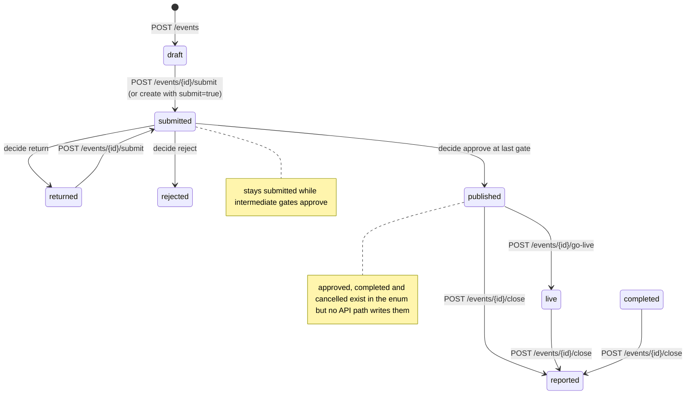
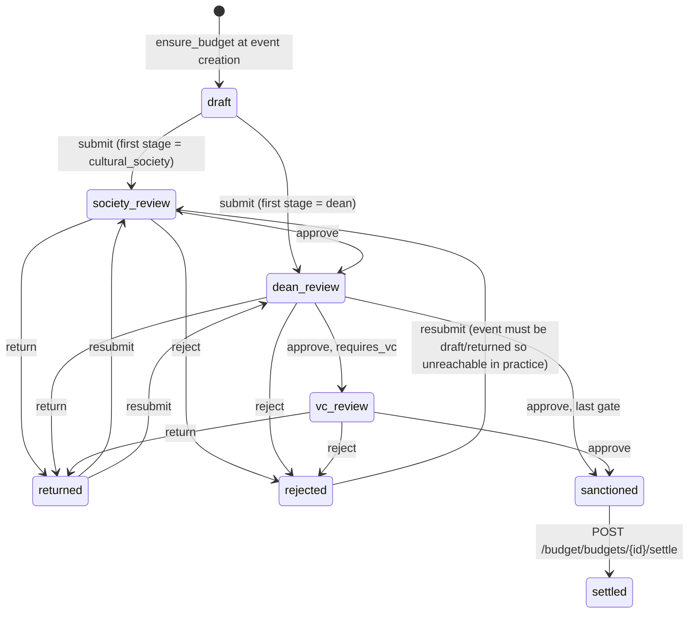
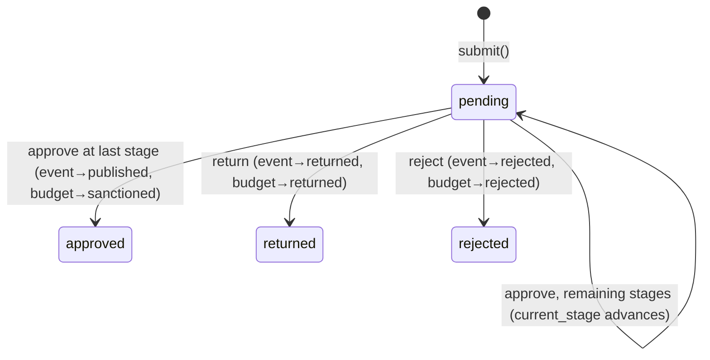
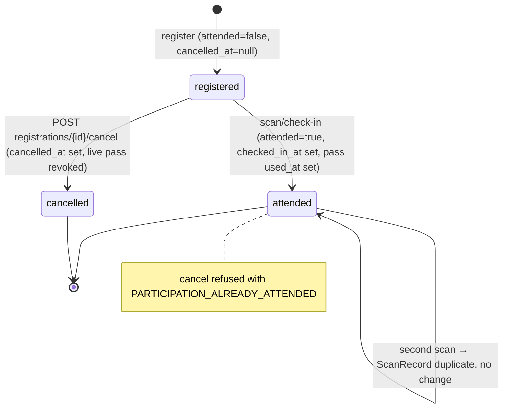

# Clubs & Events module — data model and API reference

Source of truth: `clubs-and-culturals-platform/app/backend/` (Django 5 + DRF) and its browser mirror `web-app/src/`. Everything below is transcribed from model, serializer, view, service and migration code; nothing is inferred from documents. Base path for every route is `/api/v1/`. Paths have **no trailing slash** (`DefaultRouter(trailing_slash=False)`). All responses are JSON; every error is RFC 9457 `application/problem+json` (`common/errors.py`).

Conventions that apply everywhere:

- Primary keys are UUIDs; every row has `created_at` / `updated_at` (`common/models.py: UUIDModel`). `User` declares the same three fields itself.
- Money is `DecimalField(max_digits=12, decimal_places=2)` (`MONEY`) and is serialised as a **string** (`"12000.00"`).
- Timestamps are stored UTC (`TIME_ZONE="UTC"`), rendered ISO-8601.
- Auth: `Authorization: Bearer <JWT>`; the view layer reads claims only (`identity/authentication.py: AuthContext`), never the DB.
- Pagination on list endpoints: `{count, next, previous, results}`, `page_size` query param, default 25, max 200 (`common/pagination.py`).
- Thresholds (`config/settings.py`, env-overridable): `VC_BUDGET_THRESHOLD=50000`, `RECEIPT_THRESHOLD=5000`, `VENUE_BUFFER_MINUTES=30`, `CONTINGENCY_PERCENT=8`, `APPROVAL_CHAIN=["cultural_society","dean"]`, `INTEGRATION_MODE="local"`, `DEMO_MODE=False` (refused when `DEBUG=False`), `QR_SIGNING_KEYS` (`v1:<secret>[,v2:...]`, dev default under DEBUG), `QR_ACTIVE_KEY_ID="v1"`, `TOKEN_LIFETIMES = {access: 15 min, refresh: 7 d, staff_session_cap: 8 h, scan_station_grace: 4 h}`.

---

## 1. Entity relationship diagram

```mermaid
erDiagram
    User ||--o| Student : "student_record"
    User ||--o{ RefreshToken : "refresh_tokens"
    User ||--o{ Notification : "notifications"
    User ||--o{ Event : "events_created"
    User ||--o{ ApprovalRequest : "approvals_submitted"
    User ||--o{ Registration : "check_ins"
    User ||--o{ ScanRecord : "scans_taken"
    Student ||--o{ Membership : "memberships"
    Student ||--o{ Registration : "registrations"
    Student ||--o{ StudentQRToken : "qr_tokens"
    Club ||--o{ Membership : "memberships"
    Club ||--o{ Event : "events"
    Club ||--o{ Fest : "fests"
    Membership ||--o{ RoleChange : "changes"
    Fest ||--o{ Event : "events"
    Fest ||--o| Budget : "budget"
    Venue ||--o{ Event : "events"
    Venue ||--o{ VenueReassignment : "moves_out"
    Venue ||--o{ VenueReassignment : "moves_in"
    Event ||--o{ VenueReassignment : "reassignments"
    Event ||--o{ Registration : "registrations"
    Event ||--o{ ScanRecord : "scan_records"
    Event ||--o| Budget : "budget"
    Event ||--o{ ApprovalRequest : "approval_requests"
    ExternalParticipant ||--o{ Registration : "registrations"
    Registration ||--o{ EventPass : "passes"
    Registration ||--o{ ScanRecord : "scans"
    Budget ||--o{ BudgetLine : "lines"
    BudgetLine ||--o{ ReceiptDocument : "receipts"
    ReceiptDocument |o--o| ReceiptDocument : "superseded_by"
    BudgetTemplate ||--o{ BudgetTemplateLine : "lines"
    ApprovalRequest ||--o{ ApprovalStep : "steps"

    User {
        uuid id PK
        string email UK
        string display_name
        string full_name
        json global_roles
        bool mfa_enabled
        string status "provisional|active|on_leave|graduated|withdrawn|suspended"
        bool is_staff
        bool is_active
    }
    Student {
        uuid id PK
        uuid user_id FK "OneToOne"
        string prn UK
        string full_name
        string department
        string programme
        int year_of_study "1..5 or null"
        string status "same enum as User"
    }
    ReferenceCode {
        uuid id PK
        string kind "department|programme"
        string code
        string name
        bool active
    }
    Semester {
        uuid id PK
        string name UK
        date starts_on
        date ends_on
        bool is_current
    }
    RefreshToken {
        uuid id PK
        uuid user_id FK
        string token_hash UK
        uuid family
        datetime expires_at
        datetime consumed_at
        datetime revoked_at
        bool mfa
    }
    Club {
        uuid id PK
        string name UK
        string slug UK
        string tag
        string category "cultural|literary|technical|sports|social"
        string instagram_handle
        string status "active|dormant|archived"
    }
    Membership {
        uuid id PK
        uuid club_id FK
        uuid student_id FK
        string role "club_president..club_member"
        datetime joined_at
        datetime ended_at "null = active"
    }
    RoleChange {
        uuid id PK
        uuid membership_id FK
        uuid actor_sub
        string actor_label
        string from_role
        string to_role
        string reason
    }
    Venue {
        uuid id PK
        string name UK
        int capacity
        string location
        bool active
    }
    Fest {
        uuid id PK
        string name UK
        uuid club_id FK
        date starts_on
        date ends_on
        string status "EventStatus enum"
    }
    Event {
        uuid id PK
        string title
        uuid club_id FK
        uuid fest_id FK "nullable"
        string kind "performance|workshop|competition|exhibition|talk"
        uuid venue_id FK
        datetime starts_at
        datetime ends_at
        int capacity
        int expected_attendance
        string status "EventStatus enum"
        datetime cancelled_at
        string cancelled_reason
        int photo_count
        json social_links
        datetime closed_at
        datetime submitted_at
        uuid created_by_id FK "nullable"
    }
    VenueReassignment {
        uuid id PK
        uuid event_id FK
        uuid from_venue_id FK
        uuid to_venue_id FK
        string reason
        uuid actor_sub
        string actor_label
    }
    Registration {
        uuid id PK
        uuid event_id FK
        uuid student_id FK "xor external"
        uuid external_id FK "xor student"
        string source "pre_registered|spot|manual|imported"
        datetime registered_at
        datetime cancelled_at
        bool attended
        datetime checked_in_at
        uuid checked_in_by_id FK
        string station_id
        string department_at_event
        string programme_at_event
        int year_at_event
    }
    ExternalParticipant {
        uuid id PK
        string full_name
        string institution
        string email
        string phone
        date purge_after
    }
    StudentQRToken {
        uuid id PK
        uuid student_id FK
        string token UK
        int version
        string key_id
        datetime revoked_at
    }
    EventPass {
        uuid id PK
        uuid registration_id FK
        string token UK
        datetime used_at
        datetime revoked_at
        string key_id
    }
    ScanRecord {
        uuid id PK
        uuid event_id FK
        uuid registration_id FK "nullable"
        string scanned_token "64-char prefix"
        string result "ScanResult enum"
        string station_id
        uuid operator_id FK "nullable"
        datetime scanned_at
        datetime synced_at
        string offline_ref
        string detail
    }
    BudgetTemplate {
        uuid id PK
        string name UK
        string event_kind
        int contingency_percent
    }
    BudgetTemplateLine {
        uuid id PK
        uuid template_id FK
        string head
        string basis "lump_sum|per_head|per_day"
        decimal rate
        int position
    }
    Budget {
        uuid id PK
        uuid event_id FK "OneToOne xor fest"
        uuid fest_id FK "OneToOne xor event"
        string stage "BudgetStage enum"
        datetime settled_at
        bool is_nil
        string nil_reason
        datetime nil_declared_at
        uuid nil_declared_by_sub
        string nil_declared_by_label
    }
    BudgetLine {
        uuid id PK
        uuid budget_id FK
        string head
        string basis
        decimal amount_requested
        decimal amount_sanctioned "null until approver acts"
        decimal amount_spent
        string variance_note
        int position
    }
    ReceiptDocument {
        uuid id PK
        uuid line_id FK
        string file_key
        string file_name
        string content_type
        int byte_size
        string sha256
        decimal amount
        uuid uploaded_by_sub
        uuid superseded_by_id FK "OneToOne self"
    }
    ApprovalRequest {
        uuid id PK
        uuid event_id FK
        json stages "ordered stage names"
        string current_stage "cultural_society|dean|vc"
        string state "pending|approved|returned|rejected|withdrawn"
        decimal amount_requested
        bool requires_vc
        string vc_reason
        uuid submitted_by_id FK "nullable"
        datetime resolved_at
    }
    ApprovalStep {
        uuid id PK
        uuid request_id FK
        string stage
        string decision "approve|return|reject"
        string comment
        uuid actor_sub
        string actor_label
        string actor_role
        bool mfa_verified
        decimal amount_sanctioned
    }
    Notification {
        uuid id PK
        uuid user_id FK
        string subject
        string body
        string kind
        string link
        datetime read_at
    }
    AuditEntry {
        uuid id PK
        string actor_sub
        string actor_label
        string action
        string target_type
        string target_id
        json before
        json after
        string reason
    }
```



`reporting/` has no `models.py` and is not in `INSTALLED_APPS`; it only aggregates `Event`, `Registration` and `ScanRecord`.

---

## 2. Entities

### Base model (`common/models.py`)

| field | type | null | constraint or enum | notes |
|---|---|---|---|---|
| id | UUID | no | PK, `uuid4` default, not editable | on every model below unless stated |
| created_at | datetime | no | `auto_now_add` | |
| updated_at | datetime | no | `auto_now` | |

`MONEY = {"max_digits": 12, "decimal_places": 2}`.

### identity

**User** (`identity_user`; `AbstractBaseUser + PermissionsMixin`, not `UUIDModel` but declares the same `id/created_at/updated_at`)

| field | type | null | constraint or enum | notes |
|---|---|---|---|---|
| email | EmailField | no | unique; `USERNAME_FIELD` | institutional address |
| personal_email | EmailField | blank | not unique | |
| display_name | char(80) | no | `REQUIRED_FIELDS` | defaults to `full_name` or email local part on save |
| full_name | char(160) | no | | single name field, never split |
| phone | char(20) | blank | | E.164 |
| global_roles | JSON list | no | default `[]` | strings from `GLOBAL_ROLES` |
| mfa_enabled | bool | no | default false | |
| status | char(16) | no | `Status`: provisional, active, on_leave, graduated, withdrawn, suspended; default active | `can_login` = `is_active and status in (active, on_leave, graduated)` |
| is_staff / is_active | bool | no | defaults false / true | Django admin flags |
| password, last_login, is_superuser, groups, user_permissions | | | | inherited from Django |

**Student** (`identity_student`, ordering `prn`)

| field | type | null | constraint or enum | notes |
|---|---|---|---|---|
| user | OneToOne → User | no | PROTECT, related `student_record` | |
| prn | char(32) | no | unique; validated against `settings.PRN_REGEX` (`^[0-9]{2}[A-Z]{2,4}[0-9]{3,5}$`) | upper-cased and trimmed on save |
| full_name | char(160) | no | | |
| department | char(16) | no | code | from ReferenceCode list |
| programme | char(32) | no | code | |
| year_of_study | smallint | yes | CHECK `student_year_1_to_5` (1..5 or null) | |
| status | char(16) | no | same `Status` enum, default active | |

**ReferenceCode** (`identity_reference_code`): `kind` char(16) enum `department|programme`; `code` char(32); `name` char(160); `active` bool default true. UNIQUE (`kind`,`code`) `unique_code_per_kind`.

**Semester** (`identity_semester`, ordering `-starts_on`): `name` char(64) unique; `starts_on` date; `ends_on` date; `is_current` bool default false. CHECK `semester_ends_after_start` (`ends_on > starts_on`).

**RefreshToken** (`identity_refresh_token`): `user` FK CASCADE; `token_hash` char(64) unique (sha256 of raw); `family` UUID; `expires_at`; `consumed_at` null; `revoked_at` null; `mfa` bool. Indexes on `family` and (`user`,`revoked_at`). Rotated on use; replay revokes the family.

### clubs

**Club** (ordering `name`)

| field | type | null | constraint or enum | notes |
|---|---|---|---|---|
| name | char(120) | no | unique | |
| slug | slug(140) | no | unique; read-only in API | not auto-generated by the model; set by seed/admin |
| tag | char(40) | blank | | "Music", "Dance" |
| category | char(16) | no | `Category`: cultural, literary, technical, sports, social | `under_cultural_society` = category in (cultural, literary) |
| description | text | blank | | |
| instagram_handle | char(64) | blank | | link capture only |
| status | char(16) | no | `Status`: active, dormant, archived; default active | DELETE sets archived (soft delete) |

**Membership** (ordering `club`,`role`)

| field | type | null | constraint or enum | notes |
|---|---|---|---|---|
| club | FK Club | no | PROTECT | |
| student | FK Student | no | PROTECT | |
| role | char(32) | no | `ROLE_CHOICES` = club_president, club_vice_president, club_treasurer, club_secretary, club_core, club_member; default club_member | labels President, Vice-President, Treasurer, Secretary, Core team, Member |
| joined_at | datetime | no | auto_now_add | |
| ended_at | datetime | yes | | null = active (`is_active`) |

Constraints: partial UNIQUE (`club`,`student`) WHERE `ended_at IS NULL` → `one_active_membership_per_student_per_club`; partial UNIQUE (`club`) WHERE `role='club_president' AND ended_at IS NULL` → `one_active_president_per_club`. Index (`student`,`ended_at`).

**RoleChange** (ordering `-created_at`): `membership` FK CASCADE; `actor_sub` UUID; `actor_label` char(80); `from_role`, `to_role` char(32); `reason` char(280) blank.

### events

**Venue** (ordering `name`): `name` char(120) unique; `capacity` positive int; `location` char(160) blank; `active` bool default true.

**Event** (ordering `starts_at`)

| field | type | null | constraint or enum | notes |
|---|---|---|---|---|
| title | char(200) | no | | |
| club | FK Club | no | PROTECT | |
| fest | FK Fest | yes | SET_NULL | fest membership forces the VC gate |
| kind | char(20) | no | `Kind`: performance, workshop, competition, exhibition, talk; default performance | |
| description | text | blank | | |
| venue | FK Venue | no | PROTECT | |
| starts_at / ends_at | datetime | no | CHECK `event_ends_after_start` | |
| capacity | positive int | no | serializer: ≤ venue.capacity | |
| expected_attendance | positive int | no | serializer: ≤ capacity | drives per-head budget lines |
| status | char(16) | no | `EventStatus` (see §3); default draft | |
| cancelled_at | datetime | yes | | no endpoint sets it |
| cancelled_reason | char(280) | blank | CHECK `event_cancelled_needs_reason` | |
| photo_count | positive int | no | default 0 | set at close |
| social_links | JSON list | no | default `[]` | URLs, set at close |
| closed_at | datetime | yes | | |
| submitted_at | datetime | yes | | |
| created_by | FK User | yes | PROTECT | |

Indexes: (`status`,`starts_at`), (`club`,`starts_at`), (`venue`,`starts_at`). Status groups: `SLOT_HOLDING` = submitted, approved, published, live, completed, reported; `SLOT_CONFIRMED` = approved, published, live, completed, reported; `REPORTABLE` = completed, reported; `PUBLIC_STATUSES` (views) = published, live, completed, reported.

**Fest** (ordering `-starts_on`): `name` char(160) unique; `club` FK PROTECT; `starts_on`, `ends_on` date; `status` char(16) `EventStatus` default draft. No API endpoint creates or lists fests; `fest` is accepted as an id on event creation.

**VenueReassignment** (ordering `-created_at`): `event` FK CASCADE; `from_venue`, `to_venue` FK Venue PROTECT; `reason` char(280) required; `actor_sub` UUID; `actor_label` char(80).

### participation

**Registration** (ordering `-registered_at`)

| field | type | null | constraint or enum | notes |
|---|---|---|---|---|
| event | FK Event | no | PROTECT | |
| student | FK Student | yes | PROTECT | exactly one of student/external |
| external | FK ExternalParticipant | yes | CASCADE | |
| source | char(16) | no | `Source`: pre_registered, spot, manual, imported; default pre_registered | |
| registered_at | datetime | no | default now | |
| cancelled_at | datetime | yes | | never deleted; cancel sets this |
| attended | bool | no | default false | the only counted figure |
| checked_in_at | datetime | yes | CHECK `attended_requires_check_in_time` | |
| checked_in_by | FK User | yes | SET_NULL | operator |
| station_id | char(40) | blank | | |
| department_at_event / programme_at_event | char(16)/char(32) | blank | | snapshot at registration |
| year_at_event | smallint | yes | | snapshot |

Constraints: CHECK `registration_exactly_one_participant`; partial UNIQUE (`event`,`student`) WHERE `cancelled_at IS NULL AND student IS NOT NULL` → `one_active_registration_per_event_per_student`. Indexes (`event`,`attended`), (`student`,`cancelled_at`).

**ExternalParticipant** (ordering `full_name`): `full_name` char(160); `institution` char(160) blank; `email` blank; `phone` char(20) blank; `purge_after` date null. Hard-purged, never soft-deleted. No API endpoint creates one.

**StudentQRToken** (ordering `-created_at`): `student` FK CASCADE; `token` char(512) unique; `version` positive int default 1; `key_id` char(16); `revoked_at` null. Partial UNIQUE (`student`) WHERE `revoked_at IS NULL` → `one_live_profile_qr_per_student`.

**EventPass** (ordering `-created_at`): `registration` FK CASCADE; `token` char(512) unique (subject = the pass id, not the registration); `used_at` null; `revoked_at` null; `key_id` char(16). Partial UNIQUE (`registration`) WHERE `used_at IS NULL AND revoked_at IS NULL` → `one_live_pass_per_registration`. Index (`registration`,`used_at`).

**ScanRecord** (ordering `-scanned_at`): `event` FK CASCADE; `registration` FK SET_NULL null; `scanned_token` char(64) (prefix only); `result` char(20) `ScanResult`; `station_id` char(40); `operator` FK User SET_NULL; `scanned_at` (device clock); `synced_at` default now; `offline_ref` char(64) blank (idempotency key); `detail` char(200). Partial UNIQUE (`event`,`offline_ref`) WHERE `offline_ref <> ''` → `one_record_per_offline_ref`. Indexes (`event`,`result`), (`event`,`station_id`), (`event`,`scanned_at`). `was_offline` = synced − scanned > 60 s.

### budget

**BudgetTemplate** (ordering `name`): `name` char(80) unique; `event_kind` char(20) blank; `contingency_percent` smallint default 8.

**BudgetTemplateLine** (ordering `position`,`head`): `template` FK CASCADE; `head` char(120); `basis` `Basis`: lump_sum, per_head, per_day (default lump_sum); `rate` MONEY; `position` smallint. `amount_for()` = rate × max(1, expected_attendance) for per_head, rate × max(1, days) for per_day, else rate.

**Budget**

| field | type | null | constraint or enum | notes |
|---|---|---|---|---|
| event | OneToOne Event | yes | CASCADE, related `budget` | exactly one of event/fest |
| fest | OneToOne Fest | yes | CASCADE, related `budget` | |
| stage | char(20) | no | `BudgetStage` (see §3); default draft | |
| settled_at | datetime | yes | | |
| is_nil | bool | no | default false | explicit "needs no money" declaration |
| nil_reason | char(400) | blank | CHECK `nil_budget_needs_a_reason` | |
| nil_declared_at | datetime | yes | | |
| nil_declared_by_sub | UUID | yes | | |
| nil_declared_by_label | char(80) | blank | | |

CHECK `budget_exactly_one_owner`. Derived (serialised): `total_requested/total_sanctioned/total_spent` (sums over lines), `is_ready_to_submit` (= is_nil or has lines), `is_editable` (stage in draft/returned/rejected), `settlement_waiting_on` (`"settled"` | `"sanction"` | `"event"` | null), `is_settleable` (= waiting_on is null), `settlement_hint`.

**BudgetLine** (ordering `position`,`head`): `budget` FK CASCADE; `head` char(120); `basis` char(16) default lump_sum (no choices enforced); `amount_requested` MONEY; `amount_sanctioned` MONEY null (null = not yet decided); `amount_spent` MONEY null; `variance_note` char(400) blank; `position` smallint. CHECKs `budget_line_requested_non_negative`, `budget_line_sanctioned_non_negative`, `budget_line_spent_non_negative`. `is_overspent` = spent > sanctioned (both non-null).

**ReceiptDocument** (ordering `-created_at`): `line` FK CASCADE; `file_key` char(400) (store reference, never bytes); `file_name` char(200); `content_type` char(80); `byte_size` int; `sha256` char(64); `amount` MONEY null; `uploaded_by_sub` UUID null; `superseded_by` OneToOne self SET_NULL (related `supersedes`). `is_current` = superseded_by is null.

### governance

**ApprovalRequest** (ordering `-created_at`)

| field | type | null | constraint or enum | notes |
|---|---|---|---|---|
| event | FK Event | no | CASCADE | |
| stages | JSON list | no | ordered subset of `cultural_society, dean, vc` | frozen at submission |
| current_stage | char(20) | no | `ApprovalStage`: cultural_society, dean, vc | |
| state | char(16) | no | `ApprovalState`: pending, approved, returned, rejected, withdrawn; default pending | `withdrawn` is never set by code |
| amount_requested | MONEY | no | default 0 | budget total at submission |
| requires_vc | bool | no | | |
| vc_reason | char(120) | blank | | e.g. `"budget over 50000, part of a fest"` |
| submitted_by | FK User | yes | PROTECT | |
| resolved_at | datetime | yes | | |

Partial UNIQUE (`event`) WHERE `state='pending'` → `one_pending_approval_per_event`. Index (`state`,`current_stage`).

**ApprovalStep** (ordering `created_at`): `request` FK CASCADE; `stage` `ApprovalStage`; `decision` `Decision`: approve, return, reject; `comment` text; `actor_sub` UUID; `actor_label` char(80); `actor_role` char(40); `mfa_verified` bool; `amount_sanctioned` MONEY null (budget total after this step). CHECK `return_and_reject_need_a_comment` (`decision='approve' OR comment <> ''`).

**Notification** (ordering `-created_at`): `user` FK CASCADE; `subject` char(200); `body` text; `kind` char(40); `link` char(300); `read_at` null. Index (`user`,`read_at`).

**AuditEntry** (ordering `-created_at`, append-only): `actor_sub` char(64); `actor_label` char(80); `action` char(80); `target_type` char(60) (model class name); `target_id` char(64); `before` JSON; `after` JSON; `reason` char(400). Indexes (`target_type`,`target_id`), (`action`,`-created_at`). Actions emitted: `club.role_changed`, `event.created`, `event.submitted`, `event.closed`, `event.venue_reassigned`, `approval.approve|return|reject`, `budget.declared_nil`, `budget.nil_withdrawn`, `budget.settled`, `budget.settled_nil`, `profile_qr.reissued`.

---

## 3. Enums and state machines

### Event status (`events.models.EventStatus`)

Values and labels: `draft` Draft · `submitted` Awaiting approval · `returned` Returned for changes · `rejected` Rejected · `approved` Approved · `published` Published · `live` Live now · `completed` Completed · `reported` Reported · `cancelled` Cancelled.



Edits (PUT/PATCH) are allowed only in `draft` or `returned` (`EVENTS_LOCKED` otherwise).

### Budget stage (`budget.models.BudgetStage`)

`draft` · `society_review` With the Cultural Society · `dean_review` With the Dean · `vc_review` With the Vice-Chancellor · `sanctioned` · `settled` · `returned` · `rejected`.



Lines are editable only in `draft`, `returned`, `rejected` (`BUDGET_LOCKED`). Spend may be entered in any stage except `settled` (`BUDGET_ALREADY_SETTLED`), but `settle` requires `sanctioned` and the event in `live|completed|reported`.

### ApprovalRequest state and step decisions

State: `pending` → `approved` | `returned` | `rejected` (`withdrawn` defined, never set). Step `decision`: `approve`, `return`, `reject`. Route (`governance/services.build_route`): for each stage in `APPROVAL_CHAIN`: `cultural_society` is included only if `club.under_cultural_society`; `dean` always (appended even if missing from the setting); `vc` in the setting only adds reason `"configured"`. `vc` is appended if any reason: configured, `amount_requested > VC_BUDGET_THRESHOLD` ("budget over 50000"), or `event.fest_id` ("part of a fest").



`decide()` refusals in order: `GOVERNANCE_ALREADY_RESOLVED` (409), `GOVERNANCE_WRONG_STAGE` (409, caller holds another gate on this route), `GOVERNANCE_NOT_APPROVER` (403), `GOVERNANCE_SELF_APPROVAL` (403, any club role in the submitting club), `GOVERNANCE_COMMENT_REQUIRED` (422, return/reject without comment), `GOVERNANCE_MFA_REQUIRED` (403, approve when `stage == vc` or amount > threshold and `mfa` claim false). `sanctioned` amounts are applied only at the `dean` stage; untouched lines are sanctioned as requested; a sanction above request is `BUDGET_SANCTION_EXCEEDS_REQUEST` (422), unknown line id `BUDGET_UNKNOWN_LINE` (422).

### Registration source and attended flags

`source`: `pre_registered` (POST /participation/registrations), `spot` (walk-in via profile QR), `manual` (desk PRN entry), `imported` (never set by code).



### ScanResult (`participation.models.ScanResult`)

| value | label | resolver branch |
|---|---|---|
| accepted | Checked in | valid event pass, or profile QR with a live registration |
| spot_registered | Registered at the door and checked in | profile QR, no registration, capacity left |
| duplicate | Already checked in | pass `used_at` set or registration already attended |
| wrong_event | Pass is for another event | pass payload `event_id` ≠ scanned event |
| unknown_code | Code not recognised | signature invalid, pass row missing, pass revoked ("Pass was replaced"), profile QR revoked ("Code was replaced") |
| not_registered | Not registered and cannot be | walk-in but event at capacity |
| expired | Pass expired | pass token past `exp` |
| cancelled | Registration was cancelled | pass belongs to a cancelled registration |

`ACCEPTING = (accepted, spot_registered)`; `tone` = `ok` (accepted) / `warn` (duplicate) / `bad` (other). `resolve()` writes a `ScanRecord` on every branch; a repeated `offline_ref` is silently a no-op.

### Membership role, club status, club category, user status

- Membership role (most senior first): `club_president`, `club_vice_president`, `club_treasurer`, `club_secretary`, `club_core`, `club_member`.
- Club status: `active` → `archived` (DELETE /clubs/{id}); `dormant` settable via PUT/PATCH only.
- Club category: `cultural`, `literary`, `technical`, `sports`, `social`.
- User/Student status: `provisional`, `active`, `on_leave`, `graduated`, `withdrawn`, `suspended`; login allowed for active/on_leave/graduated.

### Notification channel

Two channels only, both from one adapter call (`integrations/notifications.py: LocalNotificationSender.send`): an in-app `Notification` row plus an email to `user.email` via `send_mail(fail_silently=True)`. `PlatformNotificationSender` raises `NotImplementedError`. `kind` values emitted: `approval.pending` (link `/staff/approvals/{event_id}`), `approval.returned`, `approval.rejected`, `approval.advanced`, `approval.approved`, `event.venue_changed` (link `/club/{club_id}/events/{event_id}`). Club notifications go only to active members in `BUDGET_VIEWERS` roles.

---

## 4. Database constraints

AGENT_PROMPT §4 "constraints that must exist in PostgreSQL" versus what the migrations create. None of the migrations uses `RunSQL`, `ExclusionConstraint` or `btree_gist`; every constraint is a Django `CheckConstraint` or partial `UniqueConstraint`, which Django emits on both PostgreSQL and SQLite, so **no constraint is Postgres-only**.

| §4 requirement | status | migration | constraint name | notes |
|---|---|---|---|---|
| Registration: exactly one of student_id / external_participant_id | present | `participation/0001_initial.py` | `registration_exactly_one_participant` | CHECK; FK is named `external`, column `external_id` |
| Registration: partial unique (event_id, student_id) WHERE cancelled_at IS NULL | present | `participation/0001_initial.py` | `one_active_registration_per_event_per_student` | condition also `student IS NOT NULL` |
| BudgetLine: exactly one of event_id / fest_id | **moved** | `budget/0002_initial.py` | `budget_exactly_one_owner` | ownership lives on `Budget` (OneToOne event xor fest); `BudgetLine` only has `budget_id` |
| Event: ends_at > starts_at | present | `events/0002_initial.py` | `event_ends_after_start` | |
| Event: cancelled_reason required when cancelled | present | `events/0002_initial.py` | `event_cancelled_needs_reason` | `NOT status='cancelled' OR cancelled_reason <> ''` |
| Feedback: rating 1..5; one per student per event | **missing** | — | — | no `Feedback` model |
| VenueBooking: exclusion constraint on overlapping ranges (buffer included) | **missing** | — | — | no `VenueBooking` model and no exclusion constraint. Clash detection is application-level (`events/services.overlapping`, 30-min buffer). `reassign_venue` locks the event row, but `EventViewSet.create` checks `assert_bookable` outside any lock, so two concurrent proposals can both be accepted. The comment in `settings.py` about a Postgres exclusion constraint "degrading" on SQLite describes nothing in the migrations. |
| Membership: one active membership per student per club | present | `clubs/0002_initial.py` | `one_active_membership_per_student_per_club` | partial unique |
| "enums as text with CHECK constraints" | **missing** | — | — | enum columns are plain `varchar` with Django `choices`; no CHECK on any status/enum column |

Constraints the migrations create beyond §4:

| model | migration | name | kind |
|---|---|---|---|
| Student | `identity/0001_initial.py` | `student_year_1_to_5` | CHECK |
| ReferenceCode | `identity/0001_initial.py` | `unique_code_per_kind` | UNIQUE (kind, code) |
| Semester | `identity/0001_initial.py` | `semester_ends_after_start` | CHECK |
| Membership | `clubs/0002_initial.py` | `one_active_president_per_club` | partial UNIQUE (club) WHERE president AND active |
| Registration | `participation/0001_initial.py` | `attended_requires_check_in_time` | CHECK |
| EventPass | `participation/0001_initial.py` | `one_live_pass_per_registration` | partial UNIQUE |
| StudentQRToken | `participation/0001_initial.py` | `one_live_profile_qr_per_student` | partial UNIQUE |
| ScanRecord | `participation/0001_initial.py` | `one_record_per_offline_ref` | partial UNIQUE (event, offline_ref) WHERE offline_ref <> '' |
| BudgetLine | `budget/0002_initial.py` | `budget_line_requested_non_negative`, `budget_line_sanctioned_non_negative`, `budget_line_spent_non_negative` | CHECK |
| Budget | `budget/0003_budget_is_nil_…py` | `nil_budget_needs_a_reason` | CHECK |
| ApprovalRequest | `governance/0002_initial.py` | `one_pending_approval_per_event` | partial UNIQUE (event) WHERE state='pending' |
| ApprovalStep | `governance/0002_initial.py` | `return_and_reject_need_a_comment` | CHECK |

Column-level uniques: `User.email`, `Student.prn`, `Semester.name`, `RefreshToken.token_hash`, `Club.name`, `Club.slug`, `Venue.name`, `Fest.name`, `StudentQRToken.token`, `EventPass.token`, `BudgetTemplate.name`, `ReceiptDocument.superseded_by` (OneToOne), `Budget.event`, `Budget.fest` (OneToOne). Postgres-only behaviour in code, not schema: `User.objects.with_global_role()` uses `global_roles__contains` on Postgres and filters in Python elsewhere.

---

## 5. Roles and capability sets

Source: `common/roles.py`; mirrored verbatim in `web-app/src/roles.js`.

**Global roles** (`GLOBAL_ROLES`): `student`, `cultural_society`, `dean`, `vice_chancellor`, `admin`.

**Object-scoped roles** (`SCOPED_ROLES`), carried as `"<name>:<uuid>"`:

- club-scoped (`CLUB_ROLES`, seniority order): `club_president`, `club_vice_president`, `club_treasurer`, `club_secretary`, `club_core`, `club_member` — scope is the club id.
- event-scoped: `event_organiser` — scope is the event id. In local mode nothing grants it: `identity/tokens.roles_for()` builds `roles` from `User.global_roles` + `student` (if a Student record exists) + one scoped role per active membership. Only a platform-issued token can carry it.

**Capability sets** (tuples of club role names):

| set | members | used by |
|---|---|---|
| `ROLE_ASSIGNERS` | president, vice_president | POST /memberships/{id}/role; `can_assign_roles` |
| `BUDGET_VIEWERS` | president, vice_president, treasurer | budget queryset, event `budget` field, club notifications |
| `BUDGET_PREPARERS` | president, vice_president, treasurer | add/edit/remove line, declare-nil, withdraw-nil |
| `BUDGET_SETTLERS` | president, vice_president, treasurer | set spend, receipts, settle |
| `PROPOSERS` | president, vice_president, secretary, treasurer | create/update/submit event |
| `EVENT_OPERATORS` | president, vice_president, secretary | go-live, close |
| `DOOR_STAFF` | president, vice_president, secretary, core | scan station, sync, check-in, roster, directory |
| `STAGE_ROLE` | `{"cultural_society": cultural_society, "dean": dean, "vc": vice_chancellor}` | approval gates |
| `MFA_REQUIRED_ROLES` | dean, vice_chancellor, admin, cultural_society | login demands `mfa_code`; refresh cap 8 h |

`AuthContext` predicates: `can_see_all_clubs()` = dean | vice_chancellor | admin | cultural_society; `can_see_individual_records()` = dean | admin; `is_dean()`, `is_admin()`, `organiser_events()` = scopes of `event_organiser`; `club_role(club_id)` = most senior club role held there.

**JWT claims** (`identity/tokens.py`, HS256 with `SECRET_KEY`): `sub` (user id), `iss` (`PLATFORM_ISSUER`), `aud` (`PLATFORM_AUDIENCE`, default `"clubs"`), `email`, `student_id`, `prn`, `display_name`, `roles` (sorted list), `department`, `programme`, `year`, `mfa` (bool), `typ` (`"access"`), `iat`, `exp`, `jti`, and `scan_event` (event id, only on scan-station tokens). Login/refresh responses echo all claims except `typ` and `jti`.

**`GET /module/auth/me` payload** (`identity/views.MeView`):

```json
{
  "sub": "uuid", "display_name": "str", "prn": "str|null", "student_id": "uuid|null",
  "department": "str|null", "programme": "str|null", "year": "int|null",
  "roles": ["student", "club_president:<club uuid>", "..."], "mfa": false,
  "capabilities": {
    "can_see_individual_records": false, "can_see_all_clubs": false,
    "is_student": true, "is_dean": false, "is_vice_chancellor": false,
    "is_cultural_society": false, "is_admin": false,
    "clubs": ["<club uuid>"],
    "clubs_with_budget_access": [], "clubs_can_assign_roles": [],
    "clubs_can_propose": [], "clubs_can_operate_events": [],
    "clubs_can_enter_spend": [], "clubs_door_staff": [],
    "can_see_overview": false,
    "organiser_events": ["<event uuid>"],
    "approval_stages": ["cultural_society", "dean", "vc"]
  }
}
```

All `clubs_*` lists are sorted club ids derived from the corresponding capability set; `can_see_overview` = dean | admin | cultural_society; `approval_stages` lists the `STAGE_ROLE` keys whose role the caller holds. Advisory only: every capability is re-checked server-side.

---

## 6. API endpoint catalogue

Error codes common to every authenticated route (omitted from rows): `AUTH_REQUIRED` 401 (missing/invalid bearer), `PERMISSION_DENIED` 403 (DRF permission class), `NOT_FOUND` 404, `METHOD_NOT_ALLOWED` 405, `VALIDATION_FAILED` 422 (serializer errors, flattened `errors[{field, code, message}]`), `INTERNAL_ERROR` 500. Problem body: `{type, title, status, detail, instance, code, trace_id, errors?}`.

Shape aliases used below:

- **EventOut** (`EventSerializer`): `id, title, club, club_name, fest, kind, description, venue, venue_name, starts_at, ends_at, capacity, expected_attendance, status, status_label, photo_count, social_links, registered, attended, budget, my_registration, submitted_at, closed_at`. `budget` = `{id, stage, stage_label, total_requested, total_sanctioned, total_spent}` or `null` when absent **or when the caller is not in `BUDGET_VIEWERS`/staff**. `my_registration` = `{id, attended, pass_token}` or `null`.
- **BudgetOut** (`BudgetSerializer`): `id, event, fest, stage, stage_label, lines[LineOut], total_requested, total_sanctioned, total_spent, settled_at, settlement_problems[{field, code, message}], thresholds{receipt_threshold, vc_threshold}, nil_declaration{head, reason, declared_by, declared_at}|null, is_editable, is_ready_to_submit, can_settle, settlement_waiting_on, settlement_hint`. **LineOut**: `id, head, basis, amount_requested, amount_sanctioned, amount_spent, variance_note, is_overspent, receipts[ReceiptOut], position`. **ReceiptOut**: `id, file_name, content_type, byte_size, amount, created_at, superseded_by` (current receipts only inside LineOut).
- **ApprovalOut** (`ApprovalRequestSerializer`): `id, event, event_title, club, club_id, venue, starts_at, ends_at, expected_attendance, stages, current_stage, stage_label, state, amount_requested, requires_vc, vc_reason, steps[StepOut], lines[{id, head, amount_requested, amount_sanctioned}], clashes[{id, title, club, starts_at, ends_at, expected_attendance}], my_stage, requires_mfa, nil_declaration, created_at`. **StepOut**: `id, stage, stage_label, decision, comment, actor_label, actor_role, mfa_verified, amount_sanctioned, created_at`.
- **MembershipOut**: `id, club, student, prn, full_name, department, programme, year, role, role_label, joined_at, ended_at`. **RoleChangeOut**: `id, membership, actor_label, from_role, to_role, reason, created_at`.
- **ClubOut**: `id, name, slug, tag, category, description, instagram_handle, status, member_count, my_role`.
- **VenueOut**: `id, name, capacity, location, active`.
- **RegistrationOut**: `id, event, event_title, source, attended, checked_in_at, cancelled_at, pass_token, registered_at` (`pass_token` null unless the caller owns it).
- **ScanOutcome**: `result, result_label, verdict, tone, accepted, detail, student{prn, full_name, department, programme, year}|null, registration_id|null`.
- **Session**: `access_token, refresh_token, token_type:"Bearer", expires_in (900), claims{...}`.
- **Page<T>**: `{count, next, previous, results: T[]}`.

### identity (`/api/v1/module/…`)

| method | path | who may call | request body | response | error codes |
|---|---|---|---|---|---|
| GET | `/module/auth/mode` | anyone | — | `integration_mode, sso{enabled, issuer, authorize_url, audience}, password_login, approval_chain` | — |
| POST | `/module/auth/login` | anyone (local mode only) | `email, password, mfa_code?` | Session | `AUTH_SSO_REQUIRED` 400, `AUTH_INVALID_CREDENTIALS` 401, `AUTH_MFA_REQUIRED` 401 (errors on `mfa_code`), `AUTH_ACCOUNT_NOT_ACTIVE` 403 |
| POST | `/module/auth/refresh` | anyone | `refresh_token` | Session (rotated) | `AUTH_INVALID_CREDENTIALS` 401 (unknown, replayed, expired, revoked, account cannot log in) |
| POST | `/module/auth/logout` | authenticated | — | 204 | — |
| GET | `/module/auth/me` | authenticated | — | see §5 | — |
| GET | `/module/directory/students?q=` | dean, admin, holders of `event_organiser:*`, or any `DOOR_STAFF` club role | — | `results[{student_id, prn, full_name, department, programme, year}]` | `DIRECTORY_NOT_PERMITTED` 403 |
| GET | `/module/semesters` | authenticated | — | `[{id, name, starts_on, ends_on, is_current}]` (unpaginated) | — |
| GET | `/module/auth/demo/personas` | anyone — **DEMO_MODE only** | — | `demo_mode, personas[{key, label, sub, available, name}]` | `NOT_FOUND` 404 when off |
| POST | `/module/auth/demo/{persona}` | anyone — **DEMO_MODE only** | — | Session + `persona{key, label, sub}`; MFA granted for staff personas | `NOT_FOUND` 404, `DEMO_UNKNOWN_PERSONA` 404, `DEMO_PERSONA_UNAVAILABLE` 409 |

Persona keys: `student, organiser, president, treasurer, member, society, dean, vc`.

### clubs (`/api/v1/…`)

| method | path | who may call | request body | response | error codes |
|---|---|---|---|---|---|
| GET | `/clubs` | authenticated | — | Page<ClubOut> | — |
| POST | `/clubs` | dean, admin | `name, tag?, category, description?, instagram_handle?, status?` (`slug` read-only, must be set elsewhere) | ClubOut 201 | `CLUBS_NOT_PERMITTED` 403, `VALIDATION_FAILED` |
| GET | `/clubs/{id}` | authenticated | — | ClubOut | `NOT_FOUND` |
| PUT / PATCH | `/clubs/{id}` | dean, admin | same writable fields | ClubOut | `CLUBS_NOT_PERMITTED` 403 |
| DELETE | `/clubs/{id}` | dean, admin | — | 204; sets `status=archived` | `CLUBS_NOT_PERMITTED` 403 |
| GET | `/clubs/{id}/members` | dean, admin, or any club role in that club | — | `club{id, name}, can_assign_roles, results[MembershipOut], recent_changes[RoleChangeOut] (10)` | `NOT_FOUND` 404 (deliberately not 403) |
| POST | `/memberships/{id}/role` | president or vice_president of the membership's club | `role (club role), reason? (≤280)` | MembershipOut | `NOT_FOUND` 404 (not visible), `CLUBS_ROLE_ASSIGN_DENIED` 403, `CLUBS_PRESIDENT_EXISTS` 409, `VALIDATION_FAILED` |

There is no list/retrieve/create/delete for memberships (only the `role` action), and no endpoint to add or end a membership.

### events (`/api/v1/…`)

Visibility (`EventViewSet.get_queryset`): staff (`can_see_all_clubs`) see all; others see `PUBLIC_STATUSES` plus their own clubs' events plus organiser-scoped events. Filters: `club`, `status` (comma list), `starts_at_after`, `starts_at_before`, `ordering` (default `starts_at`).

| method | path | who may call | request body | response | error codes |
|---|---|---|---|---|---|
| GET | `/events` | authenticated | — | Page<EventOut> | — |
| POST | `/events` | `PROPOSERS` of `club` | `title, club, kind?, description?, venue, starts_at, ends_at, capacity, expected_attendance, fest?, budget_template?, budget_lines?[{head, amount_requested, basis?}], submit? (default true)` | EventOut 201 + `soft_clashes[{id, title, club}]` + `approval{id, stages, current_stage, requires_vc, vc_reason}|null`; `Location` header | `EVENTS_PROPOSE_DENIED` 403, `EVENTS_VENUE_UNAVAILABLE` 409 (errors on `venue`), `BUDGET_UNKNOWN_TEMPLATE` 422, `GOVERNANCE_BUDGET_REQUIRED` 409 (submit with empty budget), `VALIDATION_FAILED` (ends_at, capacity > venue, expected > capacity) |
| GET | `/events/{id}` | per visibility | — | EventOut | `NOT_FOUND` |
| PUT / PATCH | `/events/{id}` | `PROPOSERS` of the club; status draft/returned | EventSerializer writable fields: `title, club, fest, kind, description, venue, starts_at, ends_at, capacity, expected_attendance` | EventOut | `EVENTS_EDIT_DENIED` 403, `EVENTS_LOCKED` 409 |
| DELETE | `/events/{id}` | anyone who can see it (**no permission override**) | — | 204; hard delete (DRF default `destroy`) | `NOT_FOUND`; `INTERNAL_ERROR` if registrations exist (FK PROTECT) |
| POST | `/events/{id}/submit` | `PROPOSERS` | — | `id, stages, current_stage, requires_vc, vc_reason` | `EVENTS_PROPOSE_DENIED` 403, `GOVERNANCE_ALREADY_SUBMITTED` 409, `GOVERNANCE_BUDGET_REQUIRED` 409 |
| POST | `/events/{id}/go-live` | `EVENT_OPERATORS` or dean | — | EventOut | `EVENTS_GO_LIVE_DENIED` 403, `EVENTS_NOT_PUBLISHED` 409 |
| POST | `/events/{id}/close` | `EVENT_OPERATORS`, organiser of this event, or dean | `photo_count (≥0), social_links?[url]` | EventOut (status reported) | `EVENTS_CLOSE_DENIED` 403, `EVENTS_EVIDENCE_REQUIRED` 409 (photo_count < 1), `EVENTS_NOT_CLOSEABLE` 409 |
| GET | `/events/{id}/clashes` | per visibility | — | `clashes[{id, title, club, starts_at, ends_at, status, expected_attendance}], free_venues[VenueOut]` | `NOT_FOUND` |
| POST | `/events/{id}/reassign` | dean | `to_venue (uuid), reason (5..280 chars)` | `id, event, from_venue, from_venue_name, to_venue, to_venue_name, reason, actor_label, created_at` | `EVENTS_REASSIGN_DENIED` 403, `NOT_FOUND` (venue), `EVENTS_SAME_VENUE` 409, `EVENTS_VENUE_TOO_SMALL` 409, `EVENTS_VENUE_UNAVAILABLE` 409 |
| GET | `/venues` | authenticated | — | Page<VenueOut> (active only) | — |
| GET | `/venues/{id}` | authenticated | — | VenueOut | `NOT_FOUND` |
| GET | `/venue-calendar?date=YYYY-MM-DD&buffer=` | `can_see_all_clubs` | — | `buffer_minutes (echo of query or null), venues[VenueOut], bookings[{id, title, club, venue, venue_name, starts_at, ends_at, status, confirmed, clash}], clashes[{venue, events[{id, title, club, starts_at, ends_at, expected_attendance, status}] }]` | `EVENTS_CALENDAR_DENIED` 403 |

### participation (`/api/v1/participation/…`)

Door routes use `IsEventOrganiser` (`participation/permissions.py`): a scan-station token bound to another event is refused; allowed are `event_organiser:<event>`, `admin`, or `DOOR_STAFF` role in the owning club. Dean/VC/society are **not** allowed. Failure is `PERMISSION_DENIED` 403.

| method | path | who may call | request body | response | error codes |
|---|---|---|---|---|---|
| GET | `/participation/registrations` | authenticated (student sees own; others empty) | — | Page<RegistrationOut> | — |
| POST | `/participation/registrations` | student (`student_id` claim) | `event` | RegistrationOut 201 (pass minted) | `PARTICIPATION_NOT_A_STUDENT` 403, `NOT_FOUND` 404 (event), `PARTICIPATION_NOT_OPEN` 409, `PARTICIPATION_EVENT_FULL` 409, `PARTICIPATION_ALREADY_REGISTERED` 409 |
| POST | `/participation/registrations/{id}/cancel` | owner | — | 204 | `NOT_FOUND` 404, `PARTICIPATION_ALREADY_ATTENDED` 409 |
| POST | `/participation/registrations/{id}/reissue-pass` | owner | — | `token, image (data URI)` | `NOT_FOUND` 404 |
| GET | `/participation/my-passes` (alias `/participation/me/qr`) | authenticated | — | `passes[{registration_id, event_id, title, club, venue, starts_at, ends_at, attended, token, image}], profile_qr{token, version, image}|null, note` (non-students get `{passes:[], profile_qr:null}`) | — |
| POST | `/participation/my-passes` (alias `/participation/me/qr`) | student | — | `token, version, image` (profile QR reissued, old revoked) | `PARTICIPATION_NOT_A_STUDENT` 403 |
| GET | `/participation/events/{event_id}/scan` | door (`IsEventOrganiser`) | — | `event{id, title, club, venue, status, starts_at, ends_at}, counters{checked_in, registered, capacity}, capture{attempts, accepted, duplicates, unknown, wrong_event, expired, capture_rate}, recent[{id, result, result_label, scanned_at, station_id, was_offline, who}] (12)` | `NOT_FOUND` |
| POST | `/participation/events/{event_id}/scan` | door | `token, station_id?, scanned_at?` | ScanOutcome — always 200, rejections included | `NOT_FOUND`, `VALIDATION_FAILED` |
| POST | `/participation/events/{event_id}/scan/sync` | door | `station_id?, scans[{token, scanned_at?, ref?}]` | `synced, accepted, duplicates, results[ScanOutcome], counters{checked_in, registered, capacity}` | `NOT_FOUND`, `VALIDATION_FAILED` |
| POST | `/participation/events/{event_id}/check-in` | door | `student_id? \| prn?, station_id?` | ScanOutcome (`source` manual on walk-in) | `PARTICIPATION_STUDENT_NOT_FOUND` 404, `VALIDATION_FAILED` |
| GET | `/participation/events/{event_id}/roster?attended=1` | dean, admin, organiser of the event, or `DOOR_STAFF` of the club | — | `event{id, title}, counts{registered, attended}, results[{id, prn, full_name, department, programme, year, source, attended, checked_in_at, station_id}]` | `NOT_FOUND` 404 (deliberately not 403) |
| POST | `/participation/events/{event_id}/scan-session` | door | — | `access_token, token_type, expires_at (unix), scan_event` — token valid until `ends_at + 4 h`, bound to this event | `NOT_FOUND` |

### budget (`/api/v1/budget/…`)

Visibility (`BudgetViewSet.get_queryset`): staff see all; otherwise only budgets of clubs where the caller is in `BUDGET_VIEWERS`; everyone else gets 404.

| method | path | who may call | request body | response | error codes |
|---|---|---|---|---|---|
| GET | `/budget/budgets` | per visibility | — | Page<BudgetOut> | — |
| GET | `/budget/budgets/{id}` | per visibility | — | BudgetOut | `NOT_FOUND` |
| POST | `/budget/budgets/{id}/lines` | `BUDGET_PREPARERS` | `head (≤120), amount_requested, basis?` | BudgetOut 201 | `BUDGET_PREPARE_DENIED` 403, `BUDGET_LOCKED` 409, `BUDGET_LINE_HEAD_REQUIRED` 422, `BUDGET_LINE_NEGATIVE` 422, `BUDGET_LINE_DUPLICATE_HEAD` 409 |
| PUT | `/budget/budgets/{id}/lines/{line_id}/edit` | `BUDGET_PREPARERS` | `head?, amount_requested?, basis?` | BudgetOut | as above + `NOT_FOUND` (line) |
| DELETE | `/budget/budgets/{id}/lines/{line_id}/remove` | `BUDGET_PREPARERS` | — | BudgetOut (200) | `BUDGET_PREPARE_DENIED` 403, `BUDGET_LOCKED` 409, `NOT_FOUND` |
| POST | `/budget/budgets/{id}/declare-nil` | `BUDGET_PREPARERS` | `reason (5..400 chars)` | BudgetOut | `BUDGET_PREPARE_DENIED` 403, `BUDGET_LOCKED` 409, `BUDGET_NIL_REASON_REQUIRED` 422, `BUDGET_NIL_HAS_LINES` 409 |
| POST | `/budget/budgets/{id}/withdraw-nil` | `BUDGET_PREPARERS` | — | BudgetOut | `BUDGET_PREPARE_DENIED` 403, `BUDGET_LOCKED` 409 |
| PATCH | `/budget/budgets/{id}/lines/{line_id}` | `BUDGET_SETTLERS` | `amount_spent? (nullable), variance_note? (≤400)` | BudgetOut | `BUDGET_SPEND_DENIED` 403, `NOT_FOUND`, `BUDGET_ALREADY_SETTLED` 409 |
| POST | `/budget/budgets/{id}/lines/{line_id}/receipts` | `BUDGET_SETTLERS` | multipart: `file` (image/* or application/pdf), `amount?`, `supersedes?` (receipt id) | ReceiptOut 201 | `BUDGET_SPEND_DENIED` 403, `NOT_FOUND`, `BUDGET_RECEIPT_MISSING` 422, `BUDGET_RECEIPT_TYPE` 422, `BUDGET_RECEIPT_AMOUNT` 422 |
| POST | `/budget/budgets/{id}/settle` | `BUDGET_SETTLERS` | — | BudgetOut (stage settled) | `BUDGET_SPEND_DENIED` 403, `BUDGET_NOT_SANCTIONED` 409, `BUDGET_EVENT_NOT_RUN` 409, `BUDGET_SETTLEMENT_INCOMPLETE` 422 (errors: `NO_SPEND_ENTERED`, `RECEIPT_REQUIRED` on `lines.{id}.receipts`, `VARIANCE_NOTE_REQUIRED` on `lines.{id}.variance_note`) |
| GET | `/budget/budget-templates?expected_attendance=80` | authenticated | — | `expected_attendance, templates[{name, event_kind, lines[{head, basis, rate, amount, explanation}], contingency{percent, amount}, total_requested, requires_vc, vc_threshold}]` | — |

Settlement rules (`budget/services.settlement_problems`, only evaluated when `is_settleable` and not nil): at least one line with `amount_spent`; any line with `amount_spent > RECEIPT_THRESHOLD` needs a current receipt; any overspent line needs a non-empty `variance_note`. A nil budget settles unconditionally once sanctioned and the event has run.

### governance (`/api/v1/governance/…`)

Visibility: staff see all approval requests; club-role holders see their clubs'; others none. Filters `state`, `stage`.

| method | path | who may call | request body | response | error codes |
|---|---|---|---|---|---|
| GET | `/governance/approvals` | per visibility | — | Page<ApprovalOut> | — |
| GET | `/governance/approvals/queue` | authenticated (empty unless a `STAGE_ROLE` is held) | — | `stages_you_hold[], count, results[ApprovalOut]` (pending at the caller's stages, ordered by event start) | — |
| GET | `/governance/approvals/{id}` | per visibility | — | ApprovalOut | `NOT_FOUND` |
| POST | `/governance/approvals/{id}/decide` | holder of `current_stage`'s role, not holding any role in the submitting club; MFA for VC stage / above threshold | `decision (approve\|return\|reject), comment?, sanctioned?{<line_id>: amount}` | `step: StepOut, request: ApprovalOut` | `NOT_FOUND`, `GOVERNANCE_CLASH_UNRESOLVED` 409, `BUDGET_SANCTION_UNREADABLE` 422, `GOVERNANCE_ALREADY_RESOLVED` 409, `GOVERNANCE_WRONG_STAGE` 409, `GOVERNANCE_NOT_APPROVER` 403, `GOVERNANCE_SELF_APPROVAL` 403, `GOVERNANCE_COMMENT_REQUIRED` 422, `GOVERNANCE_MFA_REQUIRED` 403, `BUDGET_UNKNOWN_LINE` 422, `BUDGET_SANCTION_EXCEEDS_REQUEST` 422 |
| GET | `/governance/notifications?unread=1` | authenticated (own only) | — | Page<{id, subject, body, kind, link, read_at, created_at}> | — |
| GET | `/governance/notifications/unread-count` | authenticated | — | `unread` | — |
| POST | `/governance/notifications/mark-read` | authenticated | — | `marked` | — |
| GET | `/governance/audit?target_id=&action=` | dean, admin, vice_chancellor | — | `results[{id, actor, action, target_type, target_id, before, after, reason, created_at}]` (≤200, unpaginated) | `GOVERNANCE_AUDIT_DENIED` 403 |

### reporting (`/api/v1/reporting/…`)

Both accept `?semester=<id>`; default is the `is_current` semester, else the first.

| method | path | who may call | request body | response | error codes |
|---|---|---|---|---|---|
| GET | `/reporting/reports/semester` | dean, vice_chancellor, admin, cultural_society | — | `semester{id, name, starts_on, ends_on}, events_run, total_participation, unique_students, external_participants, avg_attendance, by_club[{club_id, club, tag, category, events_run, attendance}], by_department[{department, students_reached, attendance}], money{requested, sanctioned, spent}, events[{id, title, club, starts_at, attended, registered, photos, social_links, sanctioned, spent}], caveats[]` — aggregates only, no PRNs | `REPORTING_DENIED` 403, `REPORTING_NO_SEMESTER` 422 |
| GET | `/reporting/reports/overview` | dean, admin, cultural_society | — | `semester (name), pending_approvals, pending_by_stage{stage: n}, venue_clashes, clubs_active, clubs_total, clubs_inactive[names], missing_evidence[{id, title, club, missing[]}], venue_use[{venue__name, bookings}], capture{scan_attempts, scans_accepted, capture_rate}` | `REPORTING_DENIED` 403, `REPORTING_NO_SEMESTER` 422 |

### infrastructure routes

| method | path | notes |
|---|---|---|
| GET | `/api/v1/schema`, `/api/v1/docs`, `/api/v1/redoc` | drf-spectacular OpenAPI, Swagger UI, Redoc |
| GET | `/api/v1/` | DRF router root of the first included router (clubs) |
| any | `/django-admin/` | Django admin (session auth) |
| GET | `/`, `/demo/`, `/demo/<path>` | **DEMO_MODE only**: redirect to `/demo/index.html`; static files from `backend/demo/` |

---

## 7. Browser mirror differences

The mirror (`web-app/src/api.js`) is an in-memory/localStorage model with camelCase keys (`clubId`, `startsAt`, `amountRequested`, …) and a `Session` object in place of a JWT; it is called as `api.<group>.<fn>(ctx, …)` rather than over HTTP. Store collections (`seed.js`): `users, students, clubs, venues, memberships, events, semester, templates, budgets, approvals, registrations, passes, qrTokens, scans, notifications, audit, staffIds, attendancePlan`.

**Exposed by the mirror but absent from the backend**

- `budget.forEvent(ctx, eventId)` — the backend has no "budget by event" route; clients must read `event.budget.id` from EventOut and call `GET /budget/budgets/{id}`.
- `events.create` returns `{event, budget, approval, softClashes}`; the backend returns EventOut with `soft_clashes` and `approval` merged into it and no full budget.
- `events.reassign` returns `{from, to, reason}`; backend returns a `VenueReassignment` record.
- Mirror-only error codes: `EVENTS_END_BEFORE_START`, `EVENTS_OVER_CAPACITY`, `EVENTS_TITLE_REQUIRED`, `EVENTS_REASON_REQUIRED`, `CLUBS_UNKNOWN_ROLE` (all `VALIDATION_FAILED` on the backend) and `PARTICIPATION_STATION_DENIED` (backend: `PERMISSION_DENIED` from `IsEventOrganiser`).
- `events.create` ignores `capacity` and copies `venue.capacity`; `expectedAttendance` is checked against the venue, not against `capacity`.
- BudgetOut gains `eventTitle` and `eventStatus`; `budget.templates()` has no `event_kind`; `participation.myPasses` passes carry no `image` data URI; `myRegistrations` is an unpaginated array with a `pass` object instead of `pass_token`.
- Default `stationId` is `"GATE-1"` on scan/sync/check-in; the backend defaults to `""`.
- Record shapes are thinner: approval steps lack `actorRole`/`amountSanctioned`; notifications lack `kind`/`link`; audit entries lack `targetType`/`before`; receipts lack `fileKey`/`contentType`/`sha256`/`uploadedBySub`; budgets have no `fest`/`nilDeclaredBySub`; events have no `cancelledAt`/`cancelledReason`/`description`; clubs use `instagram` not `instagram_handle` and have no `description`; club `category` values only `cultural`/`literary` are seeded.

**Exposed by the backend but absent from the mirror**

- All of `/module/auth/*` (mode, login, refresh, logout, me, demo personas), `/module/semesters`, `/participation/events/{id}/scan-session`, `/participation/registrations/{id}/reissue-pass`.
- Club CRUD (`POST/PUT/PATCH/DELETE /clubs`, `GET /clubs/{id}`); mirror has only `clubs.list`, `clubs.roster`, `clubs.setRole`.
- `PUT/PATCH/DELETE /events/{id}`, `GET /venues/{id}`; event filters `starts_at_after`/`starts_at_before`.
- Approval list filters `state`/`stage`; audit filters `target_id`/`action`; report `semester` query parameter; `attended` roster filter; `expected_attendance` is accepted by both but the mirror has no `per_day` basis.
- Pagination envelopes (`count/next/previous/results`) — the mirror returns bare arrays.
- `Fest`, `ExternalParticipant`, `ReferenceCode`, `RefreshToken`, `VenueReassignment`, `BudgetTemplateLine`, `ReceiptDocument.superseded_by` chaining (mirror flags `supersededBy` but never sets it), `imported` registration source, `key_id` on QR tokens/passes, `checked_in_by`, `station_id` on registrations (mirror stores `stationId` but as a string default `""`).
- Server-side QR images (`image` data URIs) and receipt file storage (`integrations/files.py`).

---

## 8. Design-document tables not modelled

`Database_And_Data_Flow` §2 says "twenty-two tables across six domains" but names 28 in its domain table. Against the backend models:

| design table | backend | notes |
|---|---|---|
| Club | `clubs.Club` | no `logo_url`, `founded_on`, `annual_budget_envelope`, `dormant_after_days`, `last_event_at`; no `proposed` status; category `social` vs doc `social_service` |
| Membership | `clubs.Membership` | no `assigned_by_id`, no `status` enum (`pending/active/declined/ended` collapsed into `ended_at`); role changes tracked in `RoleChange` instead |
| OfficeBearerTerm | **missing** | |
| ClubSocialHandle | **missing** | reduced to `Club.instagram_handle` |
| Fest | `events.Fest` | no `edition`, `theme`, `hero_image_url`, `budget_envelope`, `allows_external`, `public_page_slug`; status reuses `EventStatus` |
| FestRole | **missing** | |
| Event | `events.Event` | no `template_id`, `category`, `registration_closes_at`, `allows_teams`, `actual_attendance` (derived at read time); `created_by` is a User not a Student; `kind` added |
| EventTemplate | **missing** | `BudgetTemplate` covers budget heads only |
| Task | **missing** | |
| Volunteer | **missing** | (no `VolunteerShift` exists in the doc either; the table is `Volunteer`) |
| Sponsor | **missing** | |
| Venue | `events.Venue` | no `facilities`, `controlled_by`, `is_bookable` (`active` instead) |
| VenueBooking | **missing** | booking is `Event.venue` + `starts_at/ends_at`; moves recorded in `VenueReassignment`; no exclusion constraint (see §4) |
| Registration | `participation.Registration` | no `waitlisted`, `team_name`, `team_captain_id`, `custom_fields`; `imported` source added; `checked_in_by` is a User |
| ExternalParticipant | `participation.ExternalParticipant` | no `fest_id`, `registration_ref`, `qr_token`; `college` renamed `institution`; `email/phone/purge_after` nullable |
| StudentQRToken | `participation.StudentQRToken` | adds `version`, `key_id`, `revoked_at` |
| EventPass | `participation.EventPass` | adds `revoked_at`, `key_id`; FK not OneToOne |
| ScanRecord | `participation.ScanRecord` | adds `offline_ref`, `synced_at`, `detail` |
| BudgetTemplate | `budget.BudgetTemplate` + `BudgetTemplateLine` | split into two tables |
| BudgetLine | `budget.BudgetLine` | owner moved to new `Budget` table (`event` xor `fest`); adds `is_nil` declaration on `Budget` |
| ReceiptDocument | `budget.ReceiptDocument` | adds `sha256`, `byte_size`, `superseded_by` |
| EventPhoto | **missing** | reduced to `Event.photo_count` |
| EventSocialPost | **missing** | reduced to `Event.social_links` JSON list of URLs |
| EventReport | **missing** | no outcomes/learnings text anywhere |
| Feedback | **missing** | no rating, no 1..5 CHECK, no per-student uniqueness |
| ApprovalRequest | `governance.ApprovalRequest` | event-only (no generic `target_type/target_id`); adds `stages`, `current_stage`, `requires_vc`, `vc_reason`; state adds `withdrawn` |
| ApprovalStep | `governance.ApprovalStep` | one row per decision taken (no pre-created pending steps, no `sequence`); adds `actor_role`, `mfa_verified`, `amount_sanctioned`; stage adds `cultural_society` |
| AuditLog | `governance.AuditEntry` | `before/after` JSON instead of `payload`; `actor_sub` is a string, not an FK |

Not in the design document but present in the backend: `identity.User`, `identity.Student` (the doc treats Student as SIS-owned), `identity.ReferenceCode`, `identity.Semester`, `identity.RefreshToken`, `clubs.RoleChange`, `events.VenueReassignment`, `budget.Budget`, `budget.BudgetTemplateLine`, `governance.Notification`.

Names the brief expected that do not appear in the design document at all: `VolunteerShift` (doc: `Volunteer`), `Waitlist` (doc: `Registration.waitlisted` flag only), `BlackoutPeriod` (not mentioned). Summary of genuinely missing design tables: **OfficeBearerTerm, ClubSocialHandle, FestRole, EventTemplate, Task, Volunteer, Sponsor, VenueBooking, EventPhoto, EventSocialPost, EventReport, Feedback** (12 of 28).
