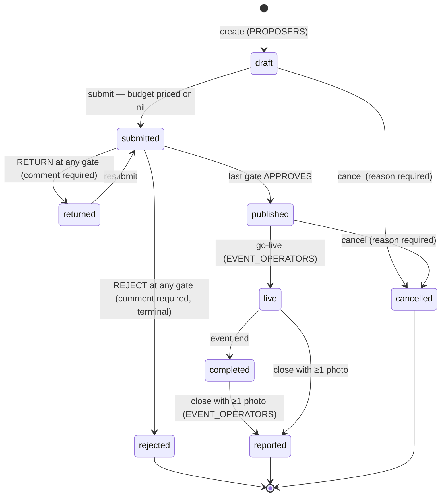
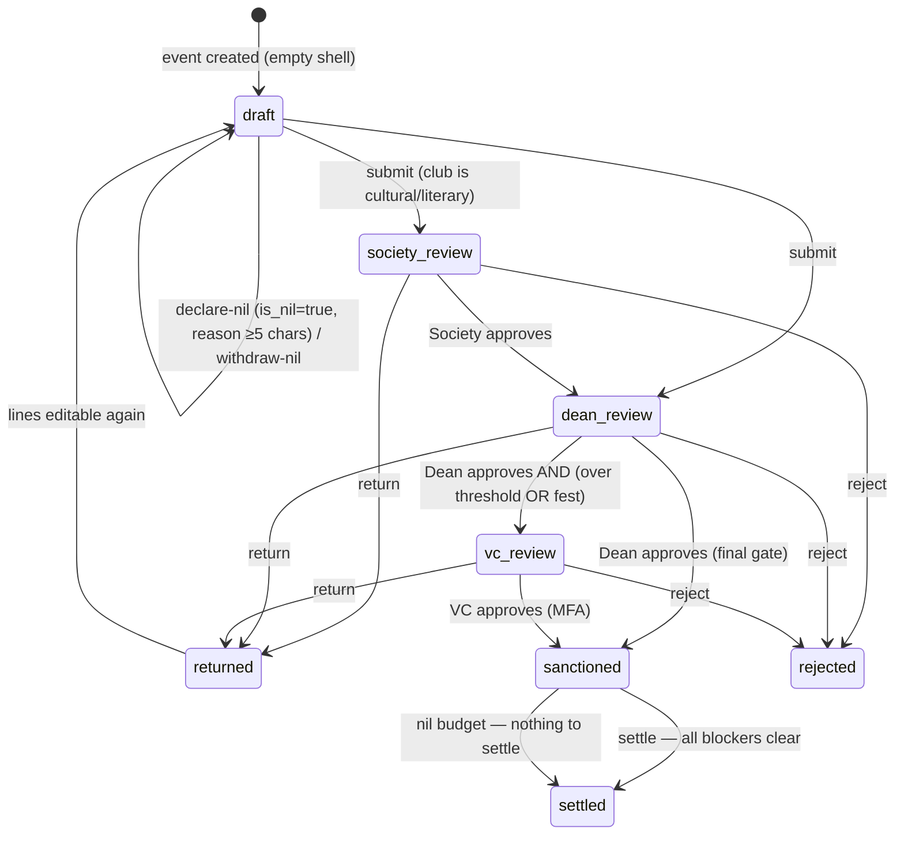
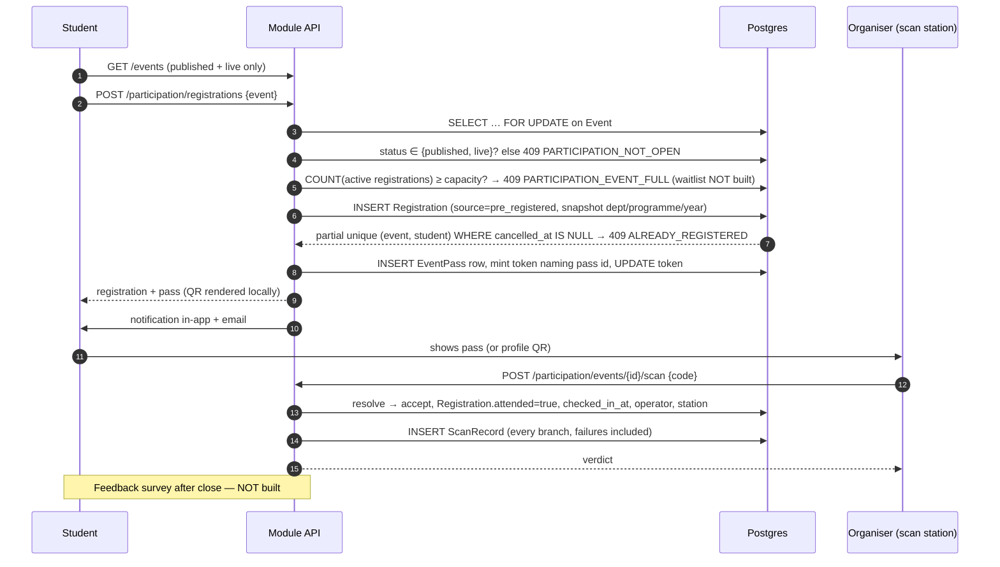
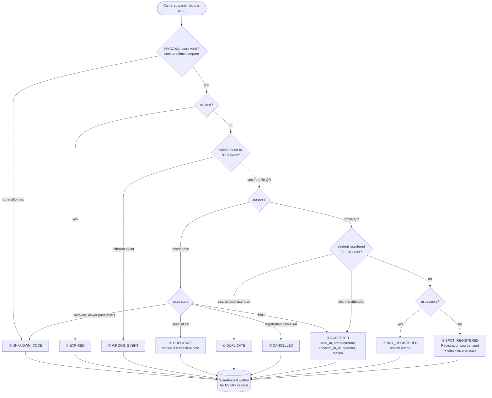
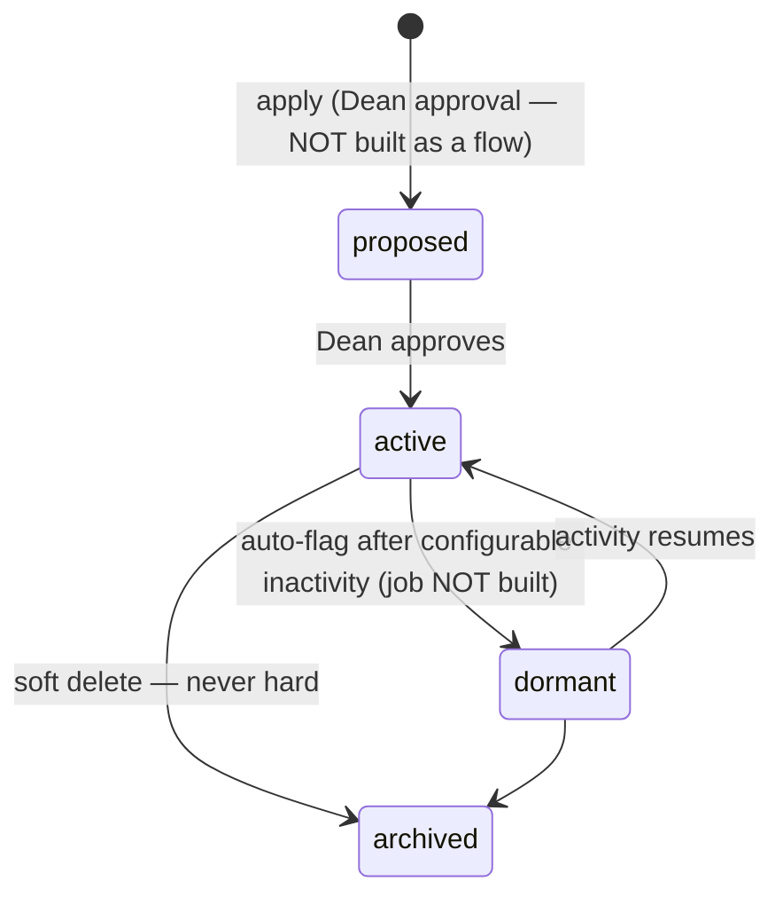
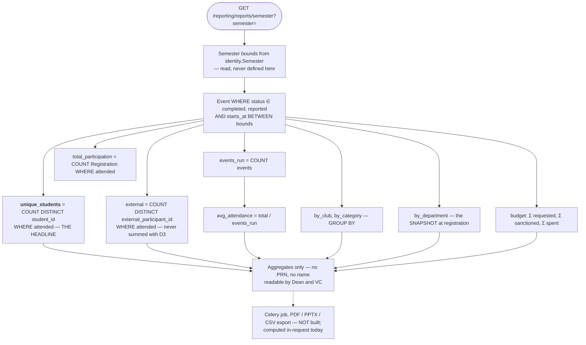
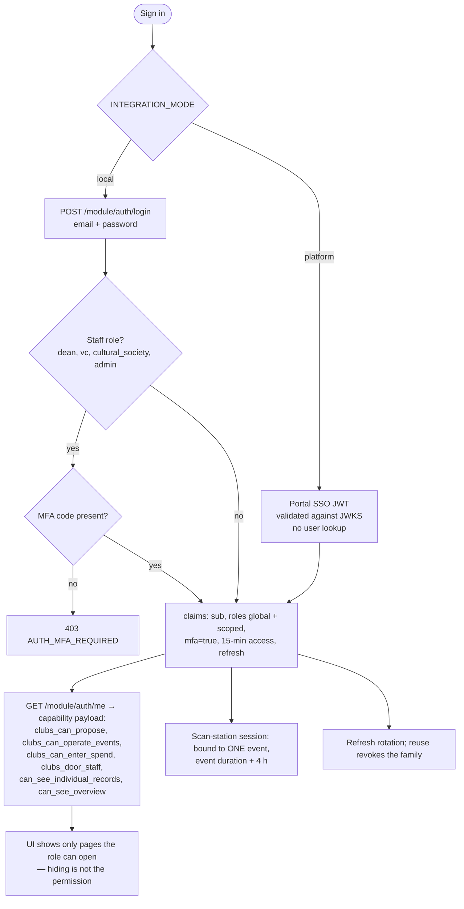

# Flows — user journeys, approval chain, conditions

Generated 2026-10-21 from the running code (`clubs-and-culturals-platform/app/backend`,
`web-app/src`) cross-checked against MASTER_SPEC §5–§7, Event_Flows_V2 and AGENT_PROMPT.
Where the code and the documents differ, the diagram shows **the code** and the note says
what the document wanted. Diagrams are Mermaid; GitHub, VS Code (with the Mermaid
extension) and most wikis render them.

Contents

1. [Roles at a glance](#1-roles-at-a-glance)
2. [End-to-end journey](#2-end-to-end-journey)
3. [Event status machine](#3-event-status-machine)
4. [Approval chain — routing conditions](#4-approval-chain--routing-conditions)
5. [A decision at a gate — every rule that can refuse it](#5-a-decision-at-a-gate)
6. [Budget lifecycle and settlement gates](#6-budget-lifecycle-and-settlement-gates)
7. [Student journey — discover, register, attend](#7-student-journey)
8. [Scan station — the seven branches](#8-scan-station--the-seven-branches)
9. [Offline station and replay](#9-offline-station-and-replay)
10. [Venue clash resolution](#10-venue-clash-resolution)
11. [Club lifecycle, join and handover](#11-club-lifecycle-join-and-handover)
12. [Semester report aggregation](#12-semester-report-aggregation)
13. [Sign-in and session](#13-sign-in-and-session)

---

## 1. Roles at a glance

| Role | Scope | Proposes | Builds budget | Runs event / door | Approves | Sees money | Sees names |
|---|---|:--:|:--:|:--:|:--:|:--:|:--:|
| Student | self | – | – | – | – | no | own only |
| Club member | one club | – | – | – | – | **no** | no |
| Secretary | one club | yes | no | yes | – | no | own club |
| Treasurer | one club | yes | **yes** | **no** | – | yes | own club |
| Vice-President | one club | yes | yes | yes | – | yes | own club |
| President | one club | yes | yes | yes | – | yes | own club |
| Organiser | **one event**, time-bound | – | – | door only | – | no | own event |
| Cultural Society | cultural + literary clubs | – | – | – | **gate 1** | yes | no |
| Dean of Student Affairs | institution | – | – | – | **gate 2, always** | yes | yes |
| Vice-Chancellor / Management | institution | – | – | – | **gate 3, conditional** | aggregates | **never** |
| Student Life Office | institution | – | – | – | – | – | – (role not built) |

Two rules shape every row: **no club role approves its own budget**, and **budget visibility begins at Treasurer**.

---

## 2. End-to-end journey

```mermaid
flowchart LR
  subgraph CLUB["Club (President / VP / Secretary / Treasurer)"]
    A[Create event<br/>title, date, venue,<br/>expected attendance] --> B{Budget}
    B -->|template| C[Lines seeded<br/>per-head × expected<br/>+ contingency]
    B -->|price later| D[Treasurer / Pres / VP<br/>add lines]
    B -->|free event| E[Declare nil<br/>reason required]
    C --> F[Submit]
    D --> F
    E --> F
  end
  F --> G{{Route frozen<br/>at submission}}
  G --> H[Gate 1<br/>Cultural Society<br/><i>only cultural / literary clubs</i>]
  G --> I[Gate 2<br/>Dean<br/><b>always</b>]
  H --> I
  I --> J{amount > ₹50,000<br/>OR part of a fest?}
  J -->|yes| K[Gate 3<br/>Vice-Chancellor<br/>MFA required]
  J -->|no| L
  K --> L[PUBLISHED<br/>budget SANCTIONED<br/>same transaction]
  L --> M[Students register<br/>→ one-time pass]
  M --> N[Organiser marks LIVE<br/>scan station runs]
  N --> O[Close with photos<br/>+ social links<br/>→ REPORTED]
  O --> P[Treasurer records spend,<br/>attaches receipts per line]
  P --> Q{Settlement<br/>blockers?}
  Q -->|all clear| R[SETTLED]
  Q -->|blocked| P
  R --> S[Semester report<br/>unique students first]
  N --> S
```



---

## 3. Event status machine



Notes
- `approved` exists in the PRD list but the code publishes in the same transaction as the final approval, so there is no "approved but not published" limbo.
- Registration is open only in `published` and `live` (409 `PARTICIPATION_NOT_OPEN` otherwise).
- Only `completed` and `reported` events count in the semester report.

---

## 4. Approval chain — routing conditions

The route is **data, not branching**: `governance/services.py:build_route` (backend) and
`web-app/src/approvals.js:buildRoute` compute an ordered list of stages at submission and
freeze it on the `ApprovalRequest`.

```mermaid
flowchart TD
  S([Submit proposal]) --> B0{Budget priced<br/>or declared nil?}
  B0 -->|no| X1[409 GOVERNANCE_BUDGET_REQUIRED]
  B0 -->|yes| B1{Already submitted?}
  B1 -->|yes| X2[409 GOVERNANCE_ALREADY_SUBMITTED]
  B1 -->|no| C0[stages = []]
  C0 --> C1{APPROVAL_CHAIN contains<br/>cultural_society AND<br/>club.category ∈ {cultural, literary}?}
  C1 -->|yes| C2[push cultural_society]
  C1 -->|no| C3
  C2 --> C3[push dean — cannot be configured away]
  C3 --> C4{amount_requested > VC_BUDGET_THRESHOLD<br/>default ₹50,000?}
  C4 -->|yes| C5[vc_reason += 'budget over threshold']
  C4 -->|no| C6
  C5 --> C6{event.fest_id set?}
  C6 -->|yes| C7[vc_reason += 'part of a fest']
  C6 -->|no| C8
  C7 --> C8{vc_reason non-empty?}
  C8 -->|yes| C9[push vc]
  C8 -->|no| D0
  C9 --> D0[ApprovalRequest<br/>state=pending<br/>current_stage=stages[0]<br/>amount_requested, requires_vc, vc_reason]
  D0 --> D1[event.status = submitted<br/>budget.stage = stage for gate 1]
  D1 --> D2[Notify holders of stage 1<br/>in-app + email only]
  D2 --> D3[Audit: event.submitted]
```

Routing truth table

| Club category | Amount | Fest? | Route |
|---|---|---|---|
| technical / sports / social service | ≤ 50,000 | no | Dean |
| technical / sports / social service | > 50,000 | – | Dean → VC |
| cultural / literary | ≤ 50,000 | no | Society → Dean |
| cultural / literary | > 50,000 | – | Society → Dean → VC |
| any | any | yes | … → Dean → VC |
| any, **nil budget** | 0 | no | (Society →) Dean — never reaches VC |
| `APPROVAL_CHAIN=dean` (config) | – | – | Society gate removed everywhere |

Not implemented, documented: a faculty-advisor gate (removed on purpose, MASTER_SPEC §9.2); delegation when the Dean is away (§11.3); SLA escalation (PRD §5.11); per-request-type chains for venue and new club (PRD §5.13).

---

## 5. A decision at a gate

Every rule `assert_can_decide` / `decide` applies, in order. The first failure wins.

```mermaid
flowchart TD
  A([Approver POSTs decide<br/>decision ∈ approve, return, reject<br/>comment, sanctioned{line: amount}]) --> R0{request.state == pending?}
  R0 -->|no| E0[409 GOVERNANCE_ALREADY_RESOLVED]
  R0 -->|yes| R1{Caller holds a club role<br/>in the proposing club?}
  R1 -->|yes| E1[403 GOVERNANCE_SELF_APPROVAL<br/>club role wins over any approver role]
  R1 -->|no| R2{Caller holds the role for<br/>request.current_stage?}
  R2 -->|no, but holds a LATER stage| E2[409 GOVERNANCE_WRONG_STAGE<br/>names who holds it]
  R2 -->|no, holds no stage on this route| E3[403 GOVERNANCE_NOT_APPROVER]
  R2 -->|yes| R3{decision}
  R3 -->|return / reject| R4{comment present?}
  R4 -->|no| E4[422 GOVERNANCE_COMMENT_REQUIRED<br/>also a DB check constraint]
  R4 -->|yes| RET[status → returned / rejected<br/>budget reopens on return<br/>notify club · audit]
  R3 -->|approve| R5{Unresolved venue clash?}
  R5 -->|yes| E5[409 GOVERNANCE_CLASH_UNRESOLVED<br/>Dean must move one event first<br/>— returning is still allowed]
  R5 -->|no| R6{stage == vc OR<br/>amount > threshold?}
  R6 -->|yes| R7{session has mfa claim?}
  R7 -->|no| E6[403 GOVERNANCE_MFA_REQUIRED]
  R7 -->|yes| R8
  R6 -->|no| R8{sanctioned amounts}
  R8 -->|unknown line id| E7[422 BUDGET_UNKNOWN_LINE]
  R8 -->|any amount > requested| E8[422 BUDGET_SANCTION_EXCEEDS_REQUEST<br/>reduce, never raise]
  R8 -->|ok| R9[Untouched lines sanctioned AS REQUESTED<br/>never left null]
  R9 --> R10{More stages on the route?}
  R10 -->|yes| ADV[current_stage = next<br/>budget.stage = that review<br/>notify next gate + club]
  R10 -->|no| PUB[event → published<br/>budget → sanctioned<br/>request → approved<br/>same transaction]
  ADV --> AUD[ApprovalStep written · AuditEntry]
  PUB --> AUD
  RET --> AUD
```

Invariants: one pending request per event (DB unique); the route is frozen at submission
(a threshold change mid-flight cannot drop a gate already passed); budget lines are
locked while an approver holds them (409 `BUDGET_LOCKED`).

---

## 6. Budget lifecycle and settlement gates



Settlement is the last step of a fixed sequence, and `settlement_waiting_on` names where it sits:

```mermaid
flowchart TD
  S([POST /budgets/{id}/settle]) --> A{stage == sanctioned?}
  A -->|no| E1[409 BUDGET_NOT_SANCTIONED<br/>waiting_on = sanction]
  A -->|yes| B{event has run?<br/>status ∈ completed, reported}
  B -->|no| E2[409 BUDGET_EVENT_NOT_RUN<br/>waiting_on = event]
  B -->|yes| C[Collect ALL blockers at once]
  C --> C1{any line with amount_spent?}
  C1 -->|none| P1[no spend entered]
  C --> C2{line spent > RECEIPT_THRESHOLD ₹5,000<br/>with no receipt?}
  C2 -->|yes| P2[receipt missing on head X]
  C --> C3{line spent > sanctioned<br/>with no variance_note?}
  C3 -->|yes| P3[variance note missing on head Y]
  P1 --> D{any problems?}
  P2 --> D
  P3 --> D
  D -->|yes| E3[422 BUDGET_SETTLEMENT_INCOMPLETE<br/>settlement_problems: all of them]
  D -->|no| OK[stage → settled · settled_at · audit]
```

Receipts attach per line, never bundled; a replacement supersedes the old row (`superseded_by`), never overwrites it.

---

## 7. Student journey



Lost phone: reissue the profile QR (old token dies immediately) or reissue the pass; the organiser can also look up by PRN. There is **no route for a student to mark themselves present**.

---

## 8. Scan station — the seven branches

`participation/services.py:resolve` (backend) and `web-app/src/attendance.js` (mirror).



Who may scan: `DOOR_STAFF` = President, VP, Secretary, core team — plus the scoped `event_organiser:<event_id>` role via the station session.

> Gap (X-4): in `local` mode `identity/tokens.py:roles_for` emits only global roles and club scopes, so `event_organiser:<id>` is never granted standalone; only a portal-issued token can carry it today.
**Not** the Treasurer (the response carries names and PRNs), not the Dean, not the VC, not the
Society; IT admin only as break-glass. The station session token is bound to one event and
lasts the event plus four hours.

Manual fallback: PRN or name lookup by the organiser → `POST …/check-in`, still recorded with
an operator and a ScanRecord (`source=manual`).

---

## 9. Offline station and replay

```mermaid
sequenceDiagram
  participant S1 as Station A (offline)
  participant S2 as Station B (offline)
  participant API as POST …/scan/sync
  Note over S1,S2: roster + valid tokens cached before signal is lost
  S1->>S1: queue scan {code, scanned_at=device clock, offline_ref}
  S2->>S2: queue scan of the SAME student, later device time
  S1->>API: replay queue on reconnect
  API->>API: sort by scanned_at (device clock, NOT arrival)
  API->>API: resolve each; set synced_at, was_offline=true
  API-->>S1: "Synced 14 — 12 in, 2 duplicate"
  S2->>API: replay queue
  API->>API: earliest scanned_at already won → this one is DUPLICATE
  S2->>API: retry (response lost)
  API-->>S2: no-op — offline_ref is unique; idempotent
```

---

## 10. Venue clash resolution

```mermaid
flowchart TD
  A([Proposal names venue + time]) --> B{Overlaps an existing booking<br/>incl. VENUE_BUFFER_MINUTES=30?}
  B -->|no| OK[Booked]
  B -->|yes, other is CONFIRMED<br/>published/live| REJ[409 — hard clash refused at submission]
  B -->|yes, other merely SUBMITTED| FLAG[Accept both, flag the clash<br/>— which club gets Friday is the Dean's call]
  FLAG --> Q[Dean sees it on the venue calendar<br/>and on the approval card]
  Q --> G{Dean tries to APPROVE}
  G --> X[409 GOVERNANCE_CLASH_UNRESOLVED]
  Q --> MV[POST /events/{id}/reassign<br/>new venue or time, reason REQUIRED]
  MV --> AT[Atomic: release old slot and take new one<br/>in ONE transaction under a row lock]
  AT --> N[Club notified in-app + email<br/>old and new venue shown]
  N --> UN[Approval unblocks]
  B -.->|exam blackout period| NB[NOT built]
```

Venue precedence (first-come, bigger event, fest first) is an open question, so the system never picks a winner.

---

## 11. Club lifecycle, join and handover



```mermaid
flowchart LR
  subgraph JOIN["Join (PRD §5.2) — code creates Membership directly"]
    J1[Student requests to join] --> J2{club.join_mode}
    J2 -->|open| J3[Membership active]
    J2 -->|approval| J4[President / VP accept or decline]
    J4 --> J3
  end
  subgraph ROLE["Role assignment (built)"]
    R1[President / VP<br/>PUT /memberships/{id}/role] --> R2[RoleChange recorded<br/>who, when, effective date]
    R2 --> R3[Permissions follow the role<br/>in the next token]
    R4[Treasurer / Secretary tries] --> R5[403]
  end
  subgraph HAND["Annual handover (PRD §5.3) — NOT built"]
    H1[Nominate incoming bearers] --> H2[OfficeBearerTerm<br/>start / end dates]
    H2 --> H3[On end date: outgoing LOSES access automatically]
  end
```

---

## 12. Semester report aggregation



Capture rate, the check on everything above: the documents define it as
`attended AND source != manual / attended`; the code computes
`accepted scans / all scan attempts`. Two metrics under one name — pick one before the Dean's dashboard ships.

---

## 13. Sign-in and session



The claim set is identical in both modes (Identity_Login §5.4), so switching to the portal's SSO changes only where the token comes from.
