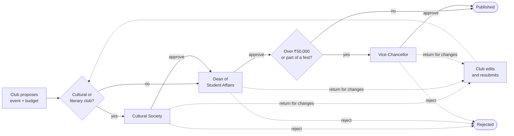

# Culturals — User guide

Culturals is the college's clubs and events app: students find events and get in with a QR pass,
clubs propose and run events with a budget, and the Cultural Society, Dean and Vice-Chancellor
approve them.

Start with **[Getting started](getting-started.md)**, then open the chapter for your role.

| I am… | Chapter |
|---|---|
| A student | [Student guide](student.md) |
| A club president, secretary or member | [Club officers guide](club-officers.md) |
| A club treasurer | [Treasurer guide](treasurer.md) |
| Running the door at an event | [Organiser & scan station guide](organiser.md) |
| The Cultural Society secretary | [Cultural Society guide](cultural-society.md) |
| The Dean of Student Affairs | [Dean guide](dean.md) |
| The Vice-Chancellor / management | [Vice-Chancellor guide](vice-chancellor.md) |

## Approval flow

Every approver can **Approve**, **Return for changes** (the club edits and sends it again, and it
starts from the first gate) or **Reject** (final). Returning and rejecting need a comment. The Dean can
sanction less than a budget line asks for, never more.

After it is published: students register and get a pass → on the day, organisers scan passes at the
door (**Live**) → afterwards the organiser closes the event (**Reported**) and the treasurer enters
actual spend and receipts, then settles the budget.

The demo data has one event in each state, so you can see them all: **Folk Fusion Evening**
(pending with the Dean), **Carnatic Music Recital** (approved and published), **Late-Night Improv
Marathon** (rejected by the Dean) and **Short Film Screening** (returned by the Dean, edited by the
club and resubmitted).

Screenshots were taken on the demo server with its seeded sample data (names, clubs and events
are fictional).
