# Club officers guide

This chapter is for club office bearers (President, Vice-President, Secretary) and for plain club
members who want to know what the club pages show them. Officers propose events, follow them through
approval, run them on the day and manage who holds which role. Budgets are covered in depth in the
[Treasurer guide](treasurer.md); the student pages (Feed, passes, joining clubs) are in the
[Student guide](student.md).

The examples use the Music Club: Meera (President), Rohan (Secretary) and Sneha (a member).

## What you see after signing in

Every club role keeps the **Student** pages (Feed, What's on, My passes, Profile QR, Clubs). Below
them, a **Club** section appears. What it holds depends on your role:

| Page | President / Vice-President | Secretary | Treasurer | Core team / Member |
|---|---|---|---|---|
| **Club events** | yes | yes | yes | yes (read only) |
| **New event** | yes | yes | yes | no |
| **Budget** | yes | no | yes | no |
| **Members & roles** | yes, can assign roles | yes, read only | yes, read only | yes, read only |
| **Scan station** (under **Door**) | yes | yes | no | Core team only |

The President's sidebar has the full Club section and the Scan station:

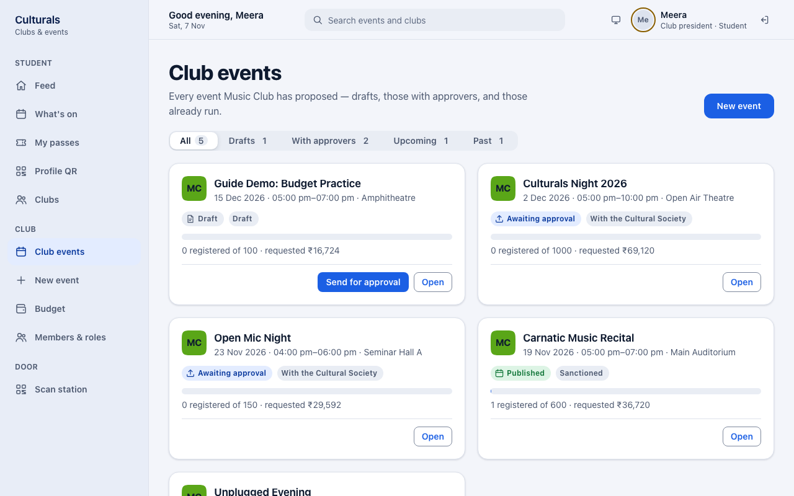

The Secretary gets the same pages except **Budget**:

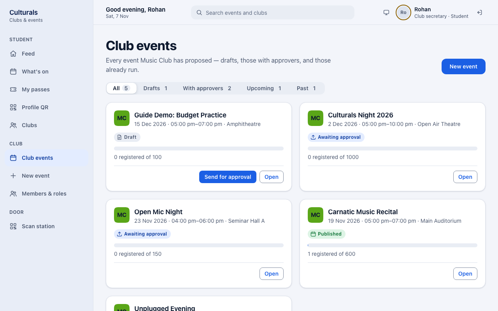

A plain member sees only **Club events** and **Members & roles**. Their event cards show no budget
amounts and no buttons except **Open**:

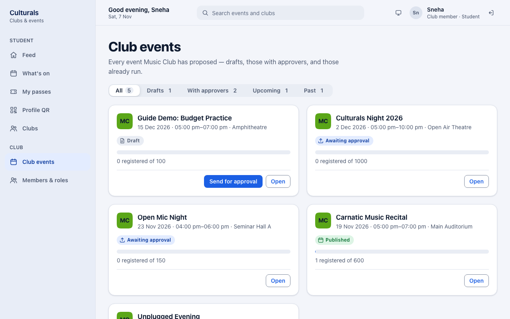

If you belong to more than one club, a **Club** picker appears at the top of Club events and
Members & roles. Choose the club you want to work on.

## Find your club's events

Open **Club events**. It lists every event your club has proposed.

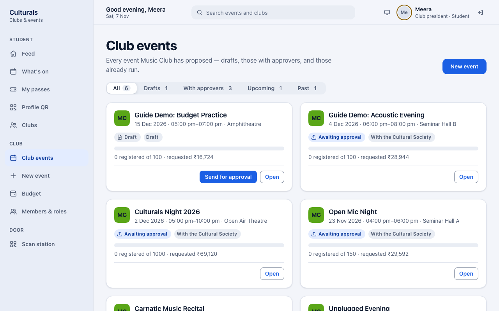

- Use the filter bar to narrow the list: **Drafts** (drafts and proposals returned to you),
  **With approvers**, **Upcoming** (approved, published or live) and **Past** (completed,
  reported, cancelled or rejected).
- Each card shows the date, time and venue, the event's status, the budget stage, how many students
  have registered and (for officers with budget access) the amount requested.
- Draft cards have a **Send for approval** button. Click **Open** on any card for the full page.

### What each status means

| Status | What it means | What you can do |
|---|---|---|
| **Draft** | Saved but not sent. Holds no venue slot. | Send it for approval, or delete it. |
| **Awaiting approval** | Sent. It is with one of the approvers (the card shows which, e.g. "With the Cultural Society"). It holds the venue slot provisionally. | Wait. Watch the approval trail. |
| **Returned for changes** | An approver sent it back with a comment. | Fix what they asked (usually the budget), then **Send for approval** again, or delete it. |
| **Rejected** | Turned down for good. It cannot be resubmitted. | Delete it, or propose a new event. |
| **Approved** | Passed every gate. It turns to Published at once. | — |
| **Published** | Visible to students on What's on; they can register and get passes. | **Go live** on the day, open the **Scan station**. |
| **Live now** | The event is running and the door is scanning passes. | Scan passes; **Close event** at the end. |
| **Completed** | It has run but has not been closed with evidence yet. | Close it. |
| **Reported** | Closed with photos and links. Attendance comes from the scans. | The Treasurer enters actual spend and settles the budget. |
| **Cancelled** | Called off. | — |

### An event's page

Click **Open** on a card. The event page shows:

- **Capacity**, **Expected**, **Registered** and **Attended** counts at the top.
- **When and where**, with the description.
- **Budget**: the amount requested and its stage, or, once approved, the sanctioned, spent and
  remaining amounts. **Open budget** takes you to the line-by-line budget (President, Vice-President
  and Treasurer only).
- **Approval trail**: a step-by-step chain from your club to **Sanctioned**, with each approver's
  decision, date and comment.
- **Clash check**: click **Check clashes** to see other events in the same venue at the same time,
  and which venues are free in that slot.

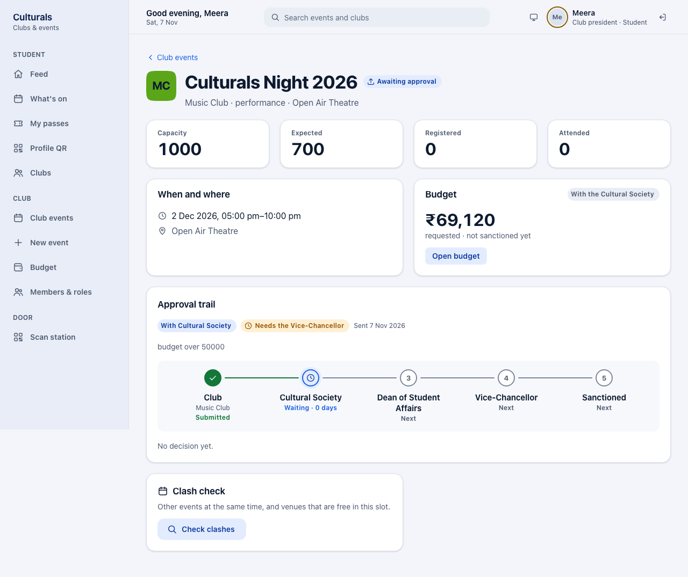

After the event has run and been reported, the page shows how much of the sanctioned budget was
spent and the full trail of approvals:

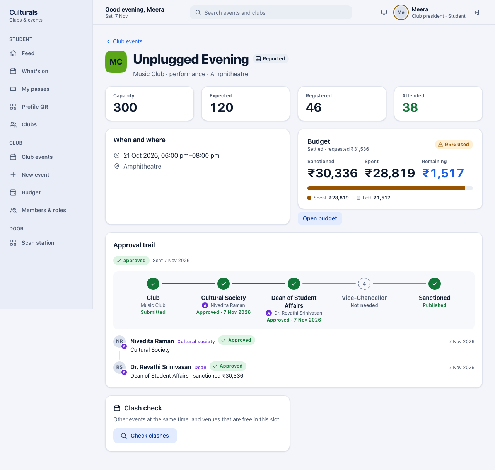

The clash check on Open Mic Night shows another club's request for the same hall overlaps it:

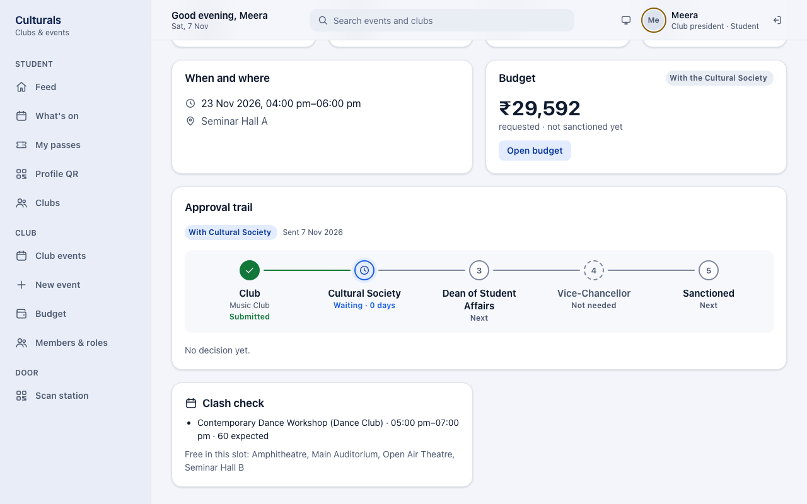

On the day of a published event, the President, Vice-President or Secretary sees **Go live** and
**Scan station** at the top of this page. When the event is live, a **Close the event** panel lets
you record **Photos taken** and **Social posts** and click **Close event**. Scanning at the door is
covered in the [Organiser & scan station guide](organiser.md).

## Propose a new event

The President, Vice-President, Secretary and Treasurer can propose events. Core team and members
cannot.

1. Click **New event** in the sidebar (or the **New event** button on Club events).

   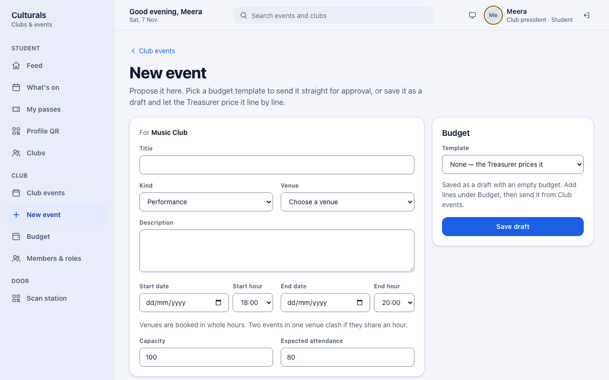

2. Fill in the event details:
   - **Title** and **Kind** (Performance, Workshop, Competition, Exhibition or Talk).
   - **Venue**. Each venue shows its seats, e.g. "Seminar Hall B · seats 120".
   - **Description** (shown to students).
   - **Start date** and **Start hour**, **End date** and **End hour**. Venues are booked in whole
     hours (for example 18:00 to 20:00); the end date follows the start date unless you change it.
     The end must be after the start.
   - **Capacity** (how many students can register; it cannot be more than the venue's seats) and
     **Expected attendance** (cannot be more than the capacity).
3. Under **Budget**, choose a **Template**: Competition, Exhibition, Performance or Workshop. The
   template fills in standard budget heads (sound and lighting, stage, refreshments, publicity) plus
   an 8% contingency, and shows the **Total requested**. Per-head items such as refreshments are
   worked out from **Expected attendance**, so change that number first.

   Below the total, a tag tells you who has to approve it:
   - **Society and Dean only**: the total is ₹50,000 or less.
   - **Above ₹50,000 — needs the Vice-Chancellor too**: the total is over the threshold, so the
     Vice-Chancellor is added to the chain.

   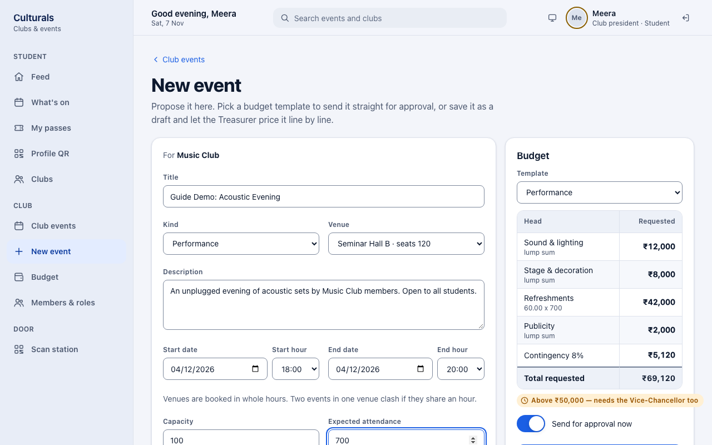

   If you choose **None — the Treasurer prices it**, the event is saved as a draft with an empty
   budget. The Treasurer adds the lines under **Budget** before it can be sent.
4. Decide whether to send it now. With a template chosen, the **Send for approval now** switch is
   on and the button reads **Propose and send**. Turn the switch off to keep it as a draft; the
   button changes to **Save draft**.

   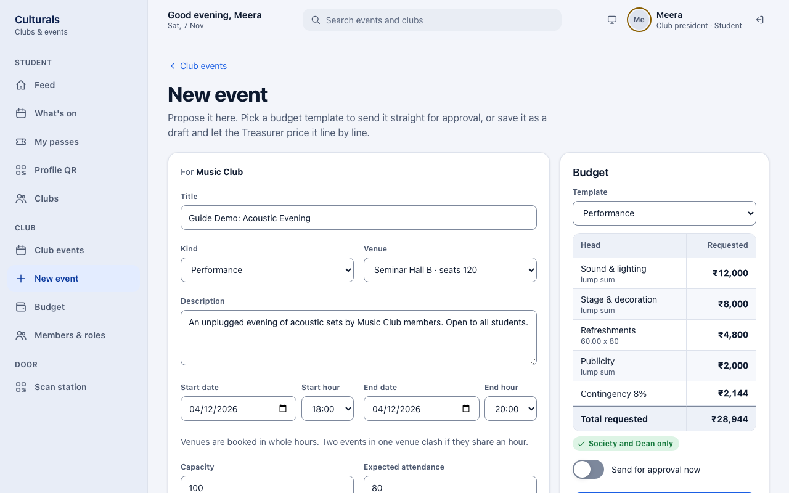

5. Click **Save draft** (or **Propose and send**). You land on the new event's page.

### Clash warnings

The app checks the venue when you save:

- **Venue already booked**: another event already approved or published uses the same venue in
  one of your hours. Nothing is saved; pick another venue or time and try again. The message gives
  the other event's times, and the venue field names the event in the way. On the demo server a
  30-minute buffer is also kept around each booking, so an event ending at 17:00 blocks one starting
  at 17:00 in the same venue.

  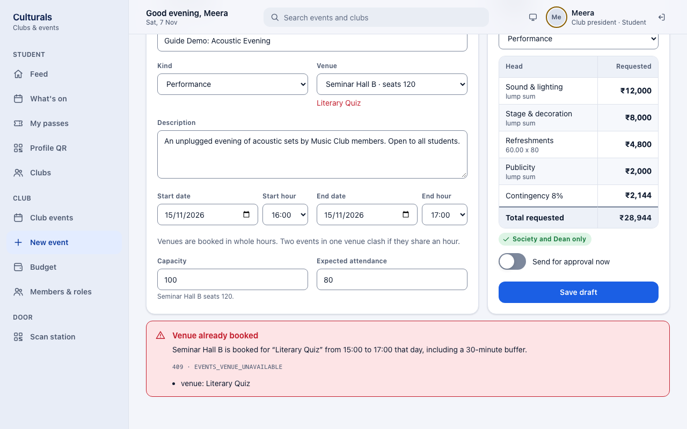

- **Soft clash**: another club has a request for the same venue and time that is still awaiting
  approval. Your proposal is accepted and the message says how many soft clashes were noted. The
  Dean decides which event gets the slot.

To see what else is on at your time before you propose, open any of your club's events and use
**Check clashes**, which also lists the venues that are free in that slot.

### Send a draft for approval

1. Open the draft (from **Club events**, filter **Drafts**). The page shows the **Draft** status,
   "Not sent for approval yet" in the approval trail, and a **Send for approval** button.

   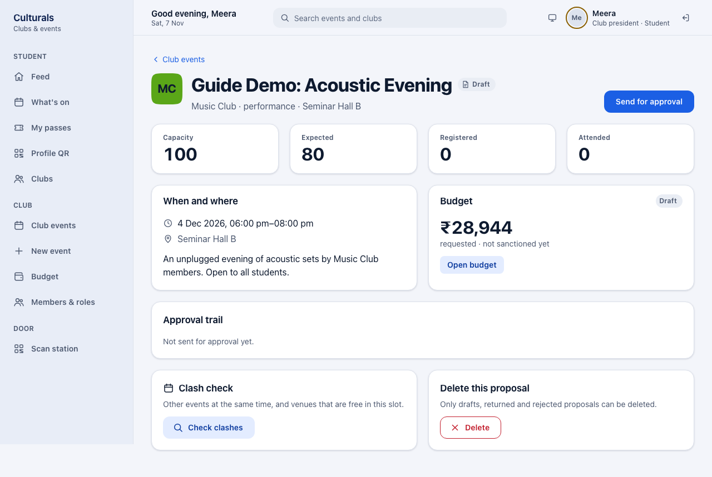

2. Check the budget. If it is empty, the app refuses with "Budget required": the Treasurer must add
   at least one line, or declare that the event needs no budget.
3. Click **Send for approval**. A message confirms it, e.g. "Sent for approval — 2 gates" (or
   "…including the Vice-Chancellor"). The status becomes **Awaiting approval**.

   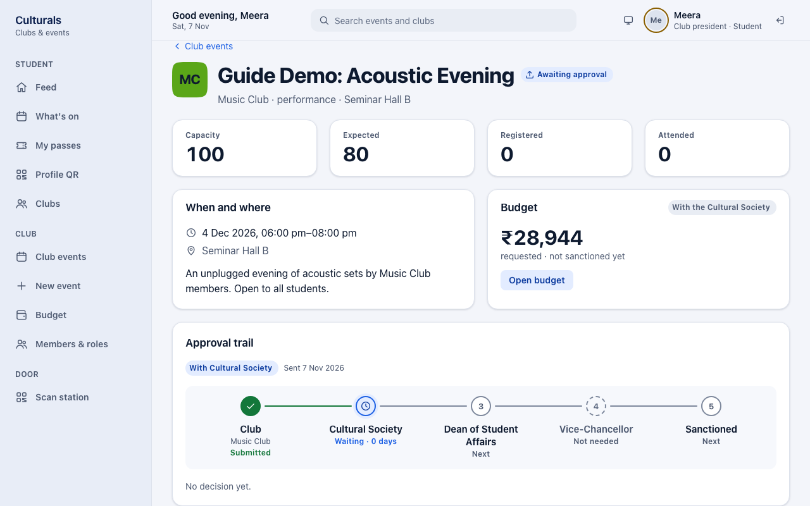

You can also send a draft straight from its card on **Club events**.

To delete a proposal, open it and use **Delete** in the **Delete this proposal** panel, then
**Yes, delete**. Only drafts, returned and rejected proposals can be deleted.

### How the approval chain works

In short: Cultural Society (cultural and literary clubs) → Dean (always) → Vice-Chancellor (over
₹50,000 or part of a fest) → Published. The [approval flow](README.md#approval-flow) diagram shows it
in full. Each approver can approve, return it to you with a comment, or reject it.

1. **Cultural Society**: only for clubs in the **cultural** or **literary** category, such as the
   Music Club. Technical clubs skip this gate.
2. **Dean of Student Affairs**: always. The Dean also settles venue clashes and sanctions the
   amount.
3. **Vice-Chancellor**: only when the total requested is **above ₹50,000**, or the event is
   **part of a fest**. The approval trail shows a **Needs the Vice-Chancellor** tag and the reason.
4. **Sanctioned**: once the last gate approves, the event is **Published** and students can
   register.

The approval trail on the event page always shows where it is ("With Cultural Society", "Waiting ·
2 days") and every decision so far. A **Past SLA** tag means it has waited at one gate longer than
it should.

## What happens after you submit

Every proposal ends one of four ways. Each example below is the event page as its own club's
President sees it.

### Still with an approver

Folk Fusion Evening (Dance Club) has been approved by the Cultural Society and is waiting with the
Dean. The status stays **Awaiting approval**; the trail shows a tick for each gate passed and a
clock on the current one, with how many days it has waited.

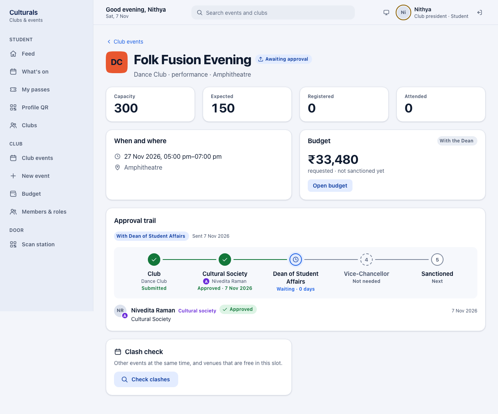

**What to do:** nothing; wait. The approvers are notified. If it shows **Past SLA**, it has waited
too long at one gate; you can follow up with that office.

### Approved and published

Carnatic Music Recital (Music Club) passed the Cultural Society and the Dean, who sanctioned
₹35,520 of the ₹36,720 requested. It is **Published**: students can see it on What's on and
register. The Budget card now shows sanctioned, spent and remaining, and **Go live** and
**Scan station** appear for the day itself.

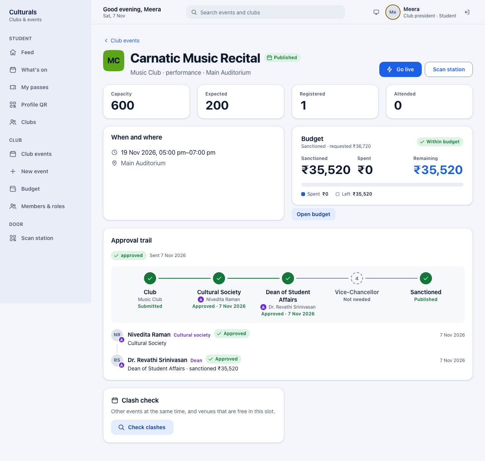

**What to do:** publicise it, run it on the day (**Go live**, then scan passes), close it with
evidence, and have the Treasurer record the spend. See the [Treasurer guide](treasurer.md) and the
[Organiser & scan station guide](organiser.md).

### Returned for changes

Short Film Screening (Photography Club) was returned by the Dean with the comment "Publicity looks
high for an 80-seat screening, and the screening licence is missing. Trim publicity and add the
licence, then resubmit." The club lowered Publicity, added a Screening licence line under
**Budget**, and sent it again. The page keeps both rounds: the first trail ends at **Returned** with
the Dean's comment; the second shows the new submission, which starts again at the Cultural Society.

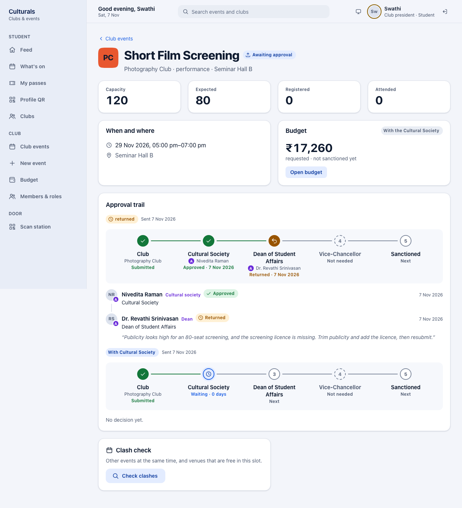

**What to do after a return:**

1. Open the event and read the approver's comment in the **Approval trail**.
2. Fix what they asked. Budget changes (lines and amounts) are made under **Budget**, by the
   President, Vice-President or Treasurer. See the [Treasurer guide](treasurer.md).
3. Click **Send for approval** on the event page (or its card under **Drafts** on Club events). The
   proposal goes through every gate again from the first one.

### Rejected

Late-Night Improv Marathon (Theatre Club) was rejected by the Dean: "Runs past the 10 pm campus
curfew and has no security plan for 300 people. Not approved this semester." The status is
**Rejected** and there is no **Send for approval** button.

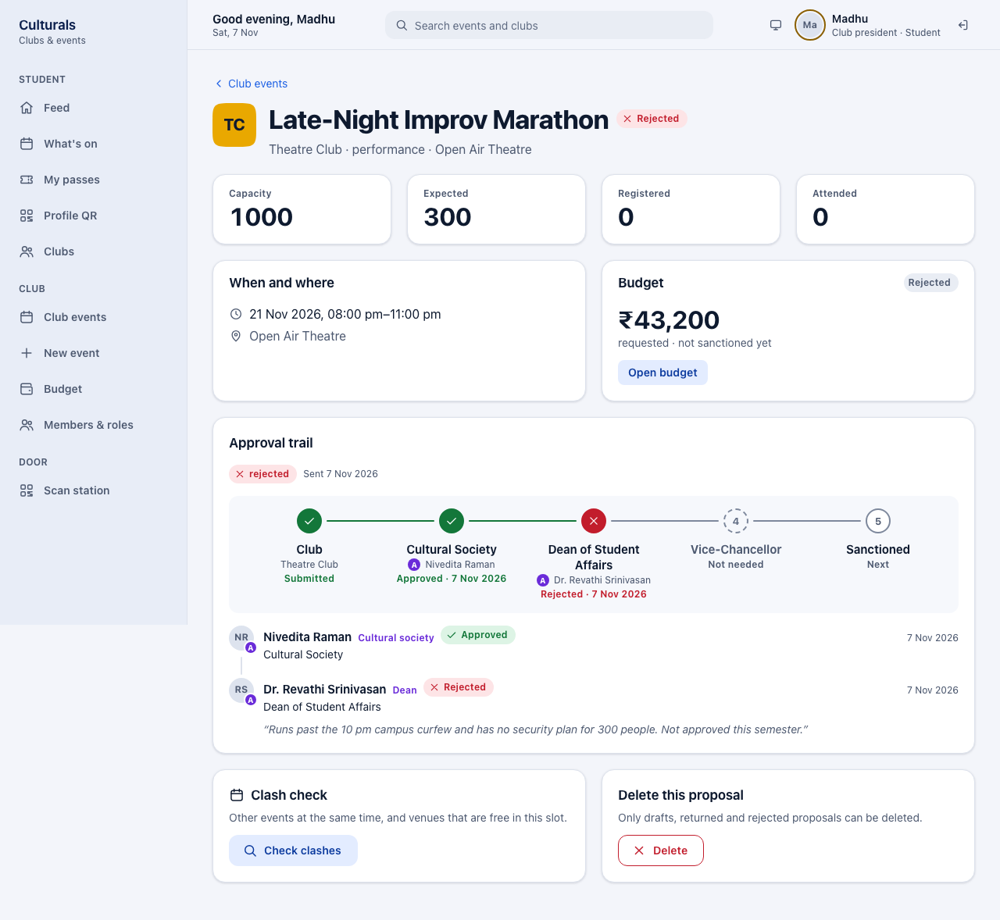

**What to do after a rejection:** the proposal is closed and cannot be sent again. If the idea can
be changed to meet the objection (here: an earlier finish and a security plan), propose it as a
**New event**. You can remove the rejected one with **Delete** to tidy your list.

## Members & roles

Open **Members & roles** to see everyone in the club: name, programme and year, PRN, department and
role. Office bearers have a gold ring around their initials. The tag at the top right says whether
the club is **Open to join** or **Joining needs approval**.

### President and Vice-President: assign roles

The President and Vice-President see a role menu on every row, plus **Join requests** and
**Handover** panels.

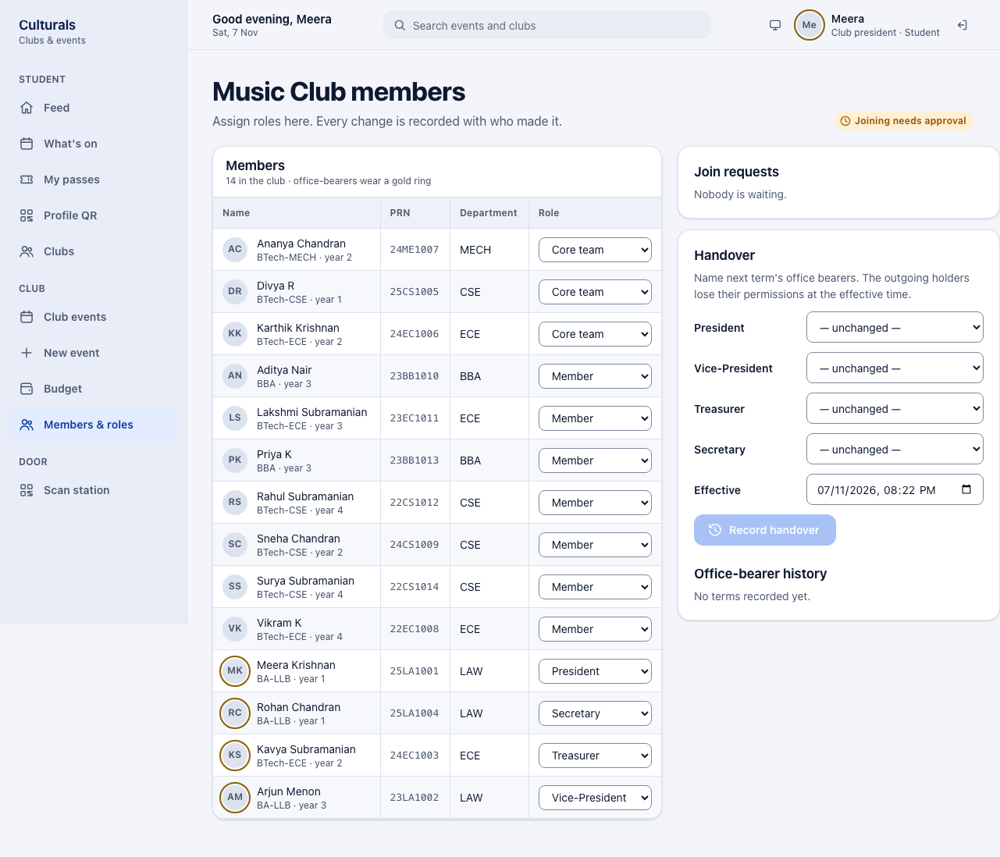

- **Change a role**: pick a new role from the member's menu (President, Vice-President, Treasurer,
  Secretary, Core team, Member). **The change is saved the moment you pick it**; there is no
  confirm step and no approval. A message confirms "… is now …", and the change is listed under
  **Role changes** with who made it. To undo a mistake, pick the old role again.
- **One President at a time**: to hand the presidency over, first move the current President to
  another role, then make the new person President.
- **Join requests**: when joining needs approval, students who asked appear here. Click **Accept**
  or **Decline**.
- **Handover**: name next term's President, Vice-President, Treasurer and Secretary, set the
  **Effective** date and time, and click **Record handover**. Leave a row on "— unchanged —" to
  keep its holder. The outgoing holders lose their permissions at the effective time. Past terms
  appear under **Office-bearer history**.

A new role changes what that person can do straight away. For example, making someone Treasurer
gives them the **Budget** page (they may need to reload the app to see it); moving them back to
Member removes it.

### Everyone else: view the roster

Secretaries, Treasurers, Core team and members see the same list with each role as a read-only tag:

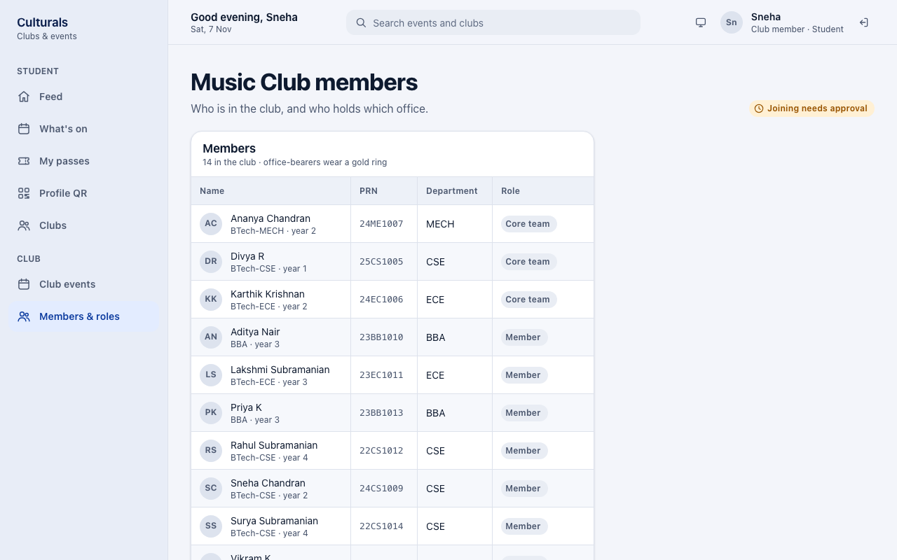

## What the President sees of the budget

The President and Vice-President (and the Treasurer) have the **Budget** page. It shows the club's
envelope for the year, the total sanctioned and settled, and one row per event budget with its stage,
number of lines, and the amounts requested, sanctioned and spent. **Price it** opens a draft budget
to add lines; **Open** shows the rest.

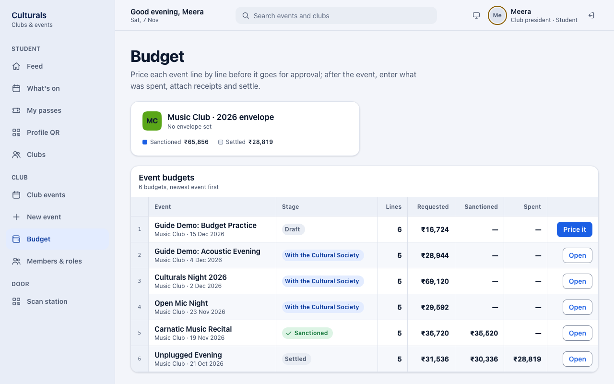

Pricing lines, recording spend, receipts and settling are covered in the
[Treasurer guide](treasurer.md). The Secretary, Core team and members cannot see budgets.

## Good to know

- **Who can propose**: President, Vice-President, Secretary and Treasurer. **Who can run the event
  on the day** (Go live, close it): President, Vice-President and Secretary. **Who can assign
  roles**: President and Vice-President only.
- **The ₹50,000 line** is on the total requested, contingency included.
- A **draft holds no venue slot**. Another club can book the hall before you send yours.
- A **returned** proposal can be fixed and sent again (it restarts at the first gate); a
  **rejected** one cannot. Propose a new event instead.
- There is no screen to edit an event's title, time or venue after saving. To change them, delete the
  draft and propose it again. The budget lines can be changed under **Budget** while it is a draft or
  returned.
- Times are shown in Indian Standard Time.

## Known issues

For the maintainer; found while writing this chapter on the demo server.

1. **The New event form's hint contradicts the buffer.** It says "Two events in one venue clash if
   they share an hour", but the demo server runs with a 30-minute buffer
   (`VENUE_BUFFER_MINUTES=30`), so back-to-back bookings (17:00 end, 17:00 start) are refused too.
2. **"Venue already booked" shows a technical line**: "409 · EVENTS_VENUE_UNAVAILABLE".
3. **Vice-Chancellor reason is raw text**: "budget over 50000" (no ₹ or thousands separator).
4. **Draft toast is misleading** when a template was used: "Saved as a draft — the Treasurer can price
   it now", although the template already priced it.
5. **Role menu saves on change** with no confirm step. A mis-click changes a member's role at once,
   and the President can demote themselves.
6. **A plain member who opens the Budget page by its address** sees "No budgets yet. Each proposed
   event gets one." instead of a "not allowed" message.
7. **The "Not permitted" message for proposing** says only the President, Vice-President or
   Secretary may propose; the Treasurer may too.
8. **No edit screen** for an event's details (title, time, venue, capacity) after it is saved.
