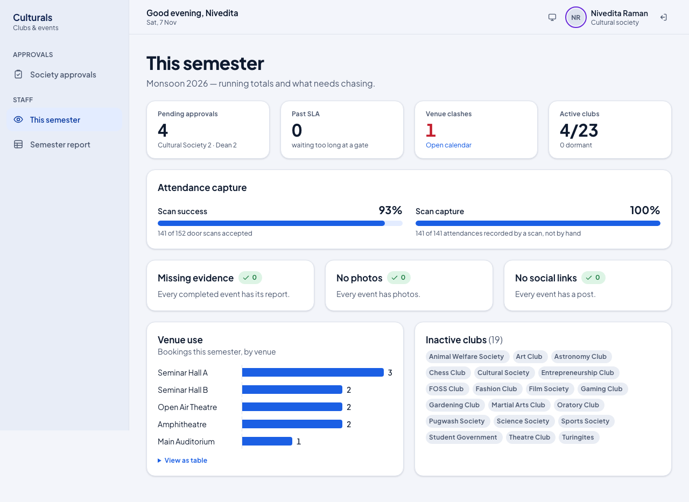
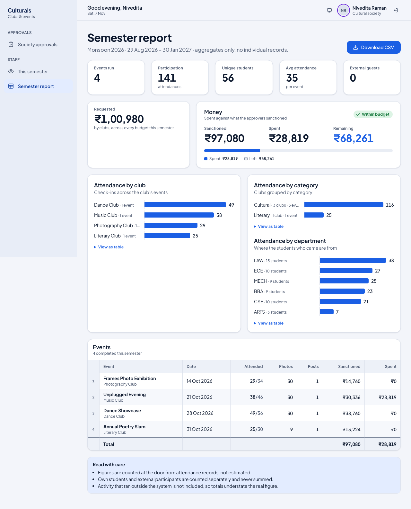

# Cultural Society guide

This chapter is for the Cultural Society secretary. You review event proposals from the
cultural and literary clubs before they go to the Dean. You can pass a proposal on to the Dean,
send it back to the club for changes, or reject it. You can also see the semester overview and
the semester report.

## How a proposal moves

Every event a club proposes goes through these approval gates, in order:

1. **Submitted** by the club, with its budget.
2. **Cultural Society** (you): only for clubs the Society covers, which are cultural and literary
   clubs. A technical or sports club's proposal skips your gate.
3. **Dean of Student Affairs**: every proposal, always. The Dean can lower a budget line, but
   never raise it.
4. **Vice-Chancellor**: only when the budget is above ₹50,000 or the event is part of a fest.
5. **Published**: students can see the event and register.

If any gate returns or rejects a proposal, it stops there and goes back to the club.

## Signing in

Staff accounts need a second step at sign-in.

1. Open the sign-in page and enter your **Institutional email** and **Password**.
2. Click **I have an authenticator code** and type the 6-digit code from your authenticator app.
3. Click **Sign in**.

**Why the code?** Approvers commit the college's money, so a stolen password alone must not be
enough to approve anything. The Cultural Society, Dean, Vice-Chancellor and administrators
cannot sign in without the code. Every decision you make is marked **MFA** in the approval
trail, so anyone can later see it was made by a verified approver.

## What you see after signing in

You start on **Society approvals**. The side menu has:

- **Society approvals**: proposals waiting at your gate.
- **This semester**: running totals and things to chase up.
- **Semester report**: attendance and money for the semester.

The three figures at the top show how many proposals are **Waiting**, how many are **Past SLA**
(waiting more than 48 hours at your gate) and the total amount **Requested**. Turn on
**Only items past the 48h SLA** to see only the late ones.

Each card shows the club, venue, date and time, how long it has been waiting, the amount
requested and the expected crowd. Tags warn you about:

- **Venue clash**: another event is booked in the same venue at the same time.
- **Needs VC**: it will also need the Vice-Chancellor's approval.
- **Nil budget**: the club declared it needs no money.

## Review a proposal

1. On a card, click **Review** (or the event title).
2. Check the page from top to bottom:
   - The **route** shows which gates this proposal must pass. A gate marked **Not needed** is
     skipped (for example the Vice-Chancellor for a small budget).
   - **Requested**, **Expected** (people) and **At this gate** (how long it has waited).
   - **Budget**: each line the club asked for. The **Sanctioned** column fills in once the Dean
     decides.
   - **Approval trail**: every decision so far, who made it, when, and their comment.

### When there is a venue clash

If the proposal overlaps another booking in the same venue (the 30-minute setup buffer counts),
a red **Venue clash** box lists the other event.

A clashing proposal **cannot be approved** at any gate until one of the events moves. Only the
Dean can move an event to another venue. Click **Open the venue calendar** to see the clash;
you can view the calendar but not change it. You can still return the proposal and ask the club
to pick another venue or time.

## Approve, return or reject

The **Your decision** panel is at the bottom of the proposal.

- **Approve and send to Dean**: the proposal moves to the Dean's queue. A comment is optional.
- **Return for changes**: the proposal goes back to the club, which can edit and resubmit it.
- **Reject**: the proposal is closed.

The club sees your comment, and the club's office bearers are notified when you return or
reject.

1. Type a comment in **Comment**. It is **required to return or reject**. If you leave it
   empty, the app refuses and asks for one:

   

2. Click the button for your decision. Here the secretary adds a note and approves:

   

3. You return to the queue with a confirmation at the bottom of the screen (for example
   **Approved: Street Play**), and the proposal leaves your queue.

   

A decision cannot be undone from this screen. If you approve by mistake, ask the Dean to return
it.

## This semester

**This semester** shows the current semester at a glance:

- **Pending approvals**, split by gate, and how many are **Past SLA**.
- **Venue clashes**, with a link to the venue calendar.
- **Active clubs**: clubs that have run at least one event.
- **Attendance capture**: how many door scans were accepted, and how many attendances were
  recorded by a scan rather than by hand.
- **Missing evidence**, **No photos**, **No social links**: completed events whose report is
  incomplete, so you know whom to chase.
- **Venue use** and **Inactive clubs**.

## Semester report

**Semester report** shows totals for completed events: events run, attendance, unique students,
external guests, money requested, sanctioned and spent, and attendance by club, category and
department. It has totals only, no individual student records. Click **Download CSV** to save
it as a spreadsheet.

## Good to know

- **Why is a proposal not in my queue?** Only cultural and literary clubs' proposals come to the
  Society. Others go straight to the Dean.
- **Why can't I approve this one?** It probably has a venue clash. Ask the Dean to move one of
  the events, or return the proposal to the club.
- **Can I change the budget?** No. Only the Dean sanctions budget lines. Return the proposal with
  a comment if a line looks wrong.
- **Covering for someone?** If you are covering another approver's gate, a note at the top of the
  queue says so. The trail records both names, and every decision you make while covering needs
  a session signed in with the authenticator code.
- **What is the SLA?** Proposals should not wait more than 48 hours at a gate. Late ones are
  marked **Past SLA** and shown on the overview.

## Known issues

- Seeded demo events show 5 h 30 min later than intended (Street Play shows 10:30 pm–12:30 am).
  `seed_demo.py` builds times with `timezone.make_aware` while `TIME_ZONE="UTC"`, so the local
  hours are stored as UTC and shown in IST.
- After a "comment is required" error, the red error box stays on screen while you type the
  comment. It clears on the next decision. The box also shows the technical code
  (`422 · GOVERNANCE_COMMENT_REQUIRED`).
- The Semester report's **Requested** tile says "across every budget this semester", but it adds
  up completed events only, so approving a proposal does not change it.
