# Dean guide

This chapter is for the Dean of Student Affairs. Every event proposal from every club passes
through your gate. You sanction the budget line by line, and your approval publishes the event
unless the Vice-Chancellor also has to approve it. You also manage the venue calendar and
resolve venue clashes. You can see the semester overview and report.

## How a proposal moves

1. **Submitted** by the club, with its budget.
2. **Cultural Society**: only for cultural and literary clubs.
3. **Dean of Student Affairs** (you): **always**. The app does not allow a route without the
   Dean's gate, so someone is always accountable for the money.
4. **Vice-Chancellor**: only when the budget is above ₹50,000 or the event is part of a fest.
5. **Published**: students can see the event and register.

## Signing in

Sign in with your **Institutional email** and **Password**, click
**I have an authenticator code**, type the 6-digit code from your authenticator app, and click
**Sign in**. The Dean cannot sign in without the code. Approvers commit college money, so a
password alone is not enough, and every decision is marked **MFA** in the approval trail. See
the [Cultural Society guide](cultural-society.md#signing-in) for a picture of the form.

## What you see after signing in

You start on **Dean approvals**. The side menu has:

- **Dean approvals**: proposals waiting at your gate.
- **Venues**: every venue and booking, and any clashes.
- **This semester**: running totals and things to chase up.
- **Semester report**: attendance and money for the semester.

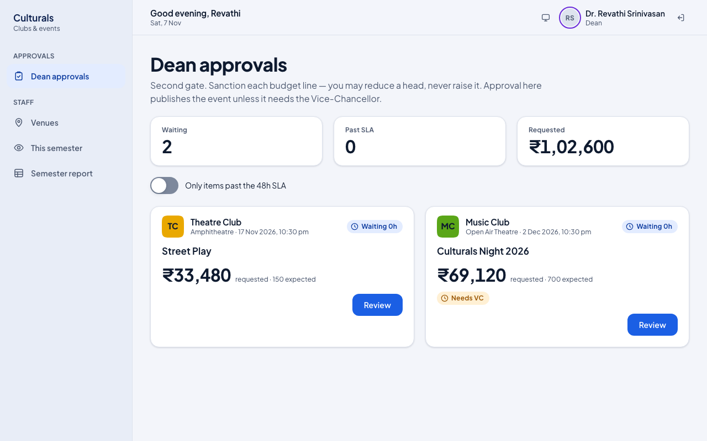

The figures at the top show how many proposals are **Waiting**, how many are **Past SLA**
(more than 48 hours at your gate) and the total **Requested**. Turn on
**Only items past the 48h SLA** to see only the late ones. A **Needs VC** tag means the
proposal goes on to the Vice-Chancellor after you.

## Review a proposal

1. On a card, click **Review**.
2. The proposal page shows:
   - The **route**: which gates are done (with who approved and when), which gate it is at now,
     and which are **Not needed**.
   - **Requested**, **Expected** (people) and **At this gate** (how long it has waited).
   - **Budget**: the club's lines.
   - **Approval trail**: earlier decisions and comments, for example the Cultural Society's
     note.
   - **Your decision**, with **Sanction by line**.

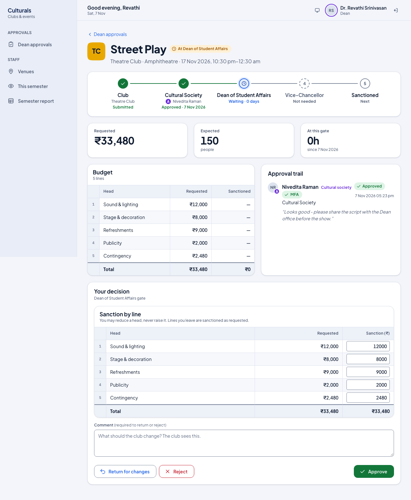

## Sanction the budget and decide

In **Sanction by line**, each line starts at the amount requested.

- To give less for a line, type the lower amount in its **Sanction (₹)** box. The total updates.
- You **cannot raise** a line above what the club asked for. If you type a higher amount, the
  line turns red and the app warns that the server will refuse it.
- Lines you leave alone are sanctioned as requested.

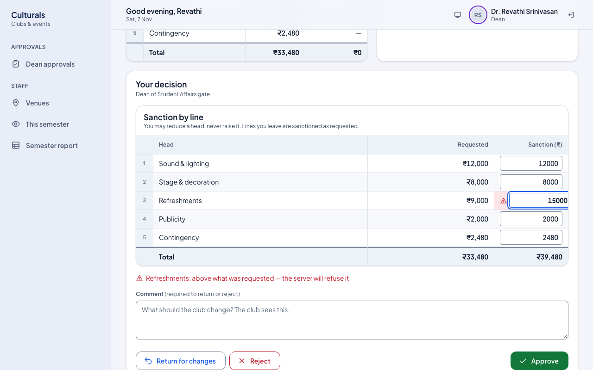

Then choose:

- **Approve**: sanctions the amounts shown. The event is **published** unless it needs the
  Vice-Chancellor, in which case it moves to the Vice-Chancellor's queue.
- **Return for changes**: the club can edit and resubmit.
- **Reject**: the proposal is closed.

A **Comment** is optional to approve and **required to return or reject**. The club sees it,
and its office bearers are notified when you return or reject.

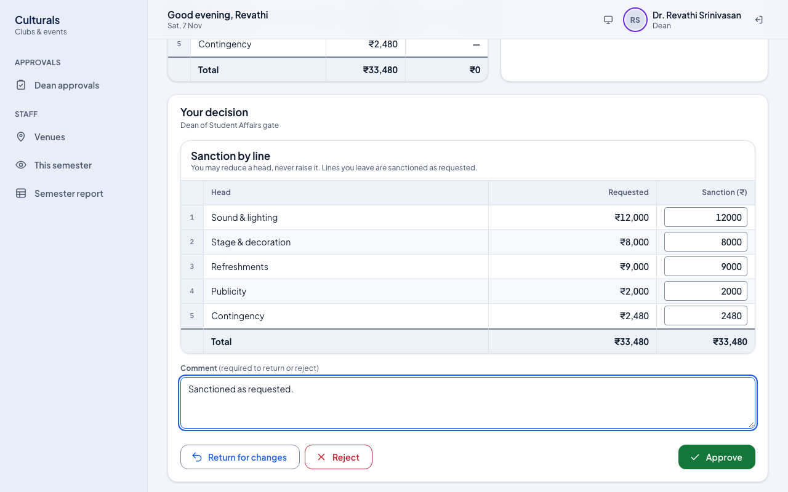

After you click **Approve**, you return to the queue with a confirmation such as
**Approved: Street Play**.

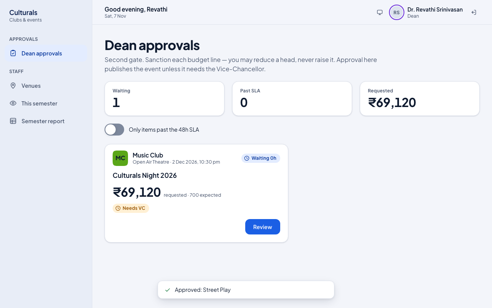

If you open the proposal again, the route ends in **Sanctioned · Published**, the **Sanctioned**
column is filled in, and your decision is in the trail.

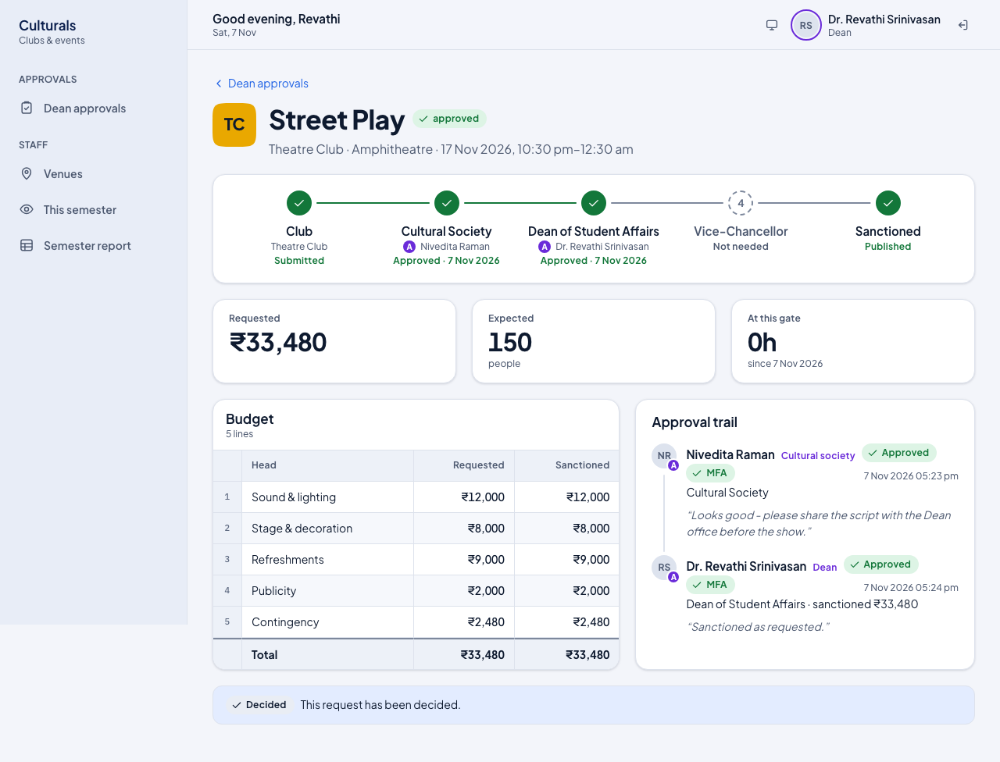

### Proposals that need the Vice-Chancellor

When the budget is above ₹50,000 (or the event is part of a fest), the **Requested** figure says
**Goes to the Vice-Chancellor** and why. Your approval sanctions the budget and passes the
proposal to the Vice-Chancellor; it is not published yet.

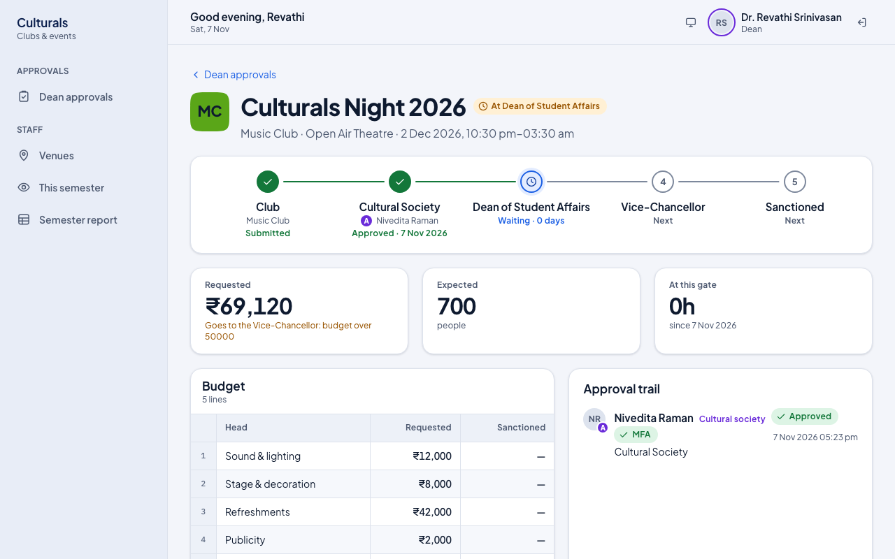

## Resolve a venue clash

Two events in the same venue at overlapping times (counting the 30-minute setup buffer) are a
clash. **Neither can be approved, at any gate, until one moves.** The app does not pick a winner;
you decide which event moves.

1. Open **Venues**. The **Clashes** figure counts clashes on all dates, and a red box lists each
   clashing pair side by side, with whether each is a **Pending request** or **Confirmed**.

   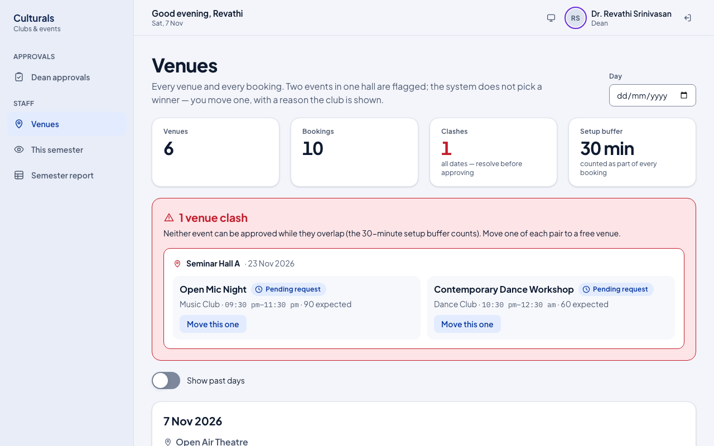

2. Under the event that should move, click **Move this one**.
3. In **Move to**, pick a venue. Each choice says whether it is free; venues that are taken or
   too small for the expected crowd cannot be picked.
4. In **Reason (the club sees this)**, explain the move.
5. Click **Move**, or **Cancel** to close the form without changing anything.

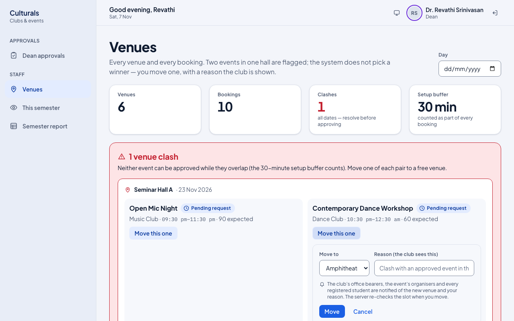

When you move an event, the club's office bearers, the event's organisers and every registered
student are notified of the new venue and your reason. The app checks the slot again when you
click **Move**, so if someone has just booked the venue, the move is refused.

Below the clash box, the calendar lists every upcoming booking by day and venue. Each booking is
marked **Confirmed** (approved) or **Pencilled** (still in approval). You can also move any
single booking with **Move venue**. Pick a **Day** to see one date, or turn on
**Show past days**.

## This semester

**This semester** shows pending approvals by gate, items **Past SLA**, the number of **Venue
clashes** (with **Open calendar**), active clubs, how well door scanning is capturing
attendance, completed events still missing a report, photos or social links, venue use and
inactive clubs. Items waiting past the SLA are listed with a link to each proposal.

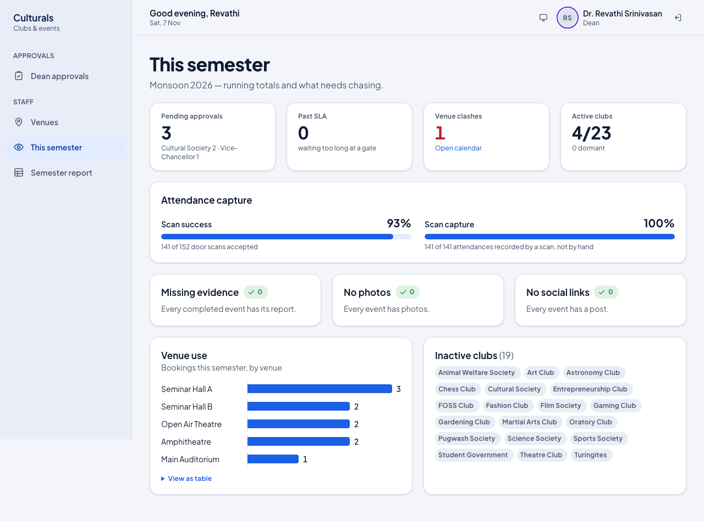

## Semester report

**Semester report** shows totals for completed events: events run, attendance, unique students,
external guests, money sanctioned against money spent, and attendance by club, category and
department, then a table of events. It has totals only, no individual student records. Click
**Download CSV** to save it.

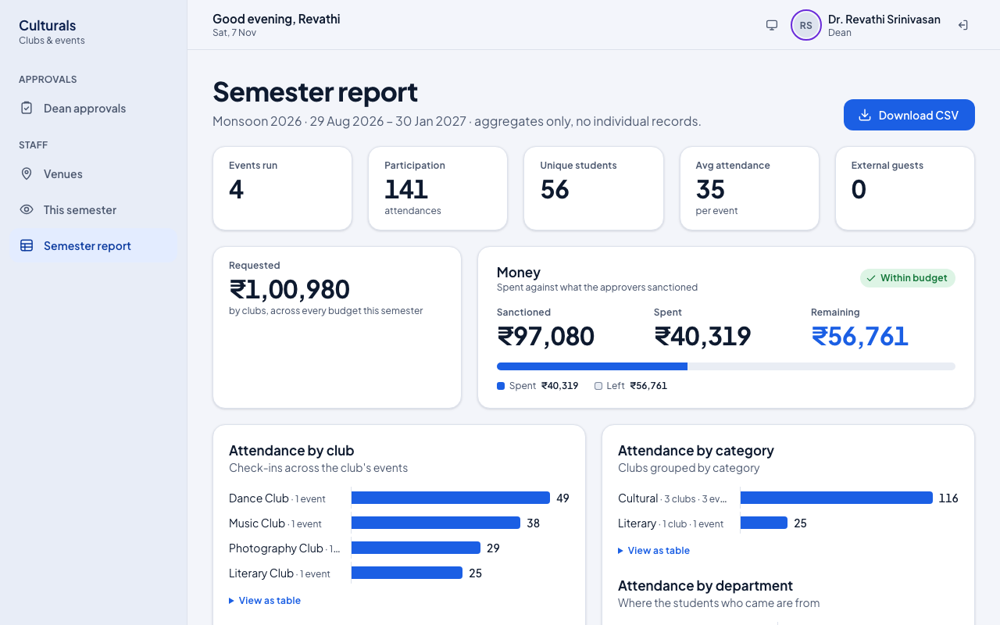

## Good to know

- **Why can't I approve this?** Usually a venue clash. Move one of the events on **Venues**
  first. If the error says a second factor is required, sign out and sign in again with your
  authenticator code.
- **Can I give a club more than it asked for?** No. Ask the club to return a revised proposal.
- **Does my approval publish the event?** Yes, unless the proposal shows **Needs VC**. Then it
  goes to the Vice-Chancellor.
- **Covering for someone?** If you are covering another approver's gate, a note at the top of
  the queue says so. The trail records both names, and every decision while covering needs a
  session signed in with the authenticator code.
- **Notifications:** clubs are notified when you return or reject a proposal, and everyone
  affected is notified when you move an event. There is no notification inbox on the staff
  screens; use the queues and **This semester** to see what needs you.

## Known issues

- Seeded demo events show 5 h 30 min later than intended (Culturals Night 2026 shows
  10:30 pm–03:30 am). `seed_demo.py` builds times with `timezone.make_aware` while
  `TIME_ZONE="UTC"`, so the local hours are stored as UTC and shown in IST.
- The Vice-Chancellor reason is shown as a raw number ("budget over 50000") rather than
  "₹50,000".
- On a decided proposal the status tag shows the raw lowercase state ("approved").
- In the **Move this one** form at desktop width, the **Move to** list is narrow and cuts off
  venue names ("Amphiteat…").
