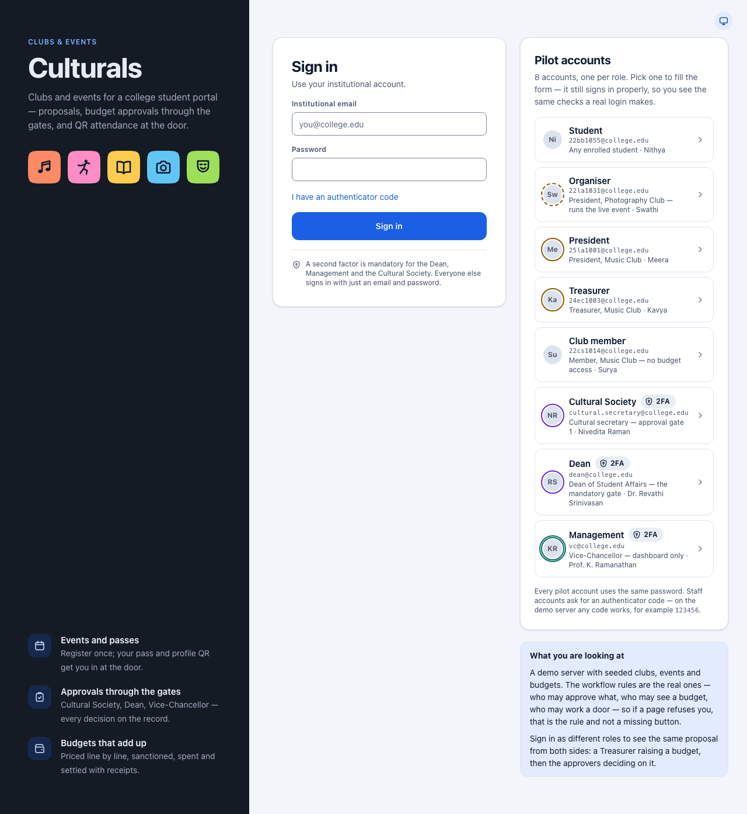
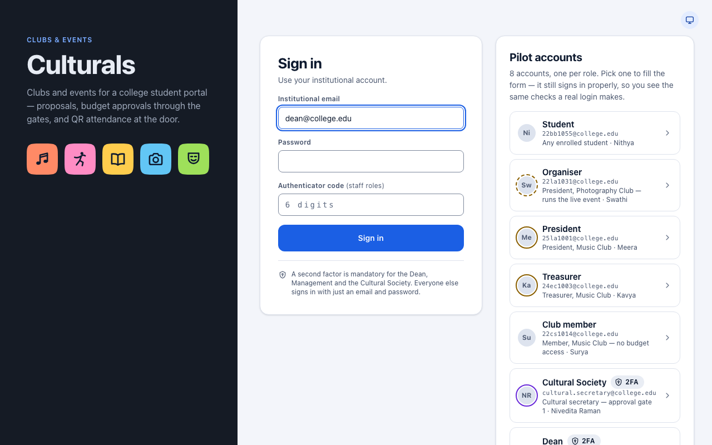
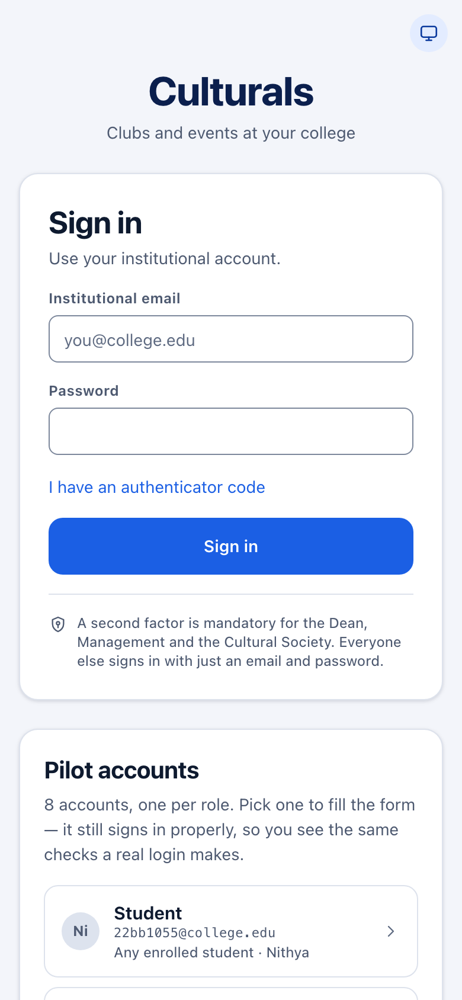
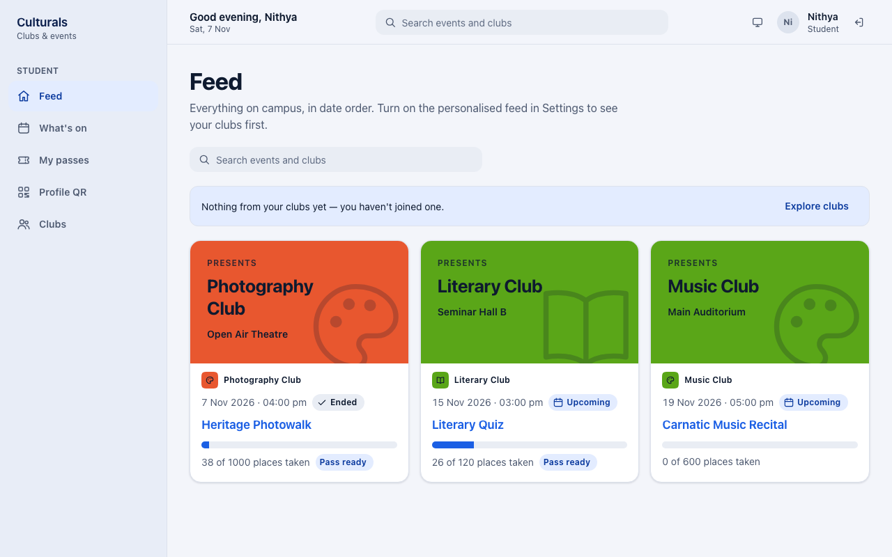
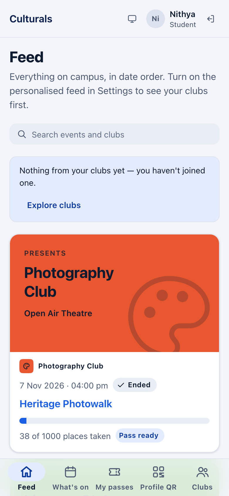
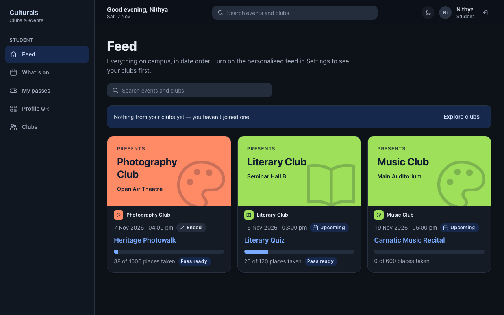

# Getting started

Culturals is the college's clubs and events app. Students use it to find events, register and
get in at the door with a QR code. Club officers use it to propose events and manage budgets,
and college staff use it to approve them. This chapter covers what everyone needs first:
signing in, finding your way around and signing out.

## Sign in

1. Open Culturals in your browser. You land on the **Sign in** page.
2. Type your **Institutional email** (for example `you@college.edu`) and your **Password**.
3. Tap **Sign in**.

After signing in you land on the first page your role allows. For a student that is the
**Feed**. For a club officer or staff member it is their own first page.

### Staff: the authenticator code

The Dean, the Vice-Chancellor (Management) and the Cultural Society must enter a second code
from their authenticator app. Everyone else signs in with just an email and password.

1. Fill in your email and password.
2. Tap **I have an authenticator code**. An **Authenticator code** field appears.
3. Type the 6-digit code from your authenticator app, then tap **Sign in**.

If you forget step 2, the app asks for the code after your first try. The field appears and you
can carry on from there without starting again.

### The "Pilot accounts" panel (demo server only)

On the demo server, the sign-in page also shows a **Pilot accounts** panel with one account
for each role: Student, Organiser, President, Treasurer, Club member, Cultural Society, Dean
and Management. Tap one to fill in the form, then tap **Sign in**. You still go through the
normal sign-in checks.

- Every pilot account uses the same password, `culturals-demo`.
- Accounts marked **2FA** (Cultural Society, Dean, Management) also need an authenticator
  code. On the demo server any code works, for example `123456`.

The panel only appears on the demo server. The real college server does not show it.

On a phone, the form comes first and the **Pilot accounts** panel is below it:

## Finding your way around

The menu only lists the pages your role is allowed to use, so two people can see different
menus. The pages themselves are the same on a computer and on a phone. Only the menu moves.

**On a computer** the menu is a sidebar on the left. The bar along the top shows a greeting,
a search box (students only: it searches events and clubs on **What's on**), the theme
button, your name and role, and the sign-out button.

**On a phone** the menu is a bar along the bottom of the screen. Your name, the theme button
and the sign-out button are in the top bar. If your role has more than five pages, the last
button on the bottom bar is **More**. Tap it to see the rest.

## Light and dark theme

The theme button sits next to your name (on the sign-in page it is in the top-right corner).
Each tap moves to the next setting:

- **System** (a monitor icon) follows your phone's or computer's own setting. This is the default.
- **Light** (a sun icon).
- **Dark** (a moon icon).

The app remembers your choice on that device.

## Sign out

Tap the sign-out button, the arrow icon just after your name in the top bar (or at the foot
of the sidebar on a tablet). You go back to the **Sign in** page.

Students can also use the **Sign out** button on **Profile QR → Settings**.

On a shared or borrowed device, always sign out when you are done.

## Good to know

- **A page says you can't open it.** Pages are tied to your role. If a link takes you to a
  page your role can't use, the app refuses. This is a permission rule, not a fault.
- **"Still signed in as …"** If you open the sign-in page while you are still signed in, a
  note says so. Tap **Continue** to go back in, or sign in below as someone else.
- **Choosing a guide chapter.** The menu tells you which chapter to read. Students see
  **Feed, What's on, My passes, Profile QR, Clubs**. Club officers also see club pages
  such as **Club events** and **Budget**, and staff see their approval pages.
