# Organiser & scan station guide

This chapter is for the people who run the door at a club event: the club president, vice-president,
secretary and core team, and anyone named as an organiser of the event. You open the **Scan station**
on a phone or laptop, check each student's pass or profile QR, admit walk-ins, and see who has arrived.
Afterwards the event page shows how many registered students actually came.

The examples use Swathi, president of the Photography Club, at her live event "Heritage Photowalk".

> Only the door marks a student present. Students cannot check themselves in: they show their QR,
> and you scan it.

## What you see after signing in

Alongside the student pages (**Feed**, **What's on**, **My passes**, **Profile QR**, **Clubs**),
club officers get a **Club** group (**Club events**, **New event**, **Budget**, **Members & roles**) and
a **Door** group with **Scan station**.

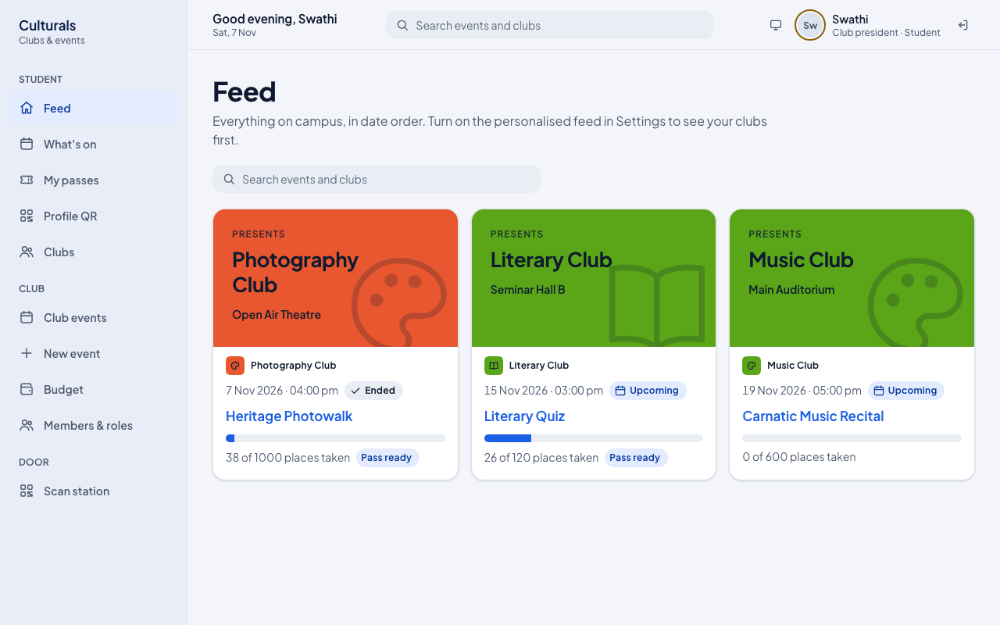

On a phone the bottom bar shows the student pages. Tap **More** to reach **Club events** and
**Scan station**.

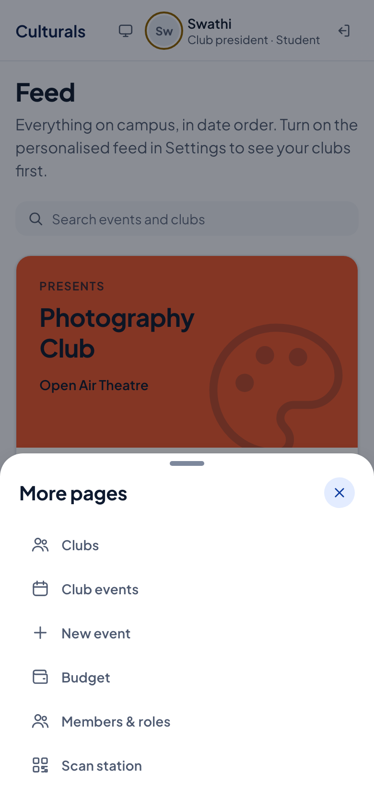

## Open the scan station for your event

The station opens for your club's events once they are **Published** (that is, approved through
the [approval flow](README.md#approval-flow)) or **Live**. You can get there two ways:

- From the event: **Club events** → open the event → **Scan station** (top right). If the event is
  still **Published**, the officers also see **Go live**; press it when doors open, so the event
  shows as "Live now" to everyone.
- From the menu: **Scan station** (on a phone: **More** → **Scan station**).

1. Open **Scan station**.
2. Under **Event at this door**, pick the event. Only events you are allowed to run a door for are
   listed, and the earliest one is picked for you, so check it every time you open the page.
3. Check the line under the title: the event status, club, venue and time, and the connection chip
   (**Online**). The short code after it (for example `station web-df53aae6`) names this device; it
   appears in "first scanned at … at web-…" messages so you can tell which door scanned someone.
4. The big panel says **Ready to scan**. You are ready.

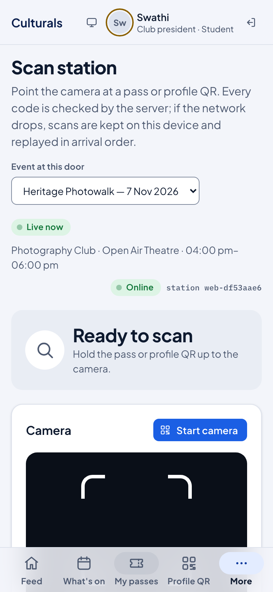

On a laptop the same page shows the live counters and the offline queue to the right.

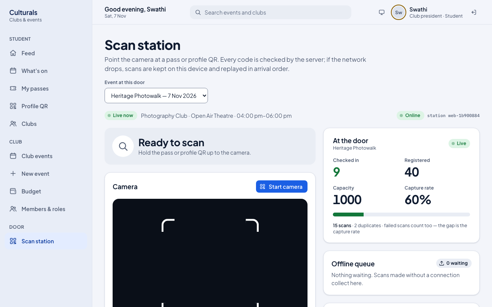

## Check a student in

A student can show either:

- their **event pass** (from **My passes**), which works once, for that event only, or
- their **profile QR** (from **Profile QR**), which works at any event and also admits walk-ins.

**With the camera**

1. Tap **Start camera** and allow camera access when the browser asks.
2. Point the camera at the QR. It is read automatically; the same code is not counted twice while it
   stays in front of the lens.
3. Read the verdict at the top of the page (see below), then let the student in or not.
4. Tap **Stop camera** when you are done.

The camera works in Chrome or Edge on Android and Safari 17+ on iPhone. In other browsers the
**Start camera** button is greyed out and a note tells you to type the code instead.

**Typing or pasting a code**

1. Under **Pass code**, paste or type the code the student shows.
2. Tap **Check code**.

**No phone? Use the PRN**

If the student's phone is flat or the code will not scan:

1. Type the PRN from their ID card under **No phone? PRN from their ID card** (for example `23AR1057`).
2. Tap **Check in by PRN**.

A registered student is checked in. A student who is not registered is registered at the door and
checked in, as long as places are left. The verdict says **Manual entry by PRN lookup**.

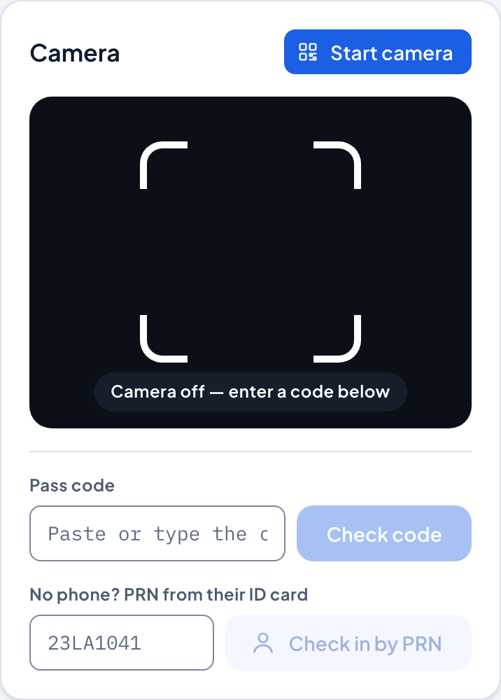

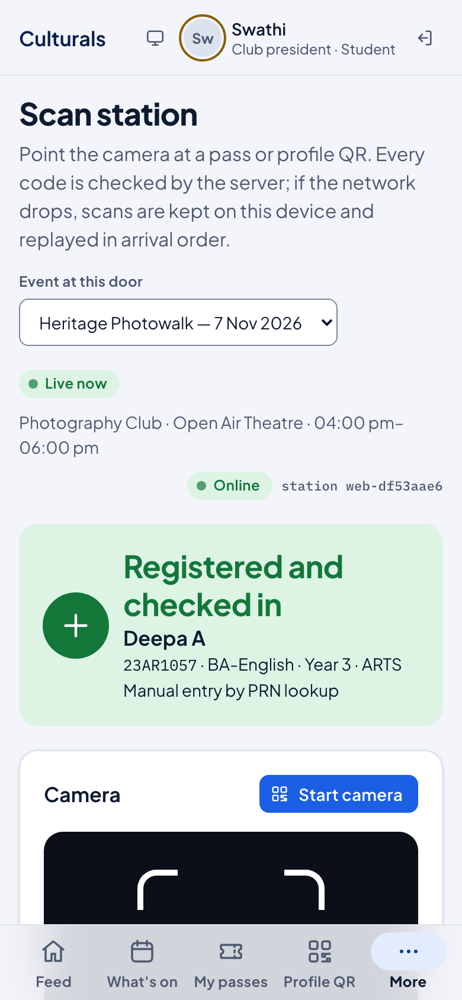

## What each verdict means

The server decides every verdict; the phone only shows it. Green means let them in, amber means look
closer, red means do not admit on this code. The phone also vibrates: one short buzz for green, a
double buzz otherwise.

| Verdict | Colour | What happened | What to do |
|---|---|---|---|
| **Checked in** | green | A registered student's pass or profile QR. Name, PRN, programme and year are shown. | Let them in. |
| **Registered and checked in** | green | Walk-in: a profile QR or PRN of a student who was not registered. They are now registered and in. Also used when a waitlisted student turns up and a place is free. | Let them in. |
| **Already checked in** | amber | This person was already admitted. The message says when and at which station. | Check it is the same person; do not count them twice. |
| **Wrong event** | red | A pass for a different event. The message names it. | Ask for their profile QR instead; it admits them here as a walk-in if places are left. |
| **Pass was replaced** | red | An older copy of a pass. The student has a newer one, or cancelled this registration. | Ask them to open the current pass, or scan their profile QR. |
| **Code was replaced** | red | An old profile QR; the student has issued a new one. | Ask them to open **Profile QR** again. |
| **Pass expired** | red | The pass is too old to use. | Scan their profile QR instead. |
| **Event at capacity** | red | A walk-in or waitlisted student, but every place is taken. | They cannot be admitted. |
| **Code not recognised** | red | Not a Culturals code at all, or mistyped. | Re-scan or retype; otherwise use the PRN. |
| **Saved offline** | amber | The server could not be reached. See the next section. | Admit only if the pass looks right. |

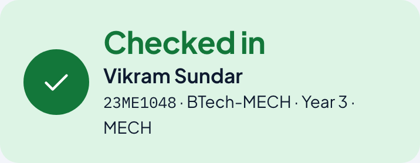

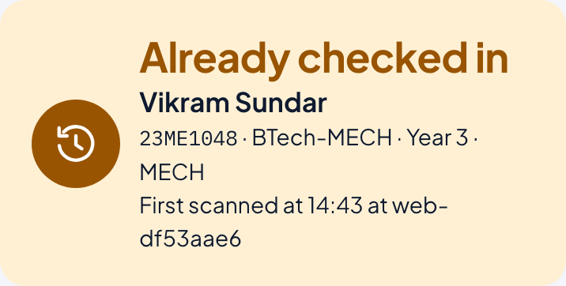

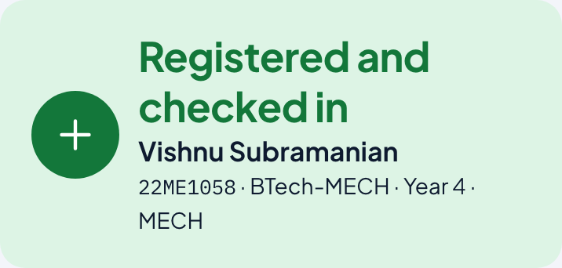

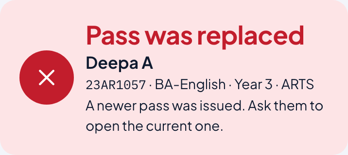

Every scan is recorded, including the red ones and every PRN lookup.

## When the connection drops

If the station cannot reach the server, a scan is kept on the device instead of being lost:

1. The verdict shows **Saved offline**: the code has not been checked yet. Let the student in only if
   the pass looks right (their name and the event on their phone).
2. The chip at the top changes to **Offline · N queued** (no network at all) or **Online · N to sync**
   (network is back but the scans are still waiting).
3. The **Offline queue** card shows how many scans are waiting.

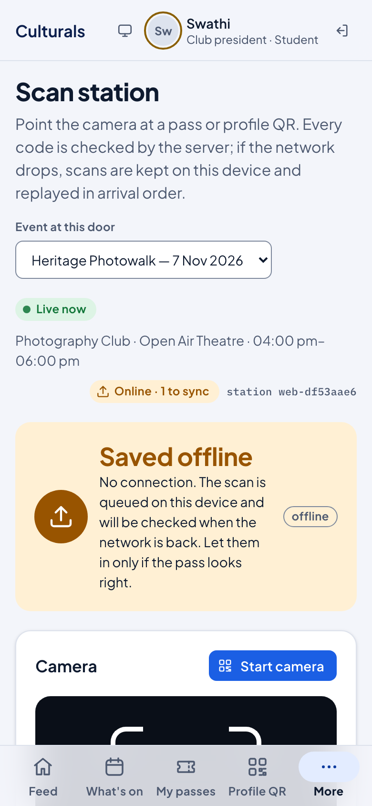

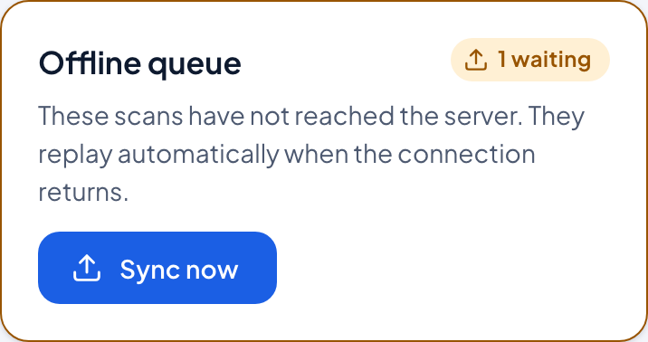

When the connection returns, the waiting scans are sent automatically. You can also tap **Sync now**.
A message reports the result, for example "Synced 1: 0 checked in, 1 duplicate". If two stations
scanned the same student while offline, the earlier scan counts and the later one becomes a duplicate.

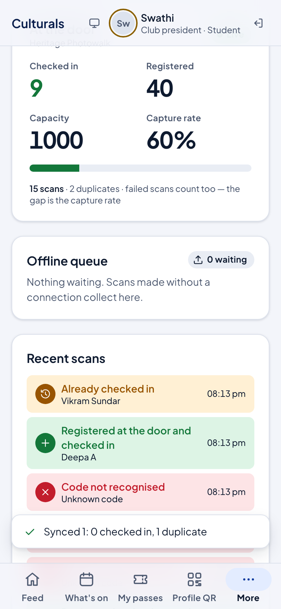

Waiting scans are stored in that browser on that device. Do not clear the browser's data or use a
private window for the station, and do not sign out until the queue shows **0 waiting**.

## Watch the door: counters and recent scans

The **At the door** card updates every few seconds:

- **Checked in** and **Registered**, with a bar showing how full the room is against registrations.
- **Capacity** of the event.
- **Capture rate**: the share of all scans that admitted someone. Duplicates and red verdicts lower
  it. A low rate means many people needed a second try; it is a measure of how smoothly the door
  ran, not of turnout.

**Recent scans** lists the last eight scans with their verdict and time, marked "offline" if they
came in through the queue. Each row also says how the student got in, for example **Registered at
the door and checked in** for a walk-in.

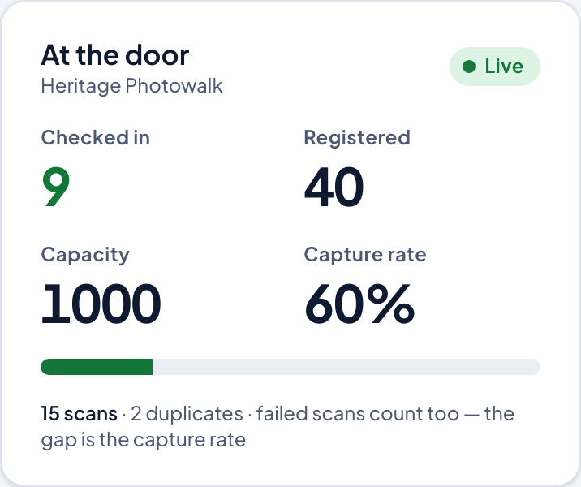

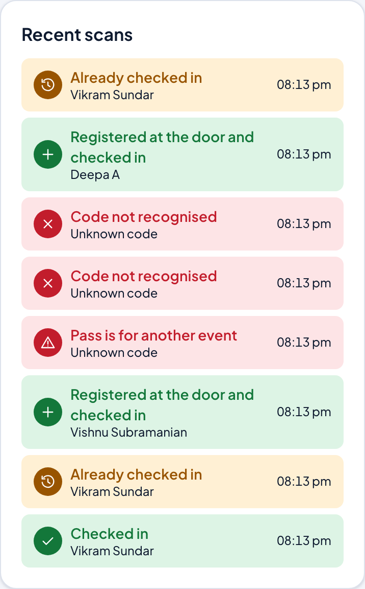

## See who is in and who is not yet

The **Attendees** list at the bottom of the scan station shows everyone registered, with
"9 of 40 checked in (23%)" style totals and a waitlist count when there is one.

- Use **Find by name or PRN** to look someone up.
- Use **All**, **Checked in** or **Not yet** to filter.
- **In · time** shows when a student was admitted. **At the door** marks a student who registered as
  a walk-in by profile QR. **Waitlisted** marks someone still in the queue for a place.

Only the event's organisers and door team (and the Dean, for oversight) see this list, because it
shows names and PRNs.

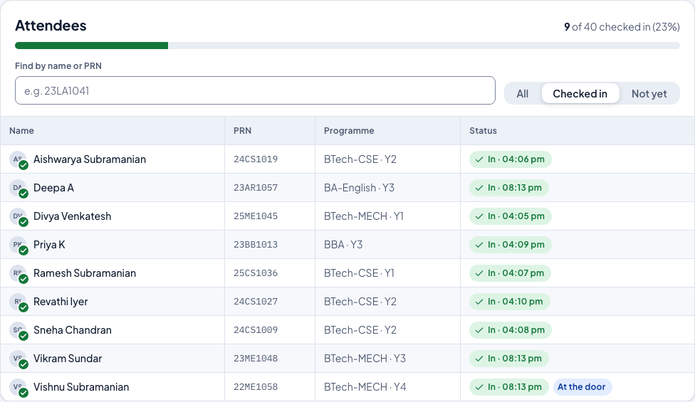

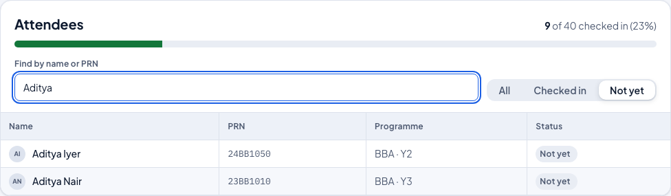

## After the event: attendance on the event page

Open **Club events** → your event. The four figures at the top are **Capacity**, **Expected**,
**Registered** and **Attended**. **Attended** is the number checked in at the door; it is not typed in
anywhere else. Compare it with **Registered** to see the turnout (here 9 of 40).

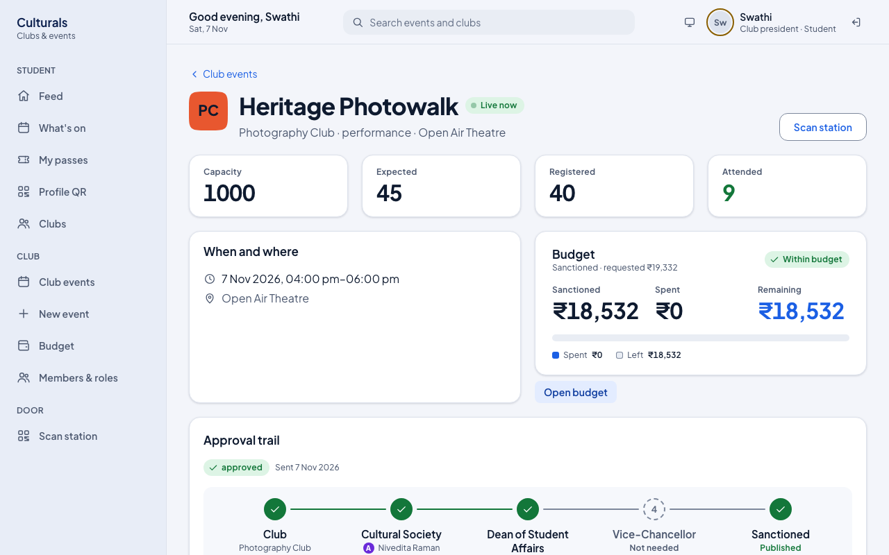

When the event is over, a president, vice-president or secretary closes it from the same page, in
the **Close the event** panel:

1. Enter **Photos taken** (at least 1; the event cannot be closed without photo evidence).
2. Paste any **Social posts** links, separated by spaces.
3. Press **Close event**. The event moves to **Reported**, and the attendance at that moment is
   what goes into the report. The treasurer then enters the actual spend (see the
   [Treasurer guide](treasurer.md)).

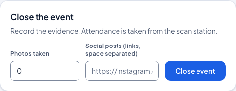

## Good to know

- **Who can run a door**: the club's president, vice-president, secretary and core team, and named
  event organisers. Plain members cannot: the station shows names and PRNs.
- **One device per door is enough**; several doors can scan the same event at once. Each device has
  its own station code.
- **A pass works once.** A second scan is reported as **Already checked in**, never as a second entry.
- **Walk-ins** are welcome as long as places are left: scan their profile QR or type their PRN.
- **Cancelled registration?** The old pass stops working. Scan the student's profile QR to admit them
  as a walk-in.
- **Re-check the event** in **Event at this door** before you start, especially if your club has more
  than one event that day.

## Known issues

For the maintainer; found while writing this chapter on 7 Nov 2026, rechecked on the reseeded server the same day.

1. **Station freezes on "Checking…" when the device itself is offline.** With the browser offline
   (chip shows **Offline · 0 queued**), pressing **Check code** leaves the viewfinder on "Checking…",
   no **Saved offline** verdict appears, nothing is queued (0 waiting after 10 s), and **Check code** stays disabled, so the
   door cannot take further scans. Cause: TanStack Query mutations default to `networkMode: 'online'`
   and pause instead of failing, so the `NETWORK_ERROR` → `enqueue` path in
   `organiser/ScanPage.tsx` never runs. The queue works only when the device thinks it is online but
   the API is unreachable (that is how screenshots 14–16 were produced, by blocking the scan request).
   Likely fix: `networkMode: 'always'` on the scan mutation.
2. **Duplicate message shows server time, not local time.** "First scanned at 14:43" (UTC) for a
   check-in the roster shows as "In · 08:13 pm" (IST). `participation/services.py` `_duplicate()`
   formats with `timezone.localtime`, which is the server zone (UTC).
3. **Cancelled registrations show "Pass was replaced".** Cancelling revokes the pass, so scanning it
   returns "Pass was replaced — A newer pass was issued", which is misleading; the
   **Registration cancelled** branch in `resolve()` is unreachable for a normal cancellation.
