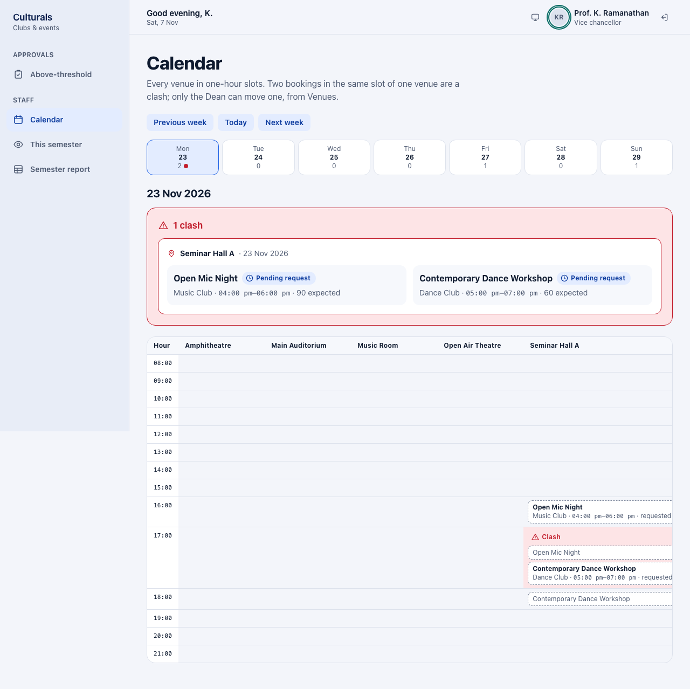
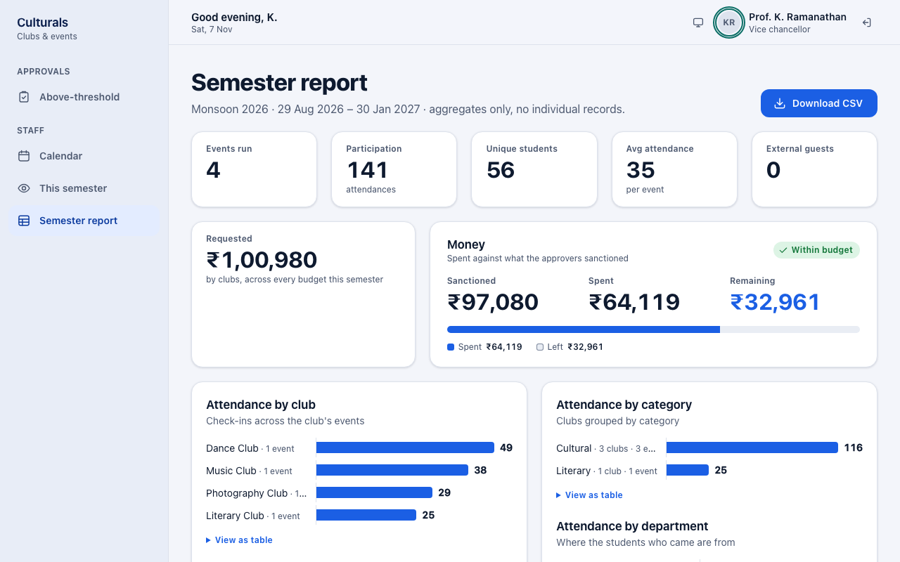

# Culturals: an overview for the Vice-Chancellor

**Culturals** is the college's single place for clubs and events. Clubs propose events and budgets
in it, approvers sign off in it, students register and get in with a QR pass, and the semester
report is built from it. Everything a club does leaves a record, so nothing has to be collected by
hand at the end of the semester.

**Try the pilot:** <https://culturals-clubs-events.vercel.app>. The sign-in page lists one pilot
account per role. Pick **Management** to see the Vice-Chancellor's view. The password is
`culturals-demo`, and staff accounts accept any 6-digit code (for example `123456`). The pilot runs
on demo data only.

## Benefits

1. **Approvals in one place.** A proposal goes from the club to the Cultural Society, then the Dean.
   It reaches you only when the budget is above ₹50,000 or the event is part of a fest. Each gate
   sees the budget, the venue and any clash, and every decision is recorded with who made it and when.
2. **Attendance is counted, not estimated.** Students show a QR pass at the door, and the scan
   station records who came. Registered, attended, walk-in and no-show figures come from those scans.
3. **Budget control.** The Dean sanctions a budget line by line. After the event the Treasurer
   enters what was spent and attaches a bill to each line. A budget cannot settle while a bill is
   missing on any line above ₹5,000, or while an overspend has no reason.
4. **A semester report without collation.** After every event the club submits a short report:
   attendance (from the scans), photos, social media post links, bills, outcomes and learnings. The
   semester report adds these up by club, category and department, with highlights and money
   sanctioned against money spent.
5. **One calendar, no double bookings.** Bookings are in whole hours, and a venue that is already
   booked is refused when the event is created. The Cultural Society, the Dean, you and club
   presidents see the same calendar. Only the Dean can move a booking. On Wednesdays, clubs can claim
   the 3–4 pm or 4–5 pm open block in one click.

## Who does what

| Role | Uses Culturals to |
|---|---|
| Student | Find events, register, carry a QR pass, join up to five clubs |
| Club President / VP / Secretary | Propose events, run the door, submit the post-event report, approve join requests |
| Club Treasurer | Price the budget (typed or from a spreadsheet CSV), enter spend and attach bills |
| Cultural Society | First approval for cultural and literary clubs; sees the calendar |
| Dean of Student Affairs | Approves every event, sanctions budgets, moves bookings, chases missing reports |
| Vice-Chancellor | Approves proposals above ₹50,000 and fest events; reads the overview and the semester report |

## What you see

- **Above-threshold**: only the proposals that need you, already approved by the Society and the
  Dean, with the sanctioned amounts.
- **Calendar**: every venue, hour by hour, with clashes marked.
- **This semester**: events run, students reached, money sanctioned and spent, and anything overdue.
- **Semester report**: the full report, which can be downloaded as CSV.

You see totals, not individual students. Names and PRNs are never shown to the Vice-Chancellor.

The full Vice-Chancellor chapter is [vice-chancellor.md](vice-chancellor.md).
