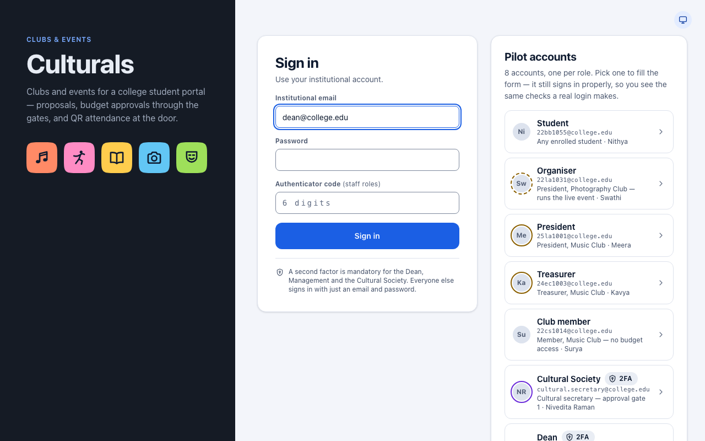
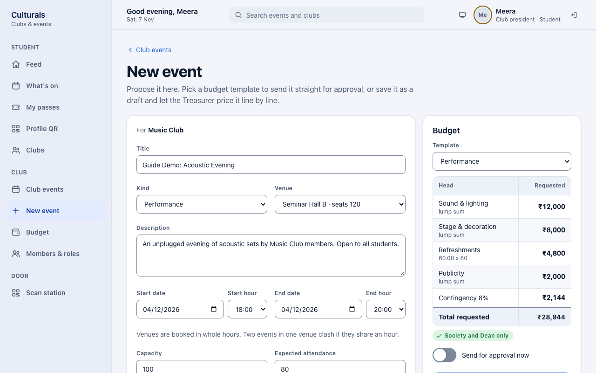
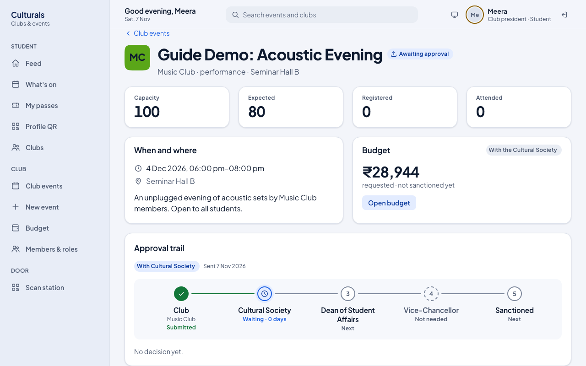
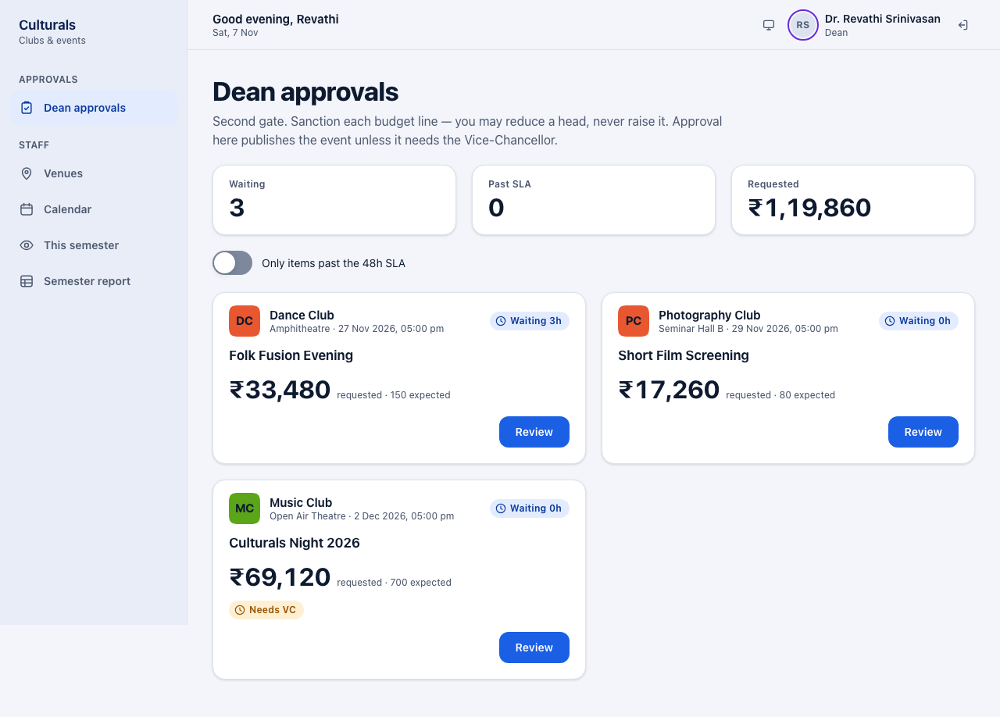
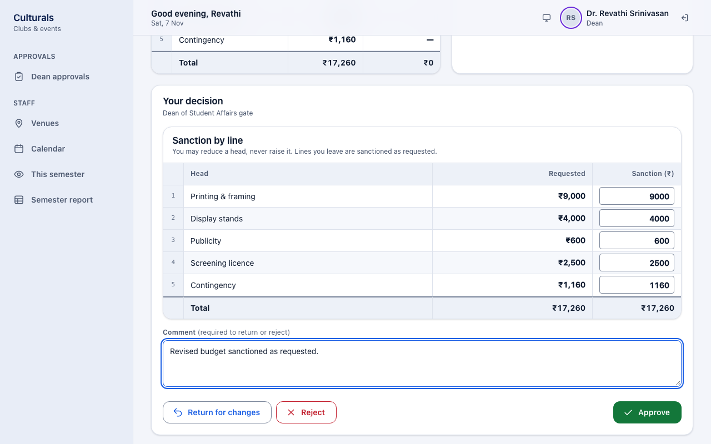
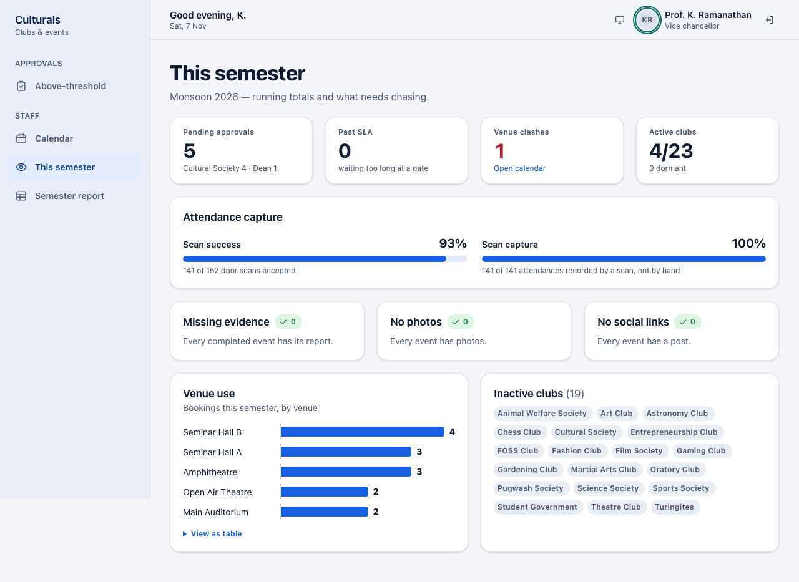
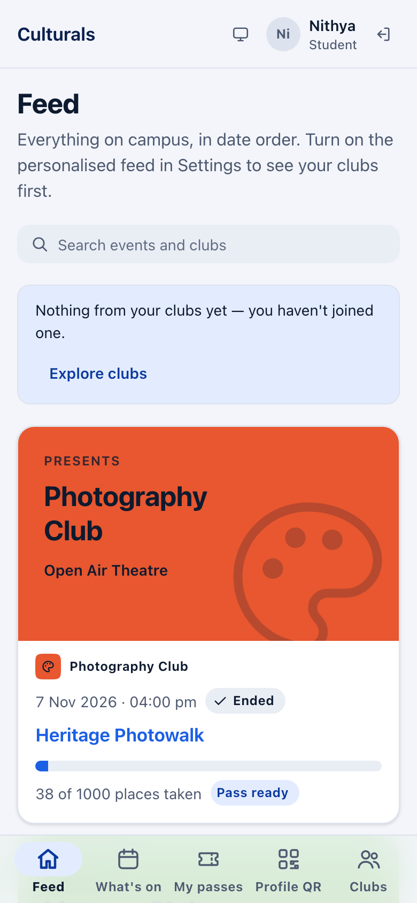
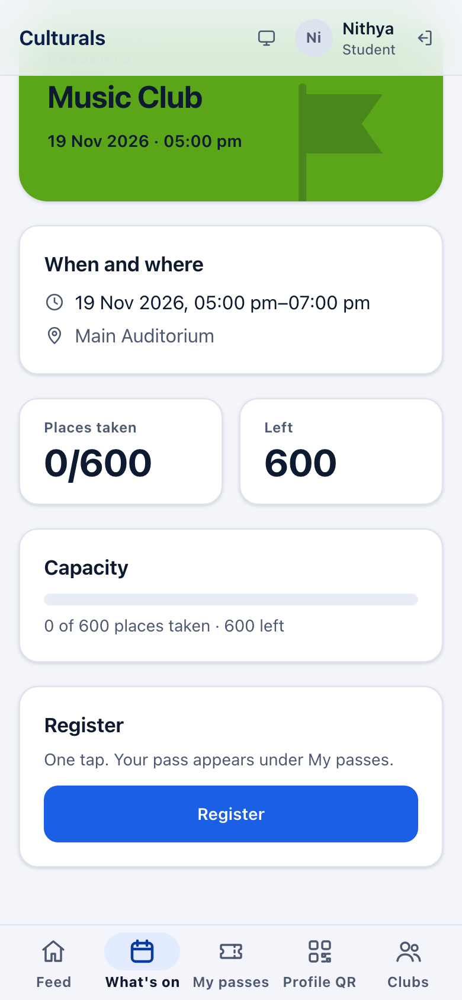
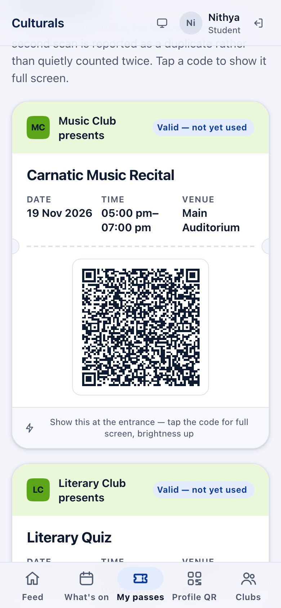
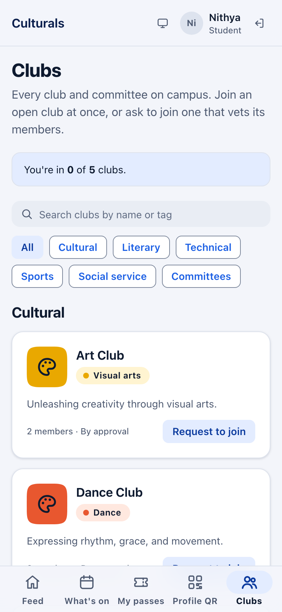

# Culturals: the quick guide

Culturals is the college app where clubs **propose events** and the **Cultural Society, the Dean
and the Vice-Chancellor approve them**. Students then register for events and get a QR pass. This
page covers the basics in a few minutes.

**Open the app:** [culturals-clubs-events.vercel.app](https://culturals-clubs-events.vercel.app)

## Sign in

Type your **college email** and **password**, then click **Sign in**.

**Cultural Society, Dean and Vice-Chancellor:** you also need a code. Click
**I have an authenticator code** and type the 6-digit code from your authenticator app.

## How an event gets approved

**Club** → **Cultural Society** → **Dean** → **Vice-Chancellor** → **Published**

- The **Cultural Society** only sees events from cultural and literary clubs.
- The **Dean** sees every event.
- The **Vice-Chancellor** only sees events over **₹50,000** or part of a fest.

At each step, the approver can **Approve**, **Return for changes** or **Reject**. A returned event
goes back to the club to fix and resend. A rejected one is closed.

## For club officers

### Propose an event

1. Click **New event** in the menu.
2. Fill in the title, venue, date and time, and how many people you expect.
3. Under **Budget**, pick a **Template**. It fills in the usual costs for you.
4. Click **Propose and send**.

### See where it is

Open **Club events** and click **Open** on your event. The **Approval trail** shows who has
approved it and who has it now.

**Sent back to you?** Read the approver's comment, make the changes, then click
**Send for approval** again.

### After the event

The Treasurer opens **Budget**, enters what was actually spent, attaches receipts for anything
over ₹5,000, and clicks **Settle budget**.

## For the Cultural Society, the Dean and the Vice-Chancellor

### Review what's waiting

Your approvals page is the first item in your menu. It lists every event waiting for you. Click
**Review** to open one.

### Decide

Check the dates, venue and budget, then click **Approve**, **Return for changes** or **Reject**.
If you return or reject an event, add a comment so the club knows why.

The **Dean** can also lower any budget line before approving, but can't raise it.

### See the bigger picture

- **Calendar**: every event and venue booking, hour by hour
- **This semester**: totals so far, and anything that needs chasing up
- **Semester report**: attendance and spending for the semester

## What students see

Once an event is approved, students can see it, mostly on their phones. Here's what that looks
like, so you can tell us what you'd change.

1. **Feed**: every event on campus, newest first.
2. **Register**: one tap on the event page, and their pass is ready.
3. **At the door**: a volunteer scans the QR code from **My passes**.
4. **Clubs**: students join up to 5 clubs. Clubs that pick their members get a request to accept.

**Ideas or problems?** Note what you'd improve, whether it's something on your own pages or the
student side, and send it to the Culturals team.

## Quick answers

- **An event is stuck?** A **Past SLA** tag means it has waited more than 48 hours at one step.
- **Two events want the same hall?** The Dean decides which one gets it, under **Venues**.
- **Over ₹50,000?** The app adds the Vice-Chancellor to the approvals automatically.
- **Running the door on the day?** Open **Scan station** and scan students' QR passes.
- **Need more detail?** See the [full guide](index.html).
