# Student guide

This chapter is for every student. In Culturals you can see what is happening on campus,
register for events, get in at the door with a QR code, and join up to three clubs. Most
students use it on their phone, so most screenshots here are from a phone.

If you have not signed in yet, read [Getting started](getting-started.md) first.

## What you see after signing in

You start on the **Feed**. The bottom bar on a phone, or the left sidebar on a computer, has
five pages:

| Page | What it is for |
|---|---|
| **Feed** | Event cards from across campus. Your clubs can come first if you turn that on. |
| **What's on** | The event list, with filters for club, category and date. This is where you register. |
| **My passes** | One QR pass for each event you registered for. |
| **Profile QR** | Your personal QR code, plus the **My clubs**, **Attendance** and **Settings** tabs. |
| **Clubs** | Every club on campus. Join a club or leave one. |

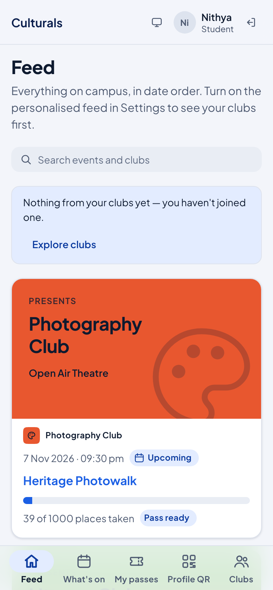

## Browse the Feed

Each event has a card showing the club, the date and time, the venue and how many places are
taken. A chip shows whether the event is **Upcoming**, **Live** (happening right now) or
**Ended**. Once you register, the card also shows your status: **Pass ready**, **Waitlisted**
or **Checked in**.

On a computer, the cards are laid out in a grid:

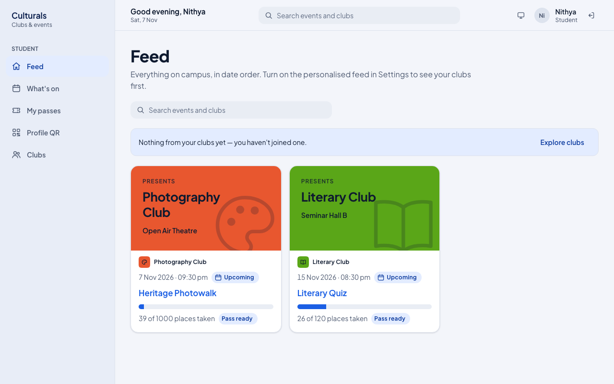

**Search the feed:** type a word into **Search events and clubs** and press Enter. The feed
then shows only matching events. Clear the box to see everything again.

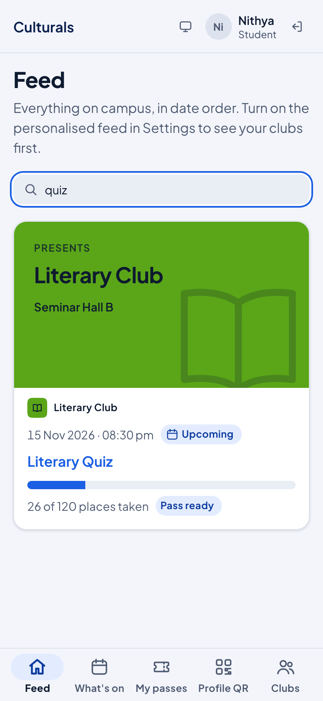

If you haven't joined a club yet, a note says *"Nothing from your clubs yet — you haven't
joined one."* Tap **Explore clubs** to go to the club directory.

### Put your clubs first (personalised feed)

By default the Feed shows everything on campus in date order. To see events from your own
clubs first:

1. Tap **Profile QR**, then the **Settings** tab.
2. Turn on **Personalised feed**.

The Feed then has two sections: **From your clubs** first, then **Across campus**. Turn the
switch off to go back to date order. This only helps once you are a member of a club.

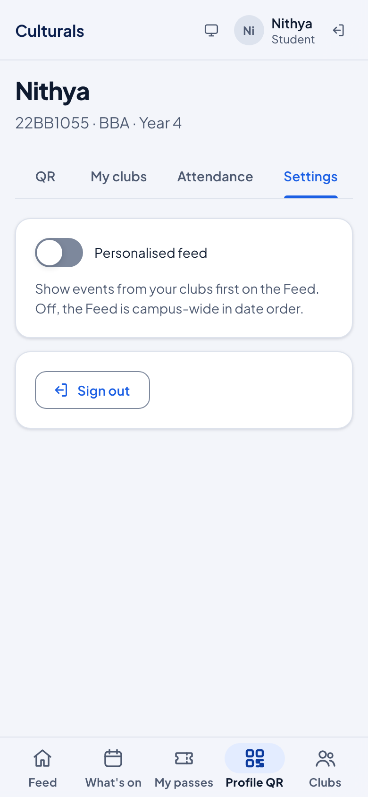

## Find an event on What's on

1. Tap **What's on**.
2. Narrow the list with the filters if you like:
   - **Club**: one club, or **All clubs**.
   - **Category**: for example Cultural, Literary, Technical or Sports.
   - **Date**: only events that start on that day.
3. Tap an event's title to open its details.

Each event shows its date, club, venue, times, a status chip (**Published** or **Live now**)
and how many places are taken. Events you have registered for show **Registered** and a
**View pass** button instead of **Register**.

On a computer you can also use the search box in the top bar. It finds events by title or
club name. Tap **Clear search** to remove it.

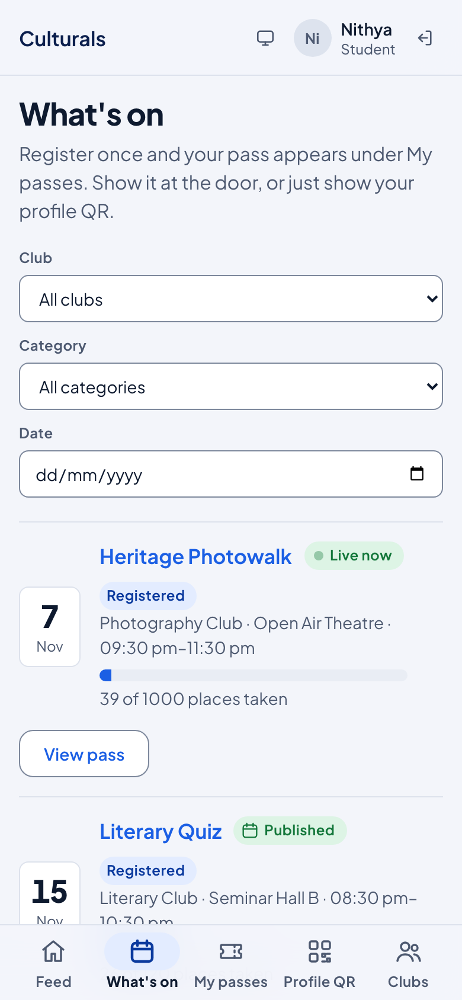

Only approved events appear here. If the list says *"Nothing published yet"*, no event has
been approved yet.

## Register for an event

1. Open the event from **What's on** (or tap its title on the **Feed**).
2. Check **When and where**, **Places taken** and **Left**.
3. In the **Register** panel, tap **Register**.

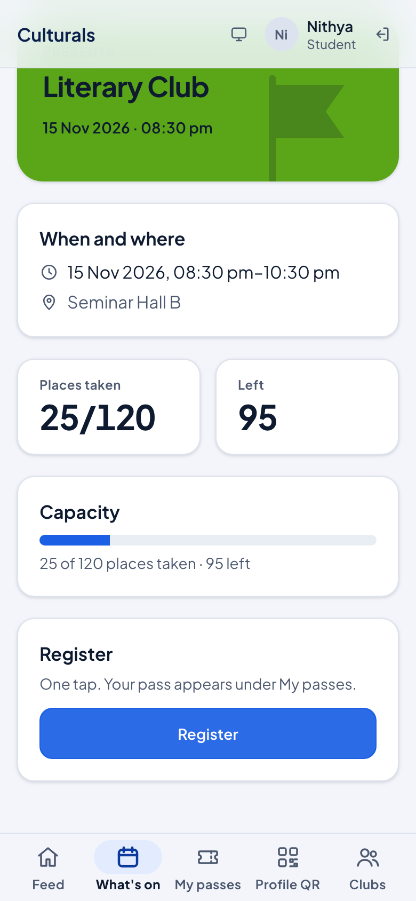

The panel changes to **You are registered** with a **Pass ready** chip, and a message
confirms it. Your pass is now under **My passes**. Tap **View pass** to go straight to it.

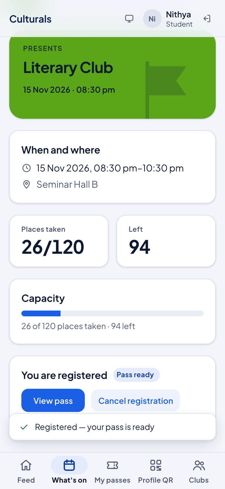

You can only hold one registration per event. If the button says **Not open**, the event is
not taking registrations at the moment (for example, it has not been published yet, or it is
over).

### When an event is full: the waitlist

When every place is taken, the event list says **Full — details** instead of **Register**.
The event page shows **Left: Full** and the message *"This event looks full. The server has
the final word — you can still try."*

You can still tap **Register**:

- If a place has opened up in the meantime, you get a normal registration and a pass.
- If the event is still full, you join the **waitlist**. The event page says **You are on
  the waitlist** with a **Waitlisted** chip. You do **not** get a pass yet.
- When someone cancels, the first person on the waitlist gets the place and a pass straight
  away and is told by notification. The waitlist goes in the order people joined.

To leave the waitlist, tap **Cancel registration** on the event page, the same way as below.

## Show your pass at the door

1. Tap **My passes**. Each pass shows the club, event, date, time and venue, plus a QR code.
2. At the entrance, tap the QR code. It fills the screen so it is easy to scan. Tap
   **Close** when you are done.

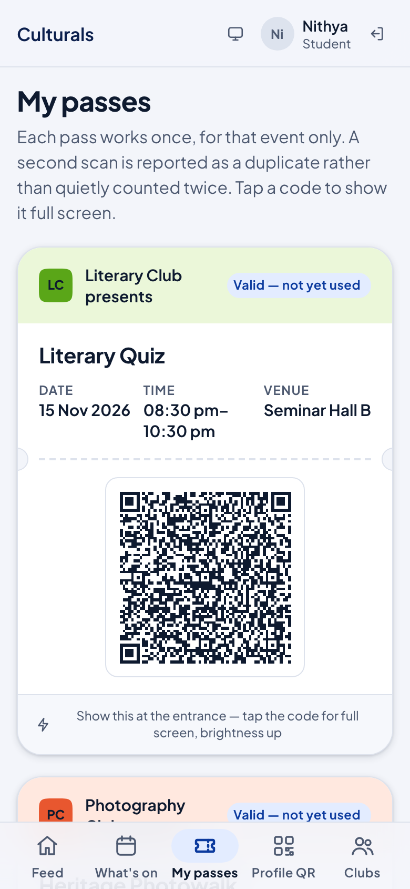

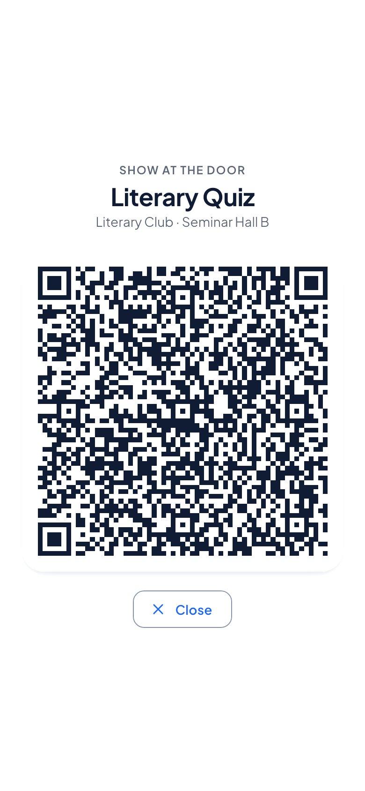

What the chip on a pass means:

- **Valid — not yet used**: ready to scan.
- **Checked in**: the door has scanned it. A pass works **once**, and a second scan is
  reported as a duplicate.
- **Pass spent**: the pass has already been used.

You can also skip the pass and show your **Profile QR** at the door (see below).

## Cancel a registration

1. Open the event (from **What's on**, or **View pass** → the event).
2. In the **You are registered** panel, tap **Cancel registration**.
3. The app asks *"Cancel it? Your pass stops working immediately."* Tap **Yes, cancel** to
   confirm, or **Keep it** to change your mind.

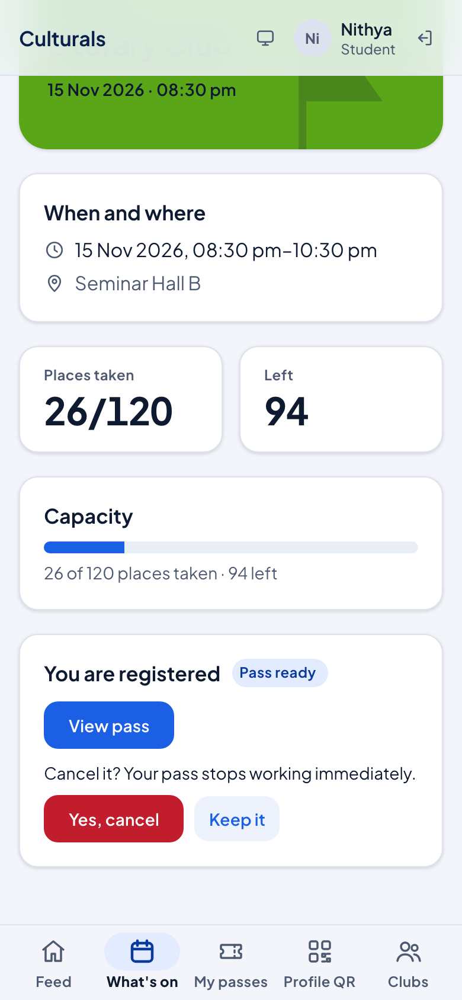

The place goes to the first person on the waitlist, if there is one. You can register again
later if places are left. You can't cancel once you have been checked in: the button is
greyed out and says *Already checked in*.

## Your Profile QR

Tap **Profile QR**. The **QR** tab shows your personal code.

- It works at **any** event, walk-ins included. One scan registers you and checks you in.
- It doesn't contain your PRN. Someone who photographs it learns nothing about you.
- Tap the code to show it full screen.
- **Lost your phone?** Tap **Lost your phone? Reissue**, then **Yes, reissue**. The old code
  stops working at the door at once, and the version number (`v1`, `v2` …) goes up. Your
  event passes are not affected.

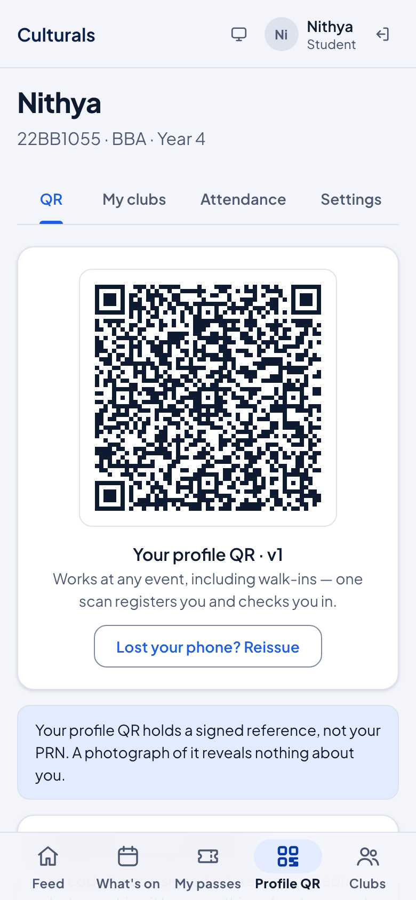

The other tabs on this page:

- **My clubs**: the clubs you belong to and your role in each, with a **Leave** button, plus
  any **Pending requests**.
- **Attendance**: the events where you have been checked in.
- **Settings**: the **Personalised feed** switch and **Sign out**.

## Join a club

1. Tap **Clubs**. The strip at the top shows how many clubs you are in, for example
   *"You're in 0 of 3 clubs."*
2. Find a club. Search by name or tag, or tap a category (**Cultural**, **Literary**,
   **Technical**, **Sports**, **Social service**, **Committees**).
3. Each card says how members get in:
   - **Open to all**: tap **Join**. You are a member straight away.
   - **By approval**: tap **Request to join**. The card then shows **Requested** until the
     club's officers accept or decline you.

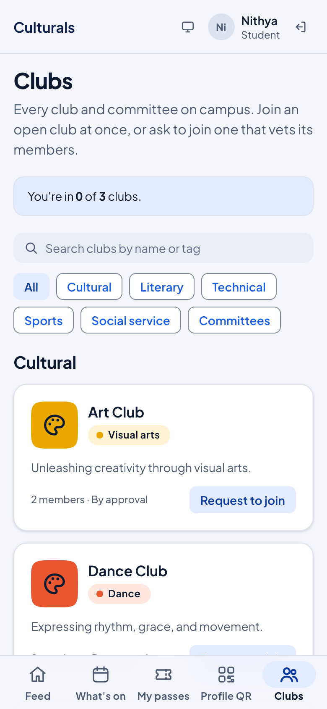

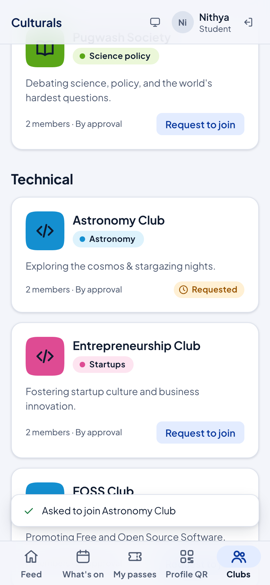

Your request also appears under **Profile QR → My clubs → Pending requests**:

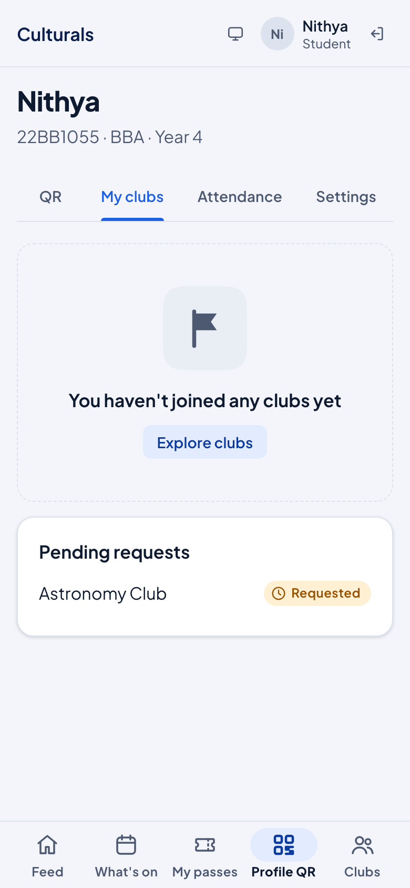

When you are accepted, the club card shows a **Member** chip (or your role, such as
Secretary) and the club appears under **My clubs**.

### The three-club limit

You can belong to at most **three** clubs at a time. When you reach three, the strip says
*"You're in 3 of 3 clubs — leave one to join another."* and the **Join** and **Request to
join** buttons are greyed out. If a club accepts your request after you have reached three,
the request stays pending until you leave a club.

## Leave a club

1. Tap **Leave** on the club's card in **Clubs**, or next to it in **Profile QR → My clubs**.
2. Confirm with **Yes, leave**, or tap **Stay** to change your mind.

You can ask to join again later. If you hold an office in the club (for example President
or Treasurer), you can't leave until your office is handed over. The app explains why.

## Good to know

- **One registration per event**, one pass per registration, and a pass works once.
- **Your Profile QR works everywhere.** If your pass won't load, show your Profile QR instead.
- **Waitlisted means no pass yet.** You get one automatically if a place frees up.
- **Three clubs at most.** Leave one to join another.
- **"Live" on the Feed** depends on the clock: an event shows Live only between its start
  and end times.
- **Feedback after an event:** you can't leave feedback in the app yet.

## Known issues

For the maintainer. Found while writing this chapter (demo server, 7 Nov 2026).

1. **No feedback screen.** The API supports feedback on an attended event, but no student
   page lets you leave it.
2. **Waitlist toast is wrong** (found by reading the code, not reproduced: no seeded event
   is full). `EventDetailPage` always shows "Registered — your pass is ready" after
   **Register**, even when the server put the student on the waitlist.
3. **A waitlisted entry shows as "Pass spent" on My passes** (from the code). The wallet
   lists waitlisted registrations with no QR code, and `PassesPage` treats "no QR code" as
   spent ("This pass has been used") instead of "Waitlisted".
4. **Attendance tab loses past events** (from the code). The tab reads the passes list, which
   only includes published or live events. Once an event is closed, the check-in drops off
   **Attendance**.
5. **Live vs Upcoming disagree.** *Heritage Photowalk* (7 Nov, 9:30 pm) showed **Live now**
   on What's on (its status) but **Upcoming** on the Feed (the Feed goes by the clock), at
   the same moment.
6. **Seeded data limits.** Every seeded club is *By approval* and no event is full. So the
   **Join** button, the three-club limit, **Leave** and the waitlist couldn't be shown in
   screenshots. They are described from the UI text and code.
