# Treasurer guide

This chapter is for club treasurers. Your job in Culturals covers the money side of your club's
events. Before an event, you price its budget line by line so it can go for approval. After the
event, you enter what was actually spent, attach receipts and settle the budget. The club's
President and Vice-President can do the same budget work, so a budget can still be settled when
the treasurer is away.

If you have not signed in yet, read [Getting started](getting-started.md) first. Screenshots use
the demo accounts of Kavya (Music Club treasurer), Deepa (Dance Club treasurer), Harini
(Photography Club treasurer) and the Theatre Club treasurer.

## What you see after signing in

The left sidebar has the usual student pages (**Feed**, **What's on**, **My passes**,
**Profile QR**, **Clubs**). Under **CLUB** you also get:

| Page | What it is for |
|---|---|
| **Club events** | Your club's events and proposals, with their approval status. |
| **New event** | Propose an event, and optionally start its budget from a template. |
| **Budget** | Every budget your club has, from draft to settled. This chapter is mostly about this page. |
| **Members & roles** | Your club's members and who holds which role. |

Ordinary club members do not see your club's budgets. Only the President, Vice-President and
Treasurer do.

## Read the Budget page

Open **Budget** in the sidebar.

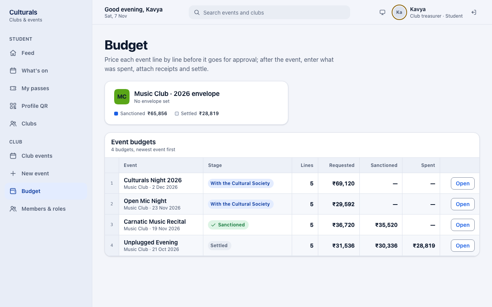

- **The envelope card** at the top shows your club's yearly allowance. It says how much is left,
  and its meter turns amber at 85 % used and red when you go over. Under the meter are two
  figures: **Sanctioned** (approved so far this year) and **Settled** (closed so far). If the
  college has not set an allowance for your club, the card says **No envelope set**.
- **Event budgets** has one row per event, newest first, with the number of lines and the
  **Requested**, **Sanctioned** and **Spent** totals.
- The button at the end of each row tells you what is next:
  - **Price it**: you can still edit the budget.
  - **Settle**: the event has run and the budget is waiting for you to settle it.
  - **Open**: there is nothing for you to do right now, but you can look at it.

### What the stages mean

| Stage | What it means | Can you edit amounts? |
|---|---|---|
| **Draft** | Not sent yet. You are still pricing it. | Yes |
| **With the Cultural Society** | The Cultural Society is reviewing it (cultural and literary clubs only). | No, amounts are frozen |
| **With the Dean** | The Dean of Student Affairs is reviewing it. Every budget goes here. | No |
| **With the Vice-Chancellor** | The Vice-Chancellor is reviewing it (big budgets and fests only). | No |
| **Returned for changes** | An approver sent it back. Revise it and send it again. | Yes |
| **Rejected** | Turned down. | Yes, but the proposal cannot go forward as it is |
| **Sanctioned** | Approved. After the event, you enter spend and receipts. | No, you only enter spend |
| **Settled** | Spend and receipts are complete and the budget is closed. | No |

Two other labels can appear next to the stage. **No budget required** means the event was
declared nil (see below). **Settlement due** means it is time to settle.

## How the budget size affects approval

The chain is: the Cultural Society (only for cultural and literary clubs), then the Dean
(always), then the Vice-Chancellor (only when the total requested is **above ₹50,000**, or the
event is part of a fest). The [approval flow](README.md#approval-flow) diagram shows the whole
chain.

When a budget is over the limit, its page shows a yellow note: **Above ₹50,000 — the
Vice-Chancellor signs too**. Expect the approval to take one more step.

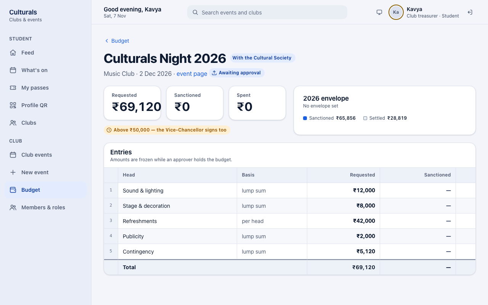

While an approver has the budget, the page says **Amounts are frozen while an approver holds the
budget.** An approver can sanction less than you asked for on any line. That line then shows a
small purple **A** mark, with your requested amount crossed out next to the sanctioned amount.

**No club role approves its own budget.** If you also hold an approval role, for example as a
stand-in for the Dean, the app still will not let you decide on your own club's budget.

## Start a budget from a template

Every event gets a budget when it is created. When you propose an event under **New event**,
the **Budget** panel on the right lets you start that budget from a template instead of a blank
sheet.

1. Fill in the event details. **Expected attendance** matters, because lines marked *per head*
   (for example Refreshments) are worked out from it.
2. Under **Template**, choose one: **Competition**, **Exhibition**, **Performance** or
   **Workshop**. You can also choose **None — the Treasurer prices it** to start with an empty
   budget.
3. Check the preview. It lists each line, then a **Contingency** line (8 % of the other lines on
   top, as a buffer for surprises), then the **Total requested**. A green **Society and Dean
   only** note, or a yellow **needs the Vice-Chancellor too** note, tells you who will approve it.
4. Decide when to send it:
   - Leave **Send for approval now** on and press **Propose and send** to send it straight to
     the approvers.
   - Turn the switch off and press **Save draft** if you want to adjust the lines first.

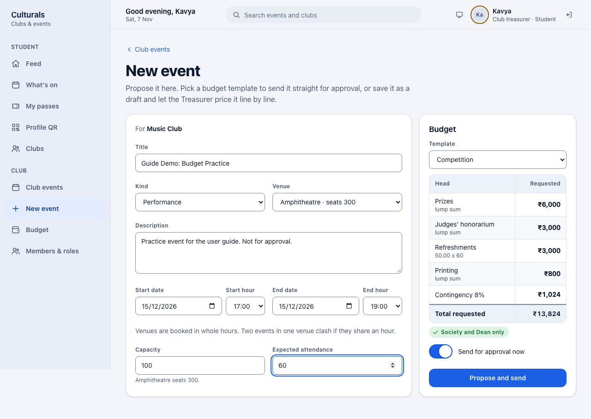

## Price a draft budget

Open the budget from **Budget** (button **Price it**), or from the event page (**Open budget**).

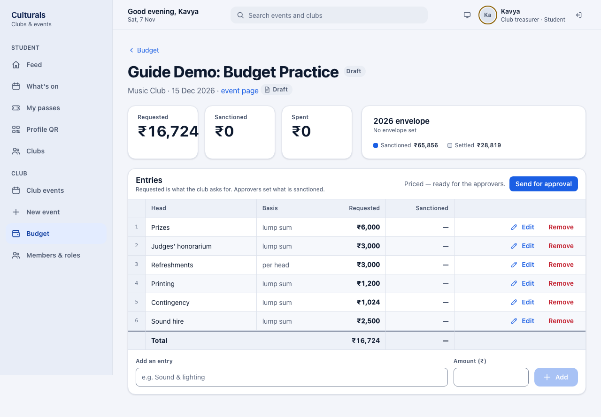

- **Add a line:** type the item under **Add an entry** (for example "Sound hire"), enter the
  **Amount (₹)** and press **Add**. Two lines cannot have the same name.
- **Change a line:** press **Edit** on its row, change the name or amount, then press **Save**.
  **Cancel** leaves it as it was.
- **Delete a line:** press **Remove**.

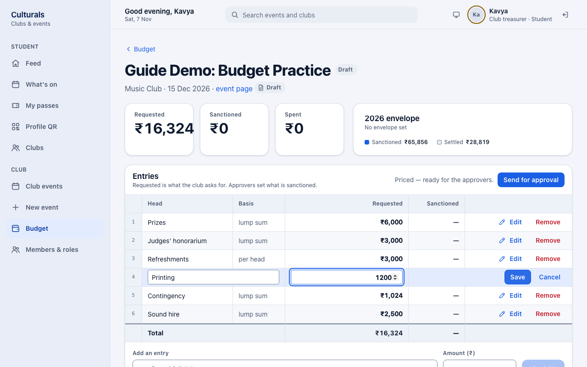

The **Contingency** line is worked out once, when the template is applied. It does **not**
change when you add or edit other lines, so adjust it by hand with **Edit** if you need to.

Once the budget has at least one line, the header shows **Priced — ready for the approvers.**
and a **Send for approval** button. You can send the proposal from there or from **Club events**.

### Events that need no money: declare nil

An empty budget cannot go for approval. If an event really costs nothing (for example a talk in
your own classroom), you must say so instead of leaving the budget blank:

1. Open the budget while it has no lines.
2. Under **Or declare that this event needs no money**, type the reason (at least a few words).
3. Press **Declare nil**.

Approvers then see your reason and your name instead of a set of figures, and the budget list
shows **No budget required**. To price the event after all, press **Withdraw — price it
instead**. You can only declare nil when no line has an amount, so remove any priced lines first.

## When your budget comes back

Instead of approving, an approver can **return** a budget for changes or **reject** it, and they
must leave a comment either way. Read the comment under **Approval trail** on the event page. To get there,
click **event page** under the budget's title.

### Returned for changes: revise and resubmit

**Short Film Screening** (Photography Club) is an example of a returned budget. The Dean
returned it with this comment: *"Publicity looks high for an 80-seat screening, and the
screening licence is missing. Trim publicity and add the licence, then resubmit."*

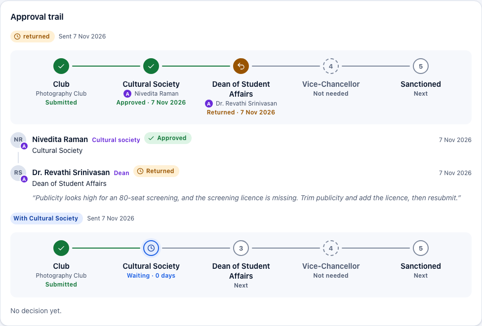

What the treasurer did:

1. Opened the budget. While it is **Returned for changes**, the budget can be edited again.
2. Pressed **Edit** on Publicity and lowered it to ₹600.
3. Added a **Screening licence** entry of ₹2,500 under **Add an entry**.
4. Pressed **Send for approval** on the budget (or on the event under **Club events**).

The resubmitted budget starts again at the first approver. The approval trail keeps the
returned round with the Dean's comment, and shows the new round under it. While the new round
is under review, the amounts are frozen again.

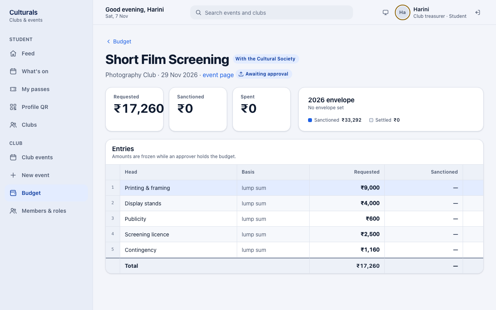

The contingency line did not change when the lines were edited (see the note under *Price a
draft budget*), so check it before you resubmit.

### Rejected: final

**Late-Night Improv Marathon** (Theatre Club) was rejected by the Dean: *"Runs past the 10 pm
campus curfew and has no security plan for 300 people. Not approved this semester."* A
rejected proposal cannot be sent again. If you still want to hold the event, propose a new event
that deals with the reasons in the comment. Rejected proposals can be removed with **Delete** on
the event page.

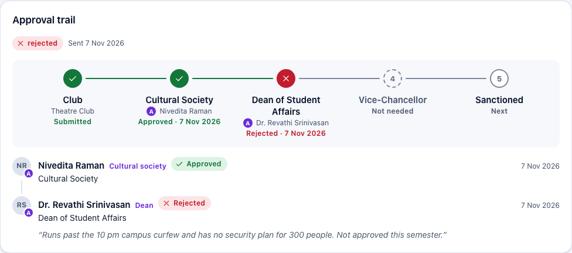

## Once it is sanctioned: an example

**Carnatic Music Recital** went through the Cultural Society and the Dean and is now
**Sanctioned**. The Dean cut Sound & lighting from ₹12,000 to ₹10,800 (marked **A**), so the
sanctioned total is ₹35,520 against ₹36,720 requested. Plan your spending on the sanctioned
figures. The card on the right now shows **Spend against sanction** instead of the envelope.

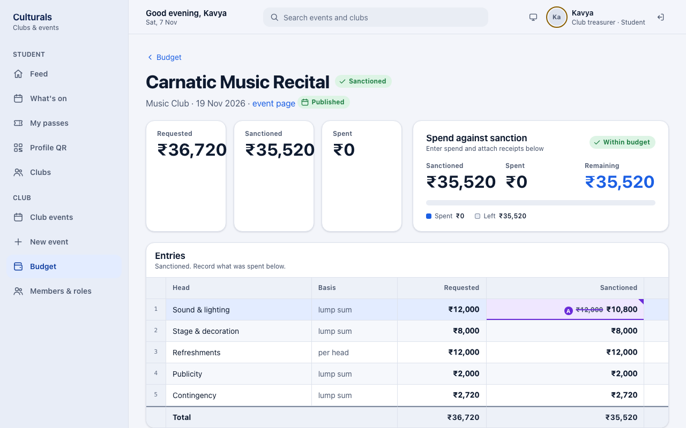

## After the event: enter spend and attach receipts

Once the budget is **Sanctioned** and the event has run, the budget page has a **Spend and
receipts** section with one block per line. Each block shows that line's sanctioned amount.

1. Open the budget (button **Settle** on the Budget page).
2. For each line, type the amount actually spent in **Spent (₹)** and press **Save**. Enter 0
   for a line you did not use.
3. If a line went over its sanctioned amount, it gets a red **Over sanctioned** label, and the
   **Note** field becomes **Why it went over (required)**. Write the reason there and press
   **Save**.
4. **Receipts are required for anything above ₹5,000.** For each such line, press **Choose
   File**, pick the bill (a PDF or a photo: JPEG, PNG, WebP or HEIC) and press **Attach**. The
   receipt appears under the line as a chip showing its file name and amount. Click the chip to
   open the receipt.

Your figures are saved line by line, so you can enter them over several sittings.

## Settle the budget

At the bottom of **Spend and receipts**, press **Settle budget**.

If anything is missing, the app refuses and lists **every** problem at once, so you can fix
them all in one go:

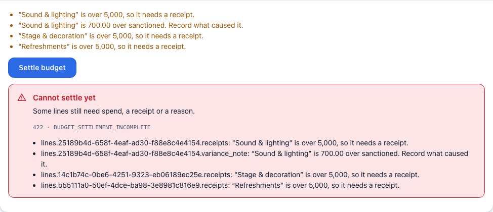

| Message | What to do |
|---|---|
| Enter what was actually spent on at least one line. | Fill in **Spent (₹)** on the lines and press **Save**. |
| "…" is over 5,000, so it needs a receipt. | Attach a receipt to that line. |
| "…" is … over sanctioned. Record what caused it. | Write the reason in **Why it went over (required)** and press **Save**. |

When the list is gone, press **Settle budget** again.

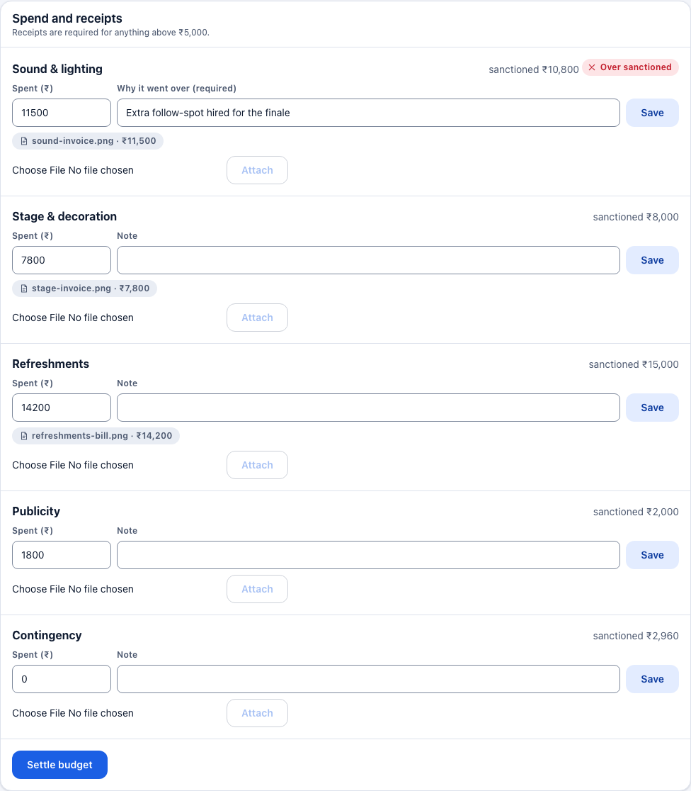

A settled budget shows **Settled on** with the date. Its spend and receipts can no longer be
changed, and the figures count towards the **Settled** total on your envelope card.

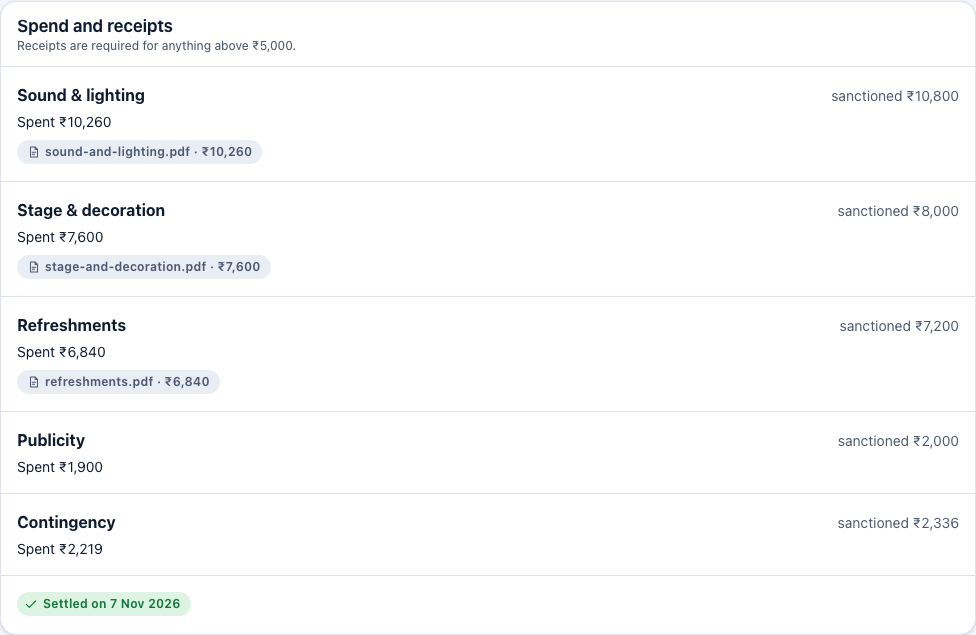

You cannot settle too early. Instead of a list of problems, the page shows one of these notes:

- *Not yet. The budget has to be sanctioned before spend is recorded against it.* The approvers
  have not finished yet.
- *Not yet. Settle after the event has run…* The event has not happened yet. Settlement opens
  once the event is live, completed or reported.

## Good to know

- **Who can do what.** The President, Vice-President and Treasurer can all price budgets, enter
  spend, attach receipts and settle. Ordinary members cannot see budgets at all.
- **Amounts freeze during review.** You cannot edit requested amounts while the Cultural
  Society, Dean or Vice-Chancellor holds the budget. If it comes back **Returned for changes**,
  you can edit it again.
- **₹50,000 limit.** Above it, the Vice-Chancellor must also sanction. Fest events always need
  the Vice-Chancellor.
- **₹5,000 receipt rule.** Every line where you spent more than ₹5,000 needs a receipt before
  settling. Smaller lines do not, but you can still attach one.
- **Overspending a line** is allowed, but you must explain why before you can settle.
- **Sanctioned can be lower than requested.** Approvers can cut individual lines. Plan your
  spending on the sanctioned figure.
- **Mistake after settling?** A settled budget is closed. Ask the Dean to reopen it.
- **No club role approves its own budget.** This holds even when someone also holds an approval
  role.

## Known issues

- **Raw technical details in the settle error.** When **Settle budget** is refused, the red box
  shows `422 · BUDGET_SETTLEMENT_INCOMPLETE`, and every message starts with an internal field path
  such as `lines.25189b4d-….receipts:`. The friendly list above the button already says the
  same thing. The red box should hide the code and the field paths (see screenshot 10).
- **The Settle button is clickable while problems remain.** It is enabled as soon as the event
  has run, even when the list of problems is not empty, so pressing it only produces the error
  above. Disabling it until the list is empty, or explaining why it is disabled, would be clearer.
- **Contingency does not follow edits.** The 8 % contingency line is fixed when the template is
  applied. If you add ₹2,500 of new lines, the contingency stays the same. This may be
  intentional, but nothing on the page says so.
- **A rejected budget still looks editable.** For a rejected proposal (Late-Night Improv
  Marathon), the Budget list shows **Price it**, and the budget page still offers **Edit**,
  **Remove** and **Add an entry**, even though the proposal can never be sent again. The server
  treats `rejected` as editable (`Budget.is_editable`). It should probably be read-only.
- **Spend entry is offered before the event has run.** On a sanctioned budget whose event is
  still upcoming (Carnatic Music Recital), the **Spent (₹)** fields, **Save** and **Attach** are
  already shown. Underneath, the note says *"Not yet. Settle after the event has run — spend
  recorded against an event that has not happened is spend against nothing."* I did not try
  saving spend there, because that budget belongs to the shared demo.
