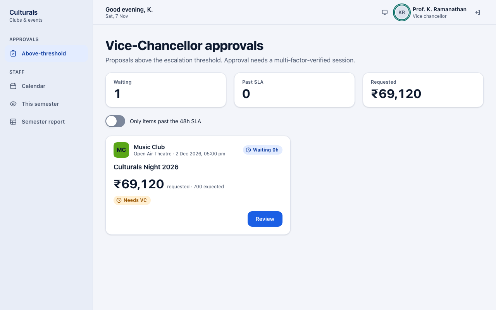
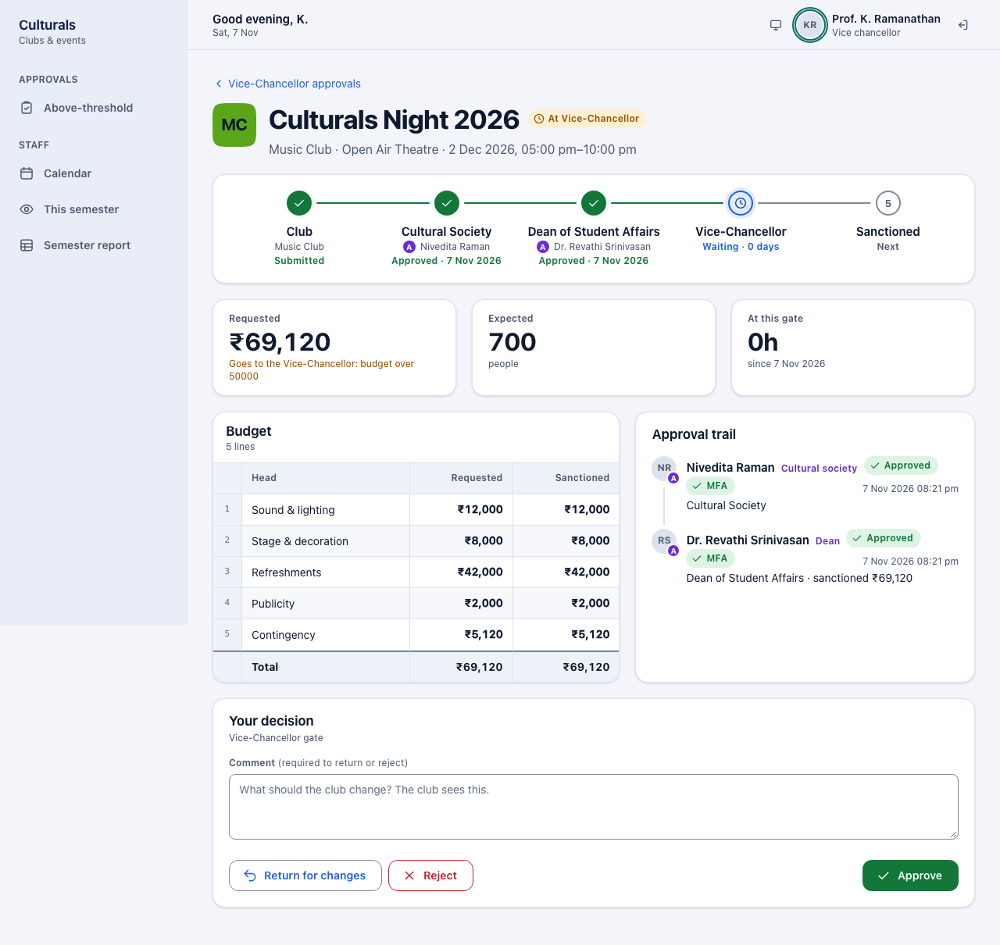
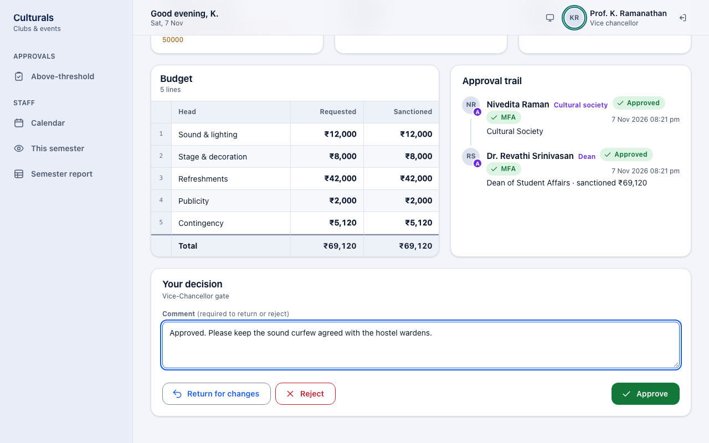
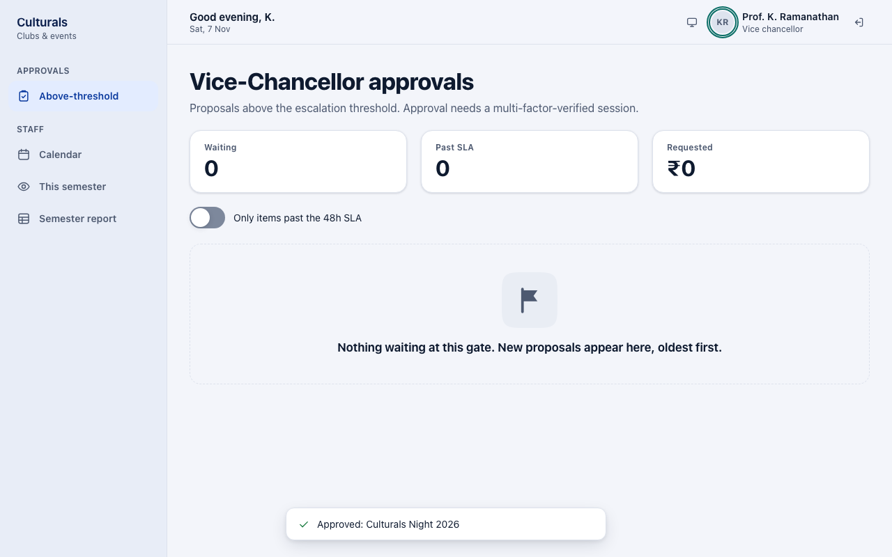
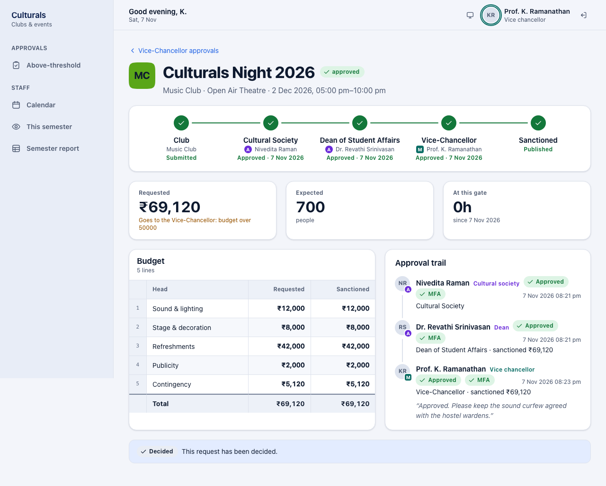
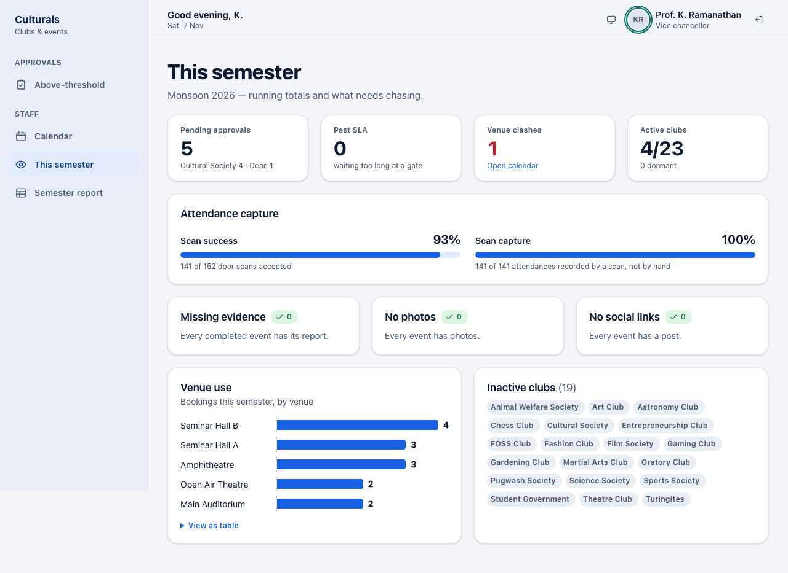
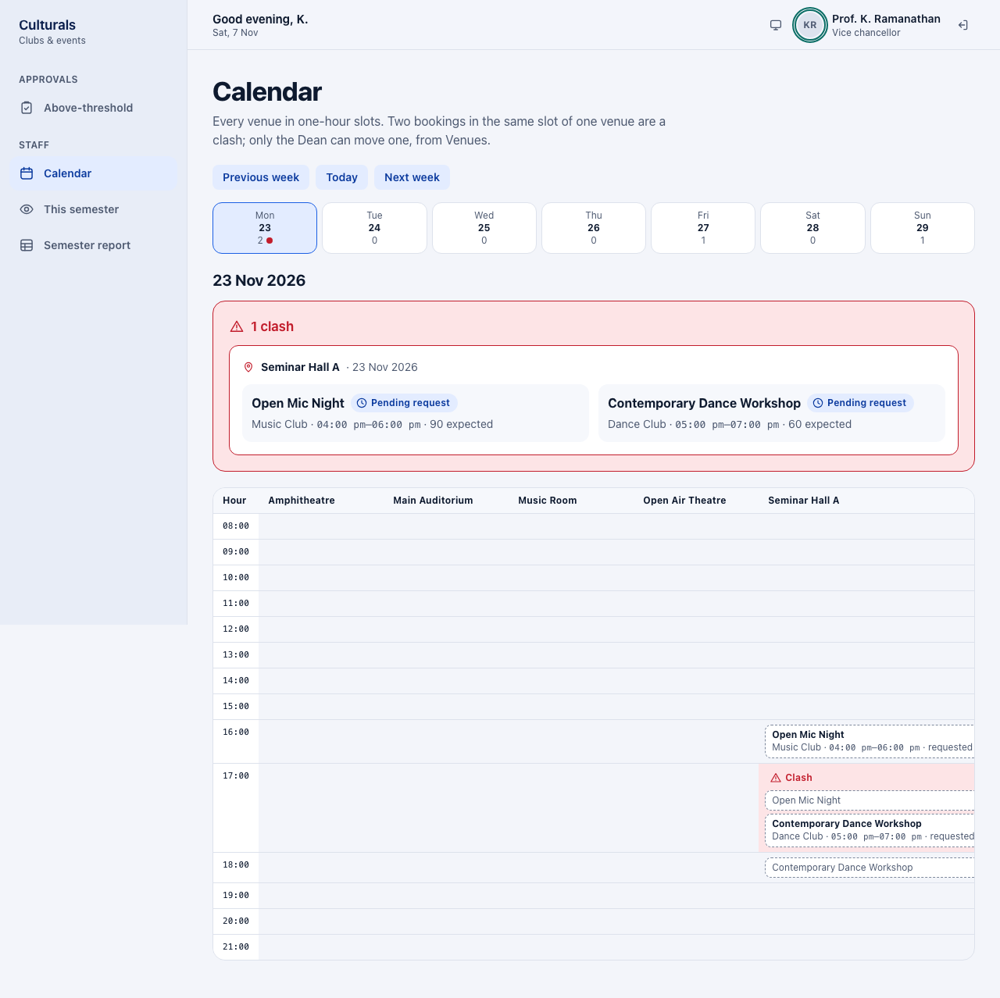
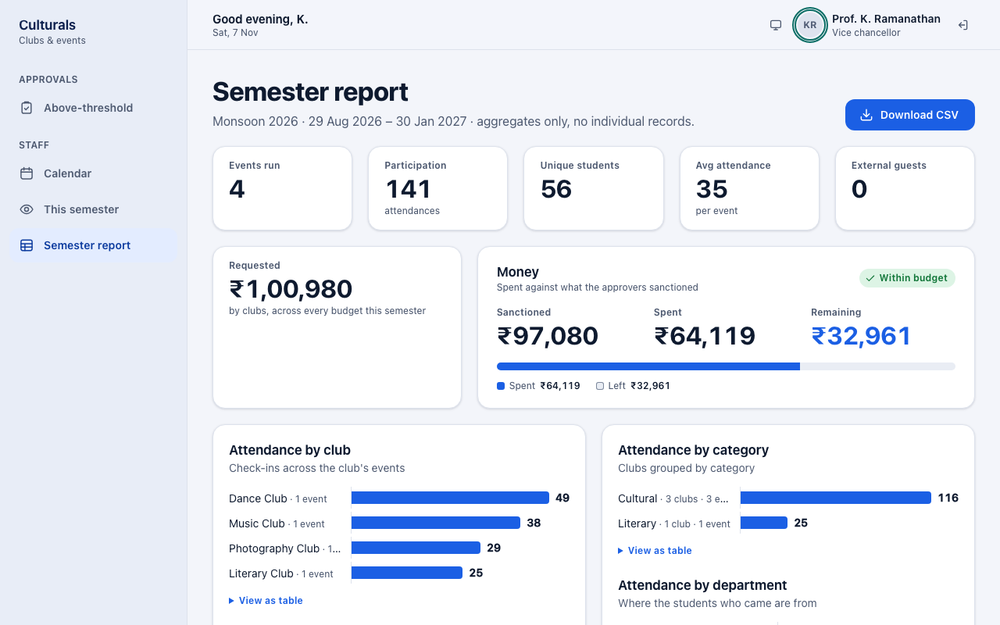

# Vice-Chancellor guide

This chapter is for the Vice-Chancellor (management). You are the last approval gate, and only
for the largest proposals: those with a budget above ₹50,000 and events that are part of a fest.
You can also see the events calendar, the semester overview and the semester report.

## How a proposal reaches you

A club's proposal goes to the Cultural Society (cultural and literary clubs only), then the Dean
(always), and comes to you only when the budget is above ₹50,000 or the event is part of a fest.
Everything else is published by the Dean's approval and never reaches you. See the
[approval flow](README.md#approval-flow) for the diagram.

So by the time a proposal is in your queue, the Society (if needed) and the Dean have already
approved it, and the Dean has set the sanctioned amounts.

## Signing in

Sign in with your **Institutional email** and **Password**, click
**I have an authenticator code**, type the 6-digit code from your authenticator app, and click
**Sign in**. The Vice-Chancellor cannot sign in without the code, and approving at your gate is
refused for any session that was not verified with it. These approvals release the largest
amounts, so a password alone must not be enough. Each decision is marked **MFA** in the trail.
See the [Cultural Society guide](cultural-society.md#signing-in) for a picture of the form.

## What you see after signing in

You start on **Above-threshold**, titled **Vice-Chancellor approvals**. The side menu has:

- **Above-threshold**: proposals waiting for you.
- **Calendar**: every venue booking, hour by hour.
- **This semester**: running totals and things to chase up.
- **Semester report**: attendance and money for the semester.

The figures show how many proposals are **Waiting**, how many are **Past SLA** (waiting more
than 48 hours at your gate) and the total **Requested**. Turn on **Only items past the 48h SLA**
to see only the late ones. Every card here carries the **Needs VC** tag.

## Review and approve a proposal

1. On a card, click **Review**.
2. Check the proposal:
   - The **route** shows the Cultural Society and the Dean approved, with names and dates, and
     that it is now **Waiting** at the Vice-Chancellor.
   - Under **Requested**, the reason it came to you, for example
     **Goes to the Vice-Chancellor: budget over 50000**.
   - **Budget**: what the club requested and what the Dean sanctioned for each line.
   - **Approval trail**: each earlier decision with its comment and the **MFA** mark.

   

3. In **Your decision**, type a **Comment** if you want to. It is optional to approve and
   **required to return or reject**. The club sees it.
4. Choose one:
   - **Approve**: the event is published at the amounts the Dean sanctioned.
   - **Return for changes**: the club can revise and resubmit it. The new version starts again
     at the first gate.
   - **Reject**: the proposal is closed. This is final.

   

5. You return to your queue with a confirmation, for example **Approved: Culturals Night 2026**.

   

Open the proposal again to see the finished route (**Sanctioned · Published**) and all three
decisions in the trail.

You do not edit budget lines at your gate. If an amount looks wrong, return the proposal with a
comment.

## This semester

**This semester** gives a picture of the whole semester:

- **Pending approvals**, split by gate, and how many are **Past SLA** (waiting more than 48
  hours at any gate).
- **Venue clashes**, with **Open calendar**.
- **Active clubs** out of all clubs.
- **Attendance capture**: how many door scans were accepted, and how many attendances were
  recorded by a scan rather than by hand.
- **Missing evidence**, **No photos**, **No social links**: completed events whose report is
  incomplete.
- **Venue use** and **Inactive clubs**.

## Calendar

**Calendar** shows every venue booking, one week at a time. It is read-only; only the Dean can
move an event.

1. Use **Previous week**, **Today** and **Next week** to change the week.
2. Each day in the week strip shows how many bookings it has. A red dot marks a day with a clash.
   Click a day to open it.
3. The day opens as a grid: venues across the top, one row per hour. A booking with a solid
   outline is approved; a dashed one marked **requested** is still going through approval.
4. A slot holding two bookings in one venue turns red and says **Clash**, and the pair is listed
   above the grid.

## Semester report

**Semester report** shows totals for completed events in the current semester: events run,
attendance, unique students, average attendance, external guests, money requested, sanctioned
and spent, and attendance by club, category and department, followed by a table of events. It
has totals only, no individual student records. Click **Download CSV** to save it as a
spreadsheet.

## Good to know

- **Why is my queue empty?** Only proposals above ₹50,000 or part of a fest come to you, and only
  after the Dean has approved them.
- **Why can't I approve?** If the error says a second factor is required, sign out and sign in
  again with your authenticator code. If it mentions a venue clash, the Dean has to move one of
  the events first.
- **Covering for someone?** If someone else is covering your gate (or you are covering theirs),
  a note at the top of the queue says so, and the trail records both names.

## Known issues

- The reason line shows a raw number ("budget over 50000") rather than "₹50,000".
- On a decided proposal the status tag shows the raw lowercase state ("approved").
- The Semester report's **Requested** tile says "across every budget this semester", but it adds
  up completed events only, so approving Culturals Night 2026 does not change it.
